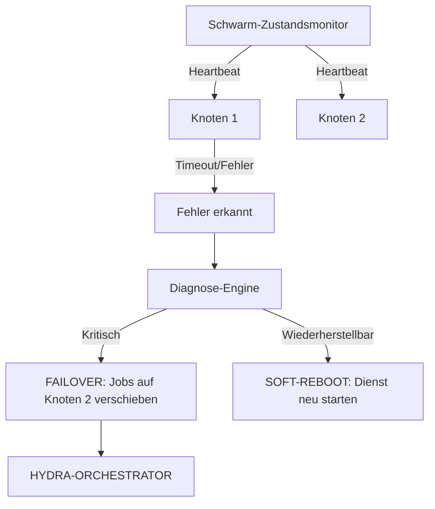

<!-- =============================================================================
HYDRA-UMC-NODE-HEALING - Fleet health watchdog
Copyright (C) JuanenRac (Electro Hobby 3D) <electrohobby3d@gmail.com>
GPL-3.0-or-later - see LICENSE
============================================================================= -->

<p align="center">
  
</p>

# 💊 HYDRA-UMC-NODE-HEALING

<p align="center"><a href="README.md">🇺🇸 English</a> | <a href="README_spa.md">🇪🇸 Español</a> | <a href="README_fra.md">🇫🇷 Français</a> | <a href="README_ita.md">🇮🇹 Italiano</a> | 🇩🇪 <b>Deutsch</b> | <a href="README_zho.md">🇨🇳 简体中文</a> | <a href="README_jpn.md">🇯🇵 日本語</a> | <a href="README_por.md">🇵🇹 Português</a></p>

### 🛡️ Hochverfügbarkeitsmonitor & Failover-Manager für HydraNodes

<p align="center">
  
  
  
  
  
  
</p>

---

**Ehrlichkeitscheck - was heute wirklich läuft:** die Polling-/Klassifizierungsschleife (`src/watchdog/watchdog.go`), die begrenzte Retry-Richtlinie (`src/watchdog/retry.go`), die echte Verdrahtung der Wiederherstellungsanfrage an HYDRA-UMC-ORCHESTRATOR (`src/watchdog/orchestrator_reactor.go`) und der statische Node-Registry-Loader (`src/config/config.go`) sind alle real und getestet (115 bestandene Tests über `src/config` und `src/watchdog`) - und das sind echte gRPC-Roundtrips über echte Loopback-Sockets, kein simulierter Client. Was eine bekannte, dokumentierte Lücke ist: die Node-Registry ist eine statische JSON-Datei (`nodes.json`), keine Live-Abfrage an HYDRA-UMC-SWARM-SYNC, weil auch dieses Projekt noch keine echte API dafür hat - das ist die ehrliche v0, kein Platzhalter, der Dynamik vortäuscht. Auch das Umleiten der tatsächlich laufenden Missionsarbeit weg von einem ausgefallenen Knoten ist nicht die Aufgabe dieses Repositories - es fordert Wiederherstellung über `OrchestratorReactor` an und hört dort auf; die nächste Schicht (Jobs tatsächlich verschieben) liegt anderswo. Die 4 Roadmap-Phasen (Digital-Twin-Synchronisation, Isaac-Sim-Physikintegration, automatisierte Wiederherstellungsmuster, KI-gestützte prädiktive Heilung) sind angestrebte Zukunftsarbeit ohne jeglichen Code dahinter bisher. Siehe `CHANGELOG.md` für das, was bisher genau ausgeliefert wurde.

---

> **Stand von Sicherheit (Safety) und Security:** Dieses Ökosystem ist kein zertifiziertes Sicherheitssystem. Es gibt noch keinen Hardware-E-STOP-Pfad, keine von der Firmware durchgesetzten Grenzen oder Verriegelungen und keinen verifizierten Bewegungsbefehl; Firmware-Images werden mit CRC-32 und einer Ed25519-Signatur geprüft, und ein Release-Build verweigert die veröffentlichten Entwicklungsschlüssel (die Werkzeugköpfe und Erweiterungsplatinen hinter dem Relais laufen noch mit URTC-Bootloadern, die statt einer Signatur ein HMAC-SHA256 mit gemeinsamem Schlüssel verwenden); TLS und gegenseitiges TLS sind optional und standardmäßig aus; noch keine eigene Platine wurde bestückt oder getestet. Lesen Sie die [Sicherheitsbasis](https://github.com/JuanenRac/HYDRA-UMC-DOCS/blob/main/docs/SECURITY_BASELINE.md) und das [Bedrohungsmodell](https://github.com/JuanenRac/HYDRA-UMC-DOCS/blob/main/docs/THREAT_MODEL.md), bevor Sie sich für die Sicherheit einer Person auf eine Aussage hier verlassen.

---

## 📋 Auf einen Blick

| | |
|---|---|
| Version | `0.2.0` |
| Reifegrad | Funktionsfähig |
| Tests | 115 (`go test ./...`) |
| Technik | Go / gRPC health checks / HTTP health probes |
| Ziel | Der Raspberry Pi CM5 einer HYDRA-UMC-Zelle |
| Auf echter Hardware | Noch nicht: für diese Version ist kein Lauf auf echter Hardware vermerkt |

**Springe zu:** [Überblick](#-überblick) · [Architektur](#-architektur) · [Schnellstart](#-schnellstart) · [Tests](#-tests) · [Struktur des Repositorys](#-struktur-des-repositorys) · [Verwandte Projekte](#-verwandte-projekte)

## 🚦 Projektstatus

Jede Zeile ist ein Teil dieses Repositorys, und die Ampel sagt, wie weit er heute ist. Sie beruht auf dem, was das Repository zeigen kann (Tests, Builds, Läufe), nicht auf dem, was geplant ist.

🟢 Fertig und überprüft · 🟡 Funktioniert, mit bekannten Grenzen · 🟠 Teilweise fertig oder noch nicht überprüft · 🔴 Nicht gemacht oder funktioniert nicht

| Bereich | Stand | Was das hier bedeutet |
|---|---|---|
| Software | 🟡 | Funktioniert für seinen Hauptzweck; die Ehrlichkeitsprüfung oben nennt, was noch fehlt |
| Tests | 🟢 | 115 automatische Tests, bei jeder Änderung ausgeführt |
| Echte Hardware | 🔴 | Noch nicht: für diese Version ist kein Lauf auf echter Hardware vermerkt |
| Dokumentation | 🟢 | README in acht Sprachen, bei jeder Änderung gegen das Manifest geprüft |

## 🎯 Überblick

**HYDRA-UMC-NODE-HEALING** ist die Resilienz-Schicht des Schwarms. Er überwacht kontinuierlich den Zustand aller physischen HydraNodes (Controller) und logischen Dienste und gewährleistet so eine Null-Ausfallzeit in der Micro-Factory.

Wenn ein Knoten aufgrund einer Hardware-Fehlfunktion oder eines Netzwerkausfalls ausfällt, löst der Healing-Manager automatisch einen Failover-Prozess aus, leitet seine aktiven Missionen an andere Knoten weiter und benachrichtigt den Bediener über den Orchestrator.

### Hauptmerkmale:
* 💓 **Gesundheits-Heartbeat:** Jeder Knoten wird alle 5 Sekunden abgefragt (gRPC-HealthService oder HTTP-Health-URL) und als HEALTHY, DEGRADED, UNHEALTHY, UNREACHABLE, INVALID oder MISCONFIGURED eingestuft; Temperaturdaten werden nicht gelesen. Jeder Knoten wird für sich abgefragt: Ein Knoten, der langsam oder gar nicht antwortet (seine Abfrage kann länger als das Intervall dauern), hält die anderen nicht auf und staut keine Abfragen an; sein nächster Takt entfällt, bis die laufende Abfrage endet.
* 🔄 **Abgesichertes Failover:** bittet den Orchestrator, die Missionen eines Knotens neu einzureihen, der AUSGEFALLEN BLEIBT (Bestätigungswartezeit, Startschonfrist, Abkühlzeit pro Knoten und ein globales Budget), nur für Registry-Einträge mit `dispatchNode`.
* 🛡️ **Soft-Reboot:** *(geplant)* der Watchdog startet heute nichts neu; er meldet nur und bittet den Orchestrator um Neueinreihung.
* 📡 **Bedieneralarme:** *(geplant)* heute geht jeder Übergang nur ins Journal.
* 🔁 **Begrenzte Retries + verifizierte Knotenidentität (v0, echt):** ein vorübergehender Netzwerkausfall kippt einen Knoten nicht mehr beim ersten Fehlschlag auf `UNREACHABLE` - `checkNode` wiederholt mit einem deterministischen, gedeckelten exponentiellen Backoff, bevor es aufgibt; ein Knoten, der antwortet, sich aber nicht korrekt selbst identifizieren kann, wird als `INVALID` klassifiziert und niemals vertraut, wiederholt oder als gesund gemeldet.
* 📓 **Persistentes Journal (v0, real):** mit `-journal PFAD` wird jeder Übergang, jede Wiederherstellungsanfrage und jede zurückgehaltene Anfrage zusätzlich als JSON-Zeile geschrieben, per SHA-256 mit der vorigen verkettet und nach Größe rotiert (`-journal-max-bytes`, `-journal-backups`); nach einem Neustart bleibt so nachvollziehbar, warum ein Knoten neu gestartet wurde. `-journal-verify` prüft die Kette. Standardmäßig aus; eine nicht schreibbare Zeile wird gemeldet und stoppt den Watchdog nie. Die systemd-Unit startet mit ausgeschaltetem Journal; eingeschaltet wird es mit `HYDRA_UMC_NODE_HEALING_JOURNAL_ARGS=--journal /var/lib/hydra-umc-node-healing/journal.jsonl` in `/etc/hydra-umc-node-healing/journal.env` (die Option `--journal` des OS-Installers schreibt es). Alles, was ins Journal oder in ein Sondendetail gelangt, läuft durch die gemeinsame Geheimnis-Schwärzung. `hydra-umc-node-healing -nodes-from-ports PFAD/contracts/ports.yaml` gibt ein Knotenregister aus, das aus dem Dienstregister des Ökosystems gebaut wird (jeder Dienst mit Health-Pfad, per HTTP geprüft), und nennt die ausgelassenen Dienste; `nodes.json` muss so nicht von Hand geschrieben werden.
* 📈 **Den Wächter überwachen (v0, real):** mit `-listen HOST:PORT` liefert er `GET /health` (Lebenszeichen: Version, Laufzeit, Anzahl der Knoten; keine Namen) und `GET /metrics` (Prometheus: Status jedes Knotens, letzte Prüfung, Dauer, Prüfungen, Übergänge und Wiederherstellungsanfragen). Eine Adresse außerhalb von Loopback verlangt `-status-token` (oder `STATUS_TOKEN`), das bei `/metrics` gefordert wird. `kill -HUP` liest das Register neu ein (ein ungültiges wird abgelehnt und die Knoten bleiben wie sie waren; ein bleibender Knoten behält seinen Zustand), und `-check-config` prüft ein Register und beendet sich. Ein gesunder Knoten wird über eine zwischen den Abfragen gehaltene gRPC-Verbindung geprüft. Gegen Attrappen und einen lokalen Server getestet; nie gegen die echte Flotte.

## 🧩 Rolle in HYDRA-UMC

**HYDRA-UMC-NODE-HEALING** ist der Gesundheitswächter der Flotte: Er fragt jeden Knoten per HTTP oder gRPC ab, stuft ihn ein und bittet `HYDRA-UMC-ORCHESTRATOR`, seine Missionen zu übernehmen, wenn ein Knoten ausfällt. Er überwacht und meldet; er startet keine Hardware neu.

## 🏛️ Architektur

<p align="center">
  
</p>

<details>
<summary>Textversion des Diagramms (Mermaid)</summary>



</details>

### ARCHITEKTUR & DESIGNENTSCHEIDUNGEN

* **Warum die echte Logik unter `src/` liegt, nicht im Repo-Root.** `src/healthpb` (generierte gRPC-Stubs), `src/watchdog` (die Polling-Engine) und `src/config` (der Knotenregister-Lader) enthalten die eigentliche Implementierung; `main.go`/`version.go` bleiben im Repo-Root als der Einstiegspunkt, der sie verbindet.
* **Warum die Erkennung vom Orchestrator getrennt ist, den sie schützt.** Ein Node-Healing-Watchdog, der INNERHALB des Orchestrator-Prozesses liefe, könnte nicht erkennen, dass genau dieser Prozess hängt - als unabhängiger Dienst zu laufen ist das, was 'einen nicht reagierenden Knoten erkennen und seine Arbeit umleiten' überhaupt erst möglich macht, auch wenn der nicht reagierende Knoten der Orchestrator selbst ist.
* **Erkennung UND echtes Failover sind jetzt beide angebunden.** `src/watchdog` fragt bei jedem registrierten Knoten `HealthService.Check()` ab (den geteilten `hydra.common.v1`-gRPC-Vertrag aus `HYDRA-UMC-ORCHESTRATOR/proto/hydra_common.proto`), in einem echten Intervall über eine echte Netzwerkverbindung, klassifiziert das Ergebnis als HEALTHY/DEGRADED/UNHEALTHY/UNREACHABLE und löst einen `Reactor`-Callback nur bei einer tatsächlichen Zustands*änderung* aus (nie bei jedem Zyklus). `OrchestratorReactor` (`src/watchdog/orchestrator_reactor.go`) ist die echte, produktiv genutzte `Reactor`-Implementierung: sie ruft bei jedem Übergang in einen ungesunden Zustand HYDRA-UMC-ORCHESTRATORs eigenes `POST /nodes/:node/recover` auf und fordert damit eine echte Wiederherstellungsaktion an, statt die Erkennung nur zu protokollieren.
* **Warum das Knotenregister eine statische JSON-Datei ist und keine Live-Abfrage an HYDRA-UMC-SWARM-SYNC.** SWARM-SYNC (die vom README ursprünglich genannte Quelle der Wahrheit für "jede Zelle des Schwarms") hat ebenfalls noch keine echte API - es befindet sich noch im Andamiaje-Stadium. Ein statisches `nodes.json` (siehe `nodes.example.json`) ist das ehrliche v0, kein Platzhalter, der dynamisch vorgibt zu sein. `src/config.LoadNodes` gegen einen echten SWARM-SYNC-Client austauschen, sobald dieses Projekt einen hat.
* 🩺 **Prüft die Dienste, die es gibt, per HTTP und sendet sein Token (v0):** Ein Eintrag in `nodes.json` kann statt einer gRPC-`address` eine `healthUrl` (`http://…` oder `https://…`) tragen: Der Watchdog sendet ein `GET` und klassifiziert die Antwort — `2xx` gesund (ein JSON-`status` von `degraded`/`unhealthy` wird beachtet, und ein JSON-`name`, der vom Registernamen abweicht, ist `INVALID`), `5xx` ungesund, keine Antwort `UNREACHABLE` (wird wiederholt), eine Weiterleitung oder ein `4xx` `INVALID` (eine falsche URL oder ein fehlendes Credential ist Konfiguration, kein Knotenausfall, wird also nie wiederholt, und Weiterleitungen werden nie verfolgt). Bisher wurde jeder Knoten über einen gRPC-`HealthService` geprüft, den kein Dienst des Ökosystems implementiert, sodass ein völlig gesunder Dienst als `UNREACHABLE` gemeldet wurde. Die Wiederherstellungsanfrage an den Orchestrator trägt `Authorization: Bearer`, wenn `-orchestrator-token` / `ORCHESTRATOR_TOKEN` gesetzt ist (ein Orchestrator auf einer Netzwerkadresse lehnt sie sonst ab), und der Knotenname wird als ein einzelnes Pfadsegment maskiert. *(implementiert)*
* **Wie sich das ins restliche Ökosystem einfügt.** Ein Geschwisterdienst unter HYDRA-UMC-ORCHESTRATOR - überwacht jeden Knoten in seinem Register, meldet Zustandsänderungen und fordert jetzt über `OrchestratorReactor` eine echte Wiederherstellung an, sobald einer nicht mehr gesund ist; die eigentliche laufende Arbeit von diesem Knoten wegzuleiten ist die nächste Schicht darüber.
* **Warum ein Transportfehler wiederholt wird (begrenzt), eine falsche Identität aber niemals.** Eine abgelehnte Verbindung oder ein RPC-Timeout kann ein wirklich vorübergehender Ausfall sein - ein neu startender Knoten, ein kurzer Netzwerk-Hänger - daher wiederholt `checkNode` bis zu `RetryPolicy.MaxAttempts` Mal mit exponentiellem Backoff, bevor es aufgibt. Ein Knoten, der antwortet, aber den falschen Namen (oder gar keinen) meldet, ist ein völlig anderes Problem: Kein Warten repariert einen Dienst, der am falschen Port hängt - daher wird dieser Fall sofort als `StatusInvalid` klassifiziert, ganz ohne Wiederholung.
* **Warum der Backoff keinen zufälligen Jitter hat.** Eine echte Produktionsflotte würde Jitter wollen, um einen Ansturm gleichzeitiger Neuverbindungen zu vermeiden, aber dieser Watchdog fragt bereits jeden Knoten aus seiner eigenen Goroutine in seinem eigenen Tempo ab - das Einzige, was Jitter hier kosten würde, ist `RetryPolicy.Backoff()` nicht-deterministisch und in Tests schwerer zu verifizieren zu machen. Jitter hinzufügen, falls/wenn dieser Watchdog jemals Hunderte von Knoten gegen eine gemeinsame Engpassressource abfragt.

Für mehr Details siehe [`docs/ARCHITECTURE.md`](docs/ARCHITECTURE.md) (Architekturleitfaden), [`docs/BUILD_AND_RUN.md`](docs/BUILD_AND_RUN.md) (Release- vs. Test-Build-Ablauf) und [`docs/INTEGRATION_CONTRACT.md`](docs/INTEGRATION_CONTRACT.md) (der versionierte Health-Snapshot-Vertrag, den ein künftiger Adapter einhalten muss).

## 🚀 Schnellstart

Benötigt Go 1.25 oder neuer.

```bash
./build.sh  # Linux, macOS (build.bat on Windows)
./run.sh -nodes nodes.example.json
go test ./...
```

## 🧪 Tests

115 automatische Tests laufen mit `go test ./...`. Jede Zahl ist ein Go-Test der obersten Ebene; Untertests werden nicht addiert. Sie brauchen keine Hardware.

Die CI führt `HYDRA_UMC_CI=1 python tools/ci_validate.py` aus; das prüft das Manifest, die Dokumente, die acht READMEs und die Bilder.

## 🏗️ Build und Veröffentlichung

Ein echter Watchdog, nicht nur ein Skelett, das kompiliert: er wählt jeden
Knoten aus `nodes.example.json` (oder `-nodes <Pfad>` für ein eigenes
Register) an (per HTTP-Health-URL oder, bei einem Eintrag mit `address`, per gRPC) und meldet Zustandsänderungen auf stdout.

```bash
# Windows
build.bat
run.bat -nodes nodes.example.json

# Linux / macOS
./build.sh
./run.sh -nodes nodes.example.json
```

`build.sh`/`build.bat` ändern die Version nie (nur `python tools/hydra_project_tool.py bump` erhöht sie) und führen anschließend
`go build` aus. `run.sh`/`run.bat` führen die resultierende Binärdatei
direkt aus.

Jeder Registereintrag braucht etwas Echtes, das auf seiner `address`
lauscht und `hydra.common.v1.HealthService` implementiert (siehe
`HYDRA-UMC-ORCHESTRATOR/proto/hydra_common.proto`), um jemals als
gesund gemeldet zu werden - da auf den Beispiel-Ports noch nichts läuft,
ist beim ersten Zyklus für alle drei `UNKNOWN -> UNREACHABLE` zu
erwarten (jetzt erst nach Erschöpfung der begrenzten Versuche von
`RetryPolicy`, nicht schon beim ersten Dial - siehe die Funktion
"Begrenzte Retries" oben), was heute das korrekte, ehrliche Ergebnis ist
(jeder Knoten des Ökosystems ist über die eigene Erkennungslogik dieses
Repos hinaus noch im Andamiaje-Stadium). Ein Knoten, der antwortet, sich
aber nicht korrekt selbst identifizieren kann, gibt stattdessen sofort
`UNKNOWN -> INVALID` aus.

```bash
go test ./...   # src/config + src/watchdog, echte gRPC-Roundtrips
                 # über echte Loopback-Sockets, ohne simulierten Client
```

## 📂 Struktur des Repositorys

<p align="center">
  
</p>

<details>
<summary>Textversion des Baums</summary>

```text
HYDRA-UMC-NODE-HEALING/
├── tools/                      Quellcode
│   ├── build_test.py           Nicht-versionierender Build-Check
│   ├── ci_validate.py          Manifest/CHANGELOG/Docs-Validierung, von CI genutzt
│   ├── _doc_policy.py          Von der Familie geteilte Dokumentationsregeln (Kopie der von HYDRA-UMC-SDK, synchron gehalten)
│   ├── _readme_parity.py       Prüfung, dass die acht READMEs dieselbe Struktur haben (Kopie der von HYDRA-UMC-SDK, synchron gehalten)
│   └── hydra_project_tool.py   Dieselben Befehle in jedem Repository: validate, test, ci, version, status, bump
├── src/                        Quellcode
├── images/                     Medien und Diagramme
├── systemd/                    Dienst-Unit
├── docs/                       Dokumente des Projekts
├── .github/                    CI-Workflow und Issue-Vorlagen
├── nodes.example.json          Beispiel-Knotenregister
├── go.mod / go.sum             Go-Modul-Definition
├── version.go                  const Version = "X.Y.Z" (go.mod hat kein solches Feld)
├── main.go                     Einstiegspunkt: lädt das Register und startet den Watchdog
├── main_test.go                Das gebaute Programm so ausgeführt, wie es ein Betreiber täte (-check-config, die Ablehnung eines offenen Status-Endpunkts)
├── bump_version.py             ausdrückliche Versionserhöhung
├── bump_manifest_version.py    Synchronisiert die Version von hydra-umc.project.json mit der nativen (--sync)
├── CHANGELOG.md                was sich in jeder Version geändert hat
├── build-test.sh               Build-Prüfung ohne Änderungen
├── build.sh                    baut und prüft; ändert nie die Version
├── hydra-umc.project.json      Manifest: Version, Reifegrad, Familie
├── run.sh                      startet das Programm
└── test.sh                     führt die Tests aus
```

</details>

## 🗺️ Roadmap und bekannte Grenzen

**Bekannte Grenzen heute**

* **Phase 1:** (erledigt, `-journal`) Ein persistentes, per Hash verkettetes JSON-Lines-Journal jedes Übergangs und jeder Wiederherstellungsanfrage. Offen: die Antworten des Orchestrators als strukturierte Felder.
* **Phase 2:** Eine schnellere Prüfung: eine Schleife pro Knoten mit dauerhaften gRPC-Verbindungen und Header pro Eintrag für die HTTP-Prüfung.
* **Phase 3:** Eigene Beobachtbarkeit (ein Metrik-Endpunkt) und ein Neuladen des Knotenregisters ohne Neustart.
* **Phase 4:** Ein Vertragstest gegen einen echten HYDRA-UMC-SERVER und ein Lease, damit immer nur ein Healer handelt.

## 🌍 Sprachen

Diese README und die Dokumente des Repositorys gibt es in acht Sprachen: Englisch, Spanisch, Deutsch, Französisch, Italienisch, Japanisch, Chinesisch und Portugiesisch (Portugal). Sie entstehen gemeinsam, und die CI prüft, dass die acht Dateien dieselben Abschnitte und dieselben Links haben. Dieses Repository hat weder eine eigene Oberfläche noch einen eigenen Meldungskatalog, es gibt also keine Oberflächentexte zu übersetzen.

## 🔗 Verwandte Projekte

Dieses Projekt ist Teil des HYDRA-UMC-Robotik-Ökosystems desselben Autors (JuanenRac / Electro Hobby 3D). Gut zu wissen, da eine Anfrage eigentlich eines dieser Projekte betreffen könnte statt dieses Repositorys.

**Übergeordnetes Projekt**
- **[HYDRA-UMC-ORCHESTRATOR](https://github.com/JuanenRac/HYDRA-UMC-ORCHESTRATOR)** — Integrationsknoten mit einem echten gRPC/Protobuf-Health-Report-Vertrag und einer Missions-Zustandsmaschine; das übergeordnete Projekt, dessen spezifischer Orchestrierungsdienst dieses Repository innerhalb seiner eigenen Schwarmkoordinationsschicht ist.

**Geschwisterprojekte** — die übrigen Orchestrierungsdienste der eigenen Schwarmkoordinationsschicht von HYDRA-UMC-ORCHESTRATOR
- **[HYDRA-UMC-SWARM-SYNC](https://github.com/JuanenRac/HYDRA-UMC-SWARM-SYNC)** — echte CRDT-LWW-Element-Map-Zustandssynchronisation, eigenschaftsgetestet auf Multi-Zellen-Konvergenz.
- **[HYDRA-UMC-PATH-PLANNER-3D](https://github.com/JuanenRac/HYDRA-UMC-PATH-PLANNER-3D)** — echter RRT-basierter 3D-Pfadplaner mit echter Hindernis-/Arbeitsraum-Kollisionsvalidierung.
- **[HYDRA-UMC-JOB-DISPATCHER](https://github.com/JuanenRac/HYDRA-UMC-JOB-DISPATCHER)** — echte prioritätsbasierte Job-Queue mit Deduplizierung, über eine echte HTTP-API.

**Direkt verwandt**
- **[HYDRA-UMC-SERVER](https://github.com/JuanenRac/HYDRA-UMC-SERVER)** — das reale Headless-Backend (REST/WebSocket), mit dem jeder Steuerungsclient tatsächlich spricht — dieser Healing-Dienst kann seinen Health-Endpunkt wie jeden anderen Knoten seines Registers überwachen (das Beispielregister überwacht ORCHESTRATOR, VOICE-UI, DATALAKE, ANOMALY-DETECTOR und COGNITIVE-NODE, nicht den Server).

**Ebenfalls Teil des Ökosystems**

*Kern-Hardware & Plattform*
- **[HYDRA-UMC](https://github.com/JuanenRac/HYDRA-UMC)** — der Entwurf des Motherboards des Roboterarms: CM5-Host + Dual-Core-STM32H745, gedacht zur Koordination von bis zu 8 Werkzeugarmen über CAN-OTA/SPI-OTA (Firmware in einer frühen Phase; noch keine bestückte Platine).
- **[HYDRA-UMC-OS](https://github.com/JuanenRac/HYDRA-UMC-OS)** — reproduzierbare Raspberry-Pi-OS-Produktschicht für den CM5: schreibgeschützter Agent, validierte Konfiguration/Profile, WiFi-Ersteinrichtung.
- **[HYDRA-UMC-SDK](https://github.com/JuanenRac/HYDRA-UMC-SDK)** — der gemeinsame JSON-Schema-Vertrag und die Software-Auftragsschranke, gegen die jede Bridge ihre Befehle validiert (keine zertifizierte Sicherheitsfunktion).
- **[HYDRA-UMC-CONNECTOR-HUB](https://github.com/JuanenRac/HYDRA-UMC-CONNECTOR-HUB)** — deklaratives Adapter-Manifest-Register und Validator für Konnektoren externer Maschinen; erweitert die eigene Vertragsidee des SDK auf externe Maschinen, ohne die Industrie-Gateway-Projekte zu ersetzen.

*Kern-Backend & Clients*
- **[HYDRA-UMC-STUDIO](https://github.com/JuanenRac/HYDRA-UMC-STUDIO)** — Web-Steuerungs-Dashboard mit Echtzeit-3D-Visualisierung mehrerer Roboter.
- **[HYDRA-UMC-SUITE](https://github.com/JuanenRac/HYDRA-UMC-SUITE)** — Desktop-Schwarmleitstand (PySide6) für mehrere Server gleichzeitig, verpackt als eigenständige ausführbare Datei.
- **[HYDRA-UMC-ANDROID-CONTROL](https://github.com/JuanenRac/HYDRA-UMC-ANDROID-CONTROL)** — native Android-Steuerungs-App mit biometrischem Login und einer gekoppelten Wear-OS-Begleit-App.
- **[HYDRA-UMC-IOS-CONTROL](https://github.com/JuanenRac/HYDRA-UMC-IOS-CONTROL)** — iOS/iPadOS-Steuerungs-App (Flutter) mit Echtzeit-WebSocket-Synchronisierung.
- **[HYDRA-UMC-DSI](https://github.com/JuanenRac/HYDRA-UMC-DSI)** — native Touch-UI für das eingebaute 7"-DSI-Touchscreen, direkt auf dem CM5 eingebettet.
- **[HYDRA-UMC-EDITOR-URDF](https://github.com/JuanenRac/HYDRA-UMC-EDITOR-URDF)** — grafischer Desktop-URDF-Ersteller/-Editor, der fertige Modelle in STUDIOs eigenen Katalog überträgt.
- **[HYDRA-UMC-EDITOR-STL](https://github.com/JuanenRac/HYDRA-UMC-EDITOR-STL)** — Desktop-STL-Modelleditor, der echte Teile im selben Modellkatalog transformiert/ersetzt/entfernt/hinzufügt, den auch HYDRA-UMC-EDITOR-URDF bearbeitet.
- **[HYDRA-UMC-BRIDGE-AMR](https://github.com/JuanenRac/HYDRA-UMC-BRIDGE-AMR)** — Koordinationsschranke für AGV-/AMR-Flotten über einen VDA-5050-MQTT-Publisher (nur gegen eine emulierte Flotte getestet).
- **[HYDRA-UMC-BRIDGE-CNC](https://github.com/JuanenRac/HYDRA-UMC-BRIDGE-CNC)** — High-Level-Koordinator für CNC-Zellen mit GRBL-Status-/Steuerbyte-Zugriff (nur gegen einen Emulator getestet).
- **[HYDRA-UMC-BRIDGE-DROIDS](https://github.com/JuanenRac/HYDRA-UMC-BRIDGE-DROIDS)** — Koordinationsschranke für laufende/humanoide Droiden, mit einem Boston-Dynamics-Spot-Befehlssender (nur gegen einen Emulator getestet).
- **[HYDRA-UMC-BRIDGE-LASER](https://github.com/JuanenRac/HYDRA-UMC-BRIDGE-LASER)** — Koordinator für Laserzellen, liest 3 Schlüssel-/Gehäuse-/Verriegelungs-GPIO-Signale (nur gegen einen simulierten Chip getestet; kann keinen Laser scharfschalten oder auslösen).
- **[HYDRA-UMC-BRIDGE-OPENPNP](https://github.com/JuanenRac/HYDRA-UMC-BRIDGE-OPENPNP)** — sicherer High-Level-Koordinator für den Leiterplattenfluss von OpenPnP Pick-and-Place.
- **[HYDRA-UMC-BRIDGE-PRINTER3D](https://github.com/JuanenRac/HYDRA-UMC-BRIDGE-PRINTER3D)** — sichere Koordinationsschranke für Moonraker/Klipper-3D-Drucker, mit echten gesicherten Job-Befehlen.
- **[HYDRA-UMC-BRIDGE-ROS2](https://github.com/JuanenRac/HYDRA-UMC-BRIDGE-ROS2)** — Koordinator mit einem träge importierten rclpy-ROS-2-Transport (noch nicht gegen eine ROS-2-Installation ausgeführt).
- **[HYDRA-UMC-BRIDGE-UAV](https://github.com/JuanenRac/HYDRA-UMC-BRIDGE-UAV)** — Koordinationsschranke für kameraausgestattete UAVs, mit einem MAVLink-Befehlssender (nur gegen einen Emulator getestet).

*URTC-Werkzeugplattform*
- **[URTC](https://github.com/JuanenRac/URTC)** — Firmware für die physische Universal-Robot-Tool-Controller-Platine, 25+ Werkzeugprofile über CAN-Bus.
- **[URTC-FLASHER](https://github.com/JuanenRac/URTC-FLASHER)** — Desktop-GUI-Flash-Tool für URTC-Platinen, CAN-OTA plus Full-Chip-SWD/JTAG.
- **[URTC-TESTER](https://github.com/JuanenRac/URTC-TESTER)** — Desktop-Live-CAN-Bus-Diagnosetool für URTC-Platinen, ein Panel pro Werkzeugprofil.
- **[URTC-WEB-STUDIO](https://github.com/JuanenRac/URTC-WEB-STUDIO)** — browserbasierte Alternative zu URTC-TESTER über die Web-Serial-API, ohne lokale Installation.
- **[URTC-GATEWAY](https://github.com/JuanenRac/URTC-GATEWAY)** — Gateway vor dem CAN-Bus von URTC: Liste erlaubter Kennungen, Ratenbegrenzung und Sitzungsschlüssel; Software auf dem Computer getestet, noch nicht an einem echten Bus.

*Vision-KI-Knoten (Hailo-8)*
- **[HYDRA-UMC-VISION-NODE](https://github.com/JuanenRac/HYDRA-UMC-VISION-NODE)** — Integrationsknoten für die Hailo-8-Vision-Pipeline, mit einer echten stufenweisen Hardware-Bereitschaftsprüfung.
- **[HYDRA-UMC-DETECTION-HEF](https://github.com/JuanenRac/HYDRA-UMC-DETECTION-HEF)** — echte Registry für kompilierte Modelle mit Hailo-Architektur-/Prüfsummen-Safe-Load-Verifizierung.
- **[HYDRA-UMC-VISION-STREAMER](https://github.com/JuanenRac/HYDRA-UMC-VISION-STREAMER)** — echter GStreamer-Pipeline- + MediaMTX-Konfigurationsgenerator mit einer echten HailoRT-Integrationsschranke.
- **[HYDRA-UMC-VISUAL-SERVOING-API](https://github.com/JuanenRac/HYDRA-UMC-VISUAL-SERVOING-API)** — Position-Based-Visual-Servoing-Korrekturgesetz mit Freigabe abhängig vom Zonenstatus; noch keine Posenschätzung per Kamera.
- **[HYDRA-UMC-SAFETY-ZONES](https://github.com/JuanenRac/HYDRA-UMC-SAFETY-ZONES)** — v0-Logik für Zonenverletzung, Kalibrierungsaktualität und E-STOP-Anforderung, die Objektpositionen aus einer Datei nimmt; kein Detektor speist sie, und noch kein physischer E-STOP ist angeschlossen.

*Kognitiver KI-Knoten (Hailo-10)*
- **[HYDRA-UMC-COGNITIVE-NODE](https://github.com/JuanenRac/HYDRA-UMC-COGNITIVE-NODE)** — Integrationsknoten für die Hailo-10-Cognitive-Pipeline (LLM-/VLA-/Sprach-Orchestrierung).
- **[HYDRA-UMC-VLA-ENGINE](https://github.com/JuanenRac/HYDRA-UMC-VLA-ENGINE)** — echte Aktions-Token-Kodierung/-Dekodierung und Trajektoriengenerierung für ein Vision-Language-Action-Modell.
- **[HYDRA-UMC-VOICE-UI](https://github.com/JuanenRac/HYDRA-UMC-VOICE-UI)** — echtes Sprach-Frontend (VAD + Intent-Parser) mit einem begrenzten, bestätigungsgesicherten Watch-Relay.
- **[HYDRA-UMC-SEMANTIC-PLANNER](https://github.com/JuanenRac/HYDRA-UMC-SEMANTIC-PLANNER)** — echte regelbasierte Aufgabenzerlegung und semantische Fehlerbehebung über MCU-Fehlercodes.
- **[HYDRA-UMC-DOCS-QA](https://github.com/JuanenRac/HYDRA-UMC-DOCS-QA)** — echte, nur auf der Standardbibliothek basierende TF-IDF-Dokumentensuche über die eigenen Markdown-Dokumente dieses Ökosystems.
- **[HYDRA-UMC-LOCAL-TECHNICIAN](https://github.com/JuanenRac/HYDRA-UMC-LOCAL-TECHNICIAN)** — lokaler, richtlinien-gesteuerter KI-Wartungstechniker für das Ökosystem selbst - beobachtet, diagnostiziert und schlägt Korrekturen vor; die zwei höchsten Risikostufen sind absichtlich noch nicht implementiert.

*Digitaler Zwilling & Simulation*
- **[HYDRA-UMC-TWIN](https://github.com/JuanenRac/HYDRA-UMC-TWIN)** — Integrationsknoten für die Digital-Twin-Engine, mit einem echten Versionskompatibilitäts-Sync-Vertrag.
- **[HYDRA-UMC-HIL-BRIDGE](https://github.com/JuanenRac/HYDRA-UMC-HIL-BRIDGE)** — Hardware-in-the-Loop-Router mit einer Software-Kollisionsverriegelung zwischen Simulation und echter Hardware (ohne echte Hardware getestet).
- **[HYDRA-UMC-PHYSICS-REPLICA](https://github.com/JuanenRac/HYDRA-UMC-PHYSICS-REPLICA)** — echte Vorwärtskinematik und Gelenkgrenzenvalidierung über eine echte URDF-Teilmenge.
- **[HYDRA-UMC-SYNTHETIC-DATA-GEN](https://github.com/JuanenRac/HYDRA-UMC-SYNTHETIC-DATA-GEN)** — echter prozeduraler 2D-Szenengenerator mit YOLO/COCO-Annotationsexport.

*Daten & Analytik*
- **[HYDRA-UMC-DATALAKE](https://github.com/JuanenRac/HYDRA-UMC-DATALAKE)** — echter sqlite3-gestützter Zeitreihenspeicher mit einer echten Ingest-/Abfrage-HTTP-API.
- **[HYDRA-UMC-ANOMALY-DETECTOR](https://github.com/JuanenRac/HYDRA-UMC-ANOMALY-DETECTOR)** — echter FFT- + statistischer Basislinien-Anomaliedetektor mit Drift-Überwachung.
- **[HYDRA-UMC-PRODUCTION-REPORTS](https://github.com/JuanenRac/HYDRA-UMC-PRODUCTION-REPORTS)** — echte OEE-/Verfügbarkeitsberechnung über den DATALAKE-Verlauf, mit reproduzierbarem CSV-Export.
- **[HYDRA-UMC-TELEMETRY-COLLECTOR](https://github.com/JuanenRac/HYDRA-UMC-TELEMETRY-COLLECTOR)** — echte CAN/WebSocket-Ingestion-Pipeline in DATALAKE, mit Sequenz-Deduplizierung.

*Industrie-Gateway*
- **[HYDRA-UMC-GATEWAY-INDUSTRIAL](https://github.com/JuanenRac/HYDRA-UMC-GATEWAY-INDUSTRIAL)** — Integrationsknoten, der zu Industrieprotokollen weiterleitet, mit einer echten Befehls-Allowlist-/Backpressure-Schicht.
- **[HYDRA-UMC-OPCUA-SERVER](https://github.com/JuanenRac/HYDRA-UMC-OPCUA-SERVER)** — echter OPC-UA-Adressraum, verifiziert mit einer echten Binärprotokoll-Client-Session.
- **[HYDRA-UMC-MQTT-BROKER](https://github.com/JuanenRac/HYDRA-UMC-MQTT-BROKER)** — echter MQTT-Broker mit optionaler Pro-Client-Authentifizierung und Topic-ACLs.
- **[HYDRA-UMC-MTCONNECT-ADAPTER](https://github.com/JuanenRac/HYDRA-UMC-MTCONNECT-ADAPTER)** — echte MTConnect-`/probe`- und `/current`-XML-Endpunkte mit Degraded-Mode-Ausgabe.

*Ergänzende Tools & Ökosystembetrieb*
- **[HYDRA-UMC-DASHBOARD-AI](https://github.com/JuanenRac/HYDRA-UMC-DASHBOARD-AI)** — Smart-Summaries- und Anomaly-Highlighting-Panels über DATALAKE/ANOMALY-DETECTOR, mit einem ehrlichen statistischen Fallback.
- **[HYDRA-UMC-TOOL-CLI](https://github.com/JuanenRac/HYDRA-UMC-TOOL-CLI)** — Flotten-CLI mit einem echten, stabilen Exit-Code-Vertrag, ein echter Live-Client der eigenen API von HYDRA-UMC-SERVER.
- **[HYDRA-UMC-WATCH](https://github.com/JuanenRac/HYDRA-UMC-WATCH)** — WearOS-Begleit-App mit haptischen Alarmmustern und einem Sprach-Relay zum gekoppelten Telefon (noch nicht auf einer physischen Uhr ausgeführt).
- **[URTC-SMART-RACK](https://github.com/JuanenRac/URTC-SMART-RACK)** — Firmware für ein Platinenmontagegestell mit echter Werkzeug-ID-Dekodierung und Smart-Idle-Vorheizlogik.
- **[URTC-VISION-TOOL](https://github.com/JuanenRac/URTC-VISION-TOOL)** — Firmware plus ein echter Python-Vision-Begleiter für einen Thermal-/RGB-Inspektionswerkzeugkopf.
- **[HYDRA-UMC-UPDATER](https://github.com/JuanenRac/HYDRA-UMC-UPDATER)** — administratives Desktop-Tool, das jedes Repository in diesem Ökosystem entdeckt, klont und aktualisiert.
- **[HYDRA-UMC-OS-REBUILDER](https://github.com/JuanenRac/HYDRA-UMC-OS-REBUILDER)** — Windows/Linux-Desktop-Tool, das ein flashbereites CM5-Image baut, vorgeladen mit den aktuellsten Versionen des Ökosystems, mit Ersteinrichtungs-Konfiguration für WLAN/Benutzer/SSH im Stil von Raspberry Pi Imager.
- **[HYDRA-UMC-OPS-AGENT](https://github.com/JuanenRac/HYDRA-UMC-OPS-AGENT)** — Wartungsvorfall-Koordinator: eine Edge-Rolle mit niedrigem Privileg sammelt einen bereinigten Inventar-/Gesundheits-Snapshot, eine Control-Plane-Rolle rendert ihn schreibgeschützt und bittet einen KI-Anbieter um einen Diagnosevorschlag - wendet nie einen Patch an und stellt nie etwas bereit.
- **[HYDRA-UMC-DEV-SERVER](https://github.com/JuanenRac/HYDRA-UMC-DEV-SERVER)** — reproduzierbarer Entwicklungshost (Raspberry Pi 5 / CM5), der den Quellcode des Ökosystems vorhält und begrenzte Build-/Test-Aufgaben über eine dauerhafte Warteschlange ausführt; eine dedizierte Entwicklerrolle, ausdrücklich kein operativer CM5.

## 📚 Dokumentation

Hier steht mehr:

* [Sicherheitsgrundlage des Ökosystems](https://github.com/JuanenRac/HYDRA-UMC-DOCS/blob/main/docs/SECURITY_BASELINE.md)
* [Bedrohungsmodell des Ökosystems](https://github.com/JuanenRac/HYDRA-UMC-DOCS/blob/main/docs/THREAT_MODEL.md)
* [Änderungsprotokoll dieses Repositorys](CHANGELOG.md)
* [Lizenz dieses Repositorys](LICENSE.md)

## 🤝 Mitwirken und Community

* Führe vor einem Pull Request `HYDRA_UMC_CI=1 py -3 tools/ci_validate.py` (oder `HYDRA_UMC_CI=1 python3 tools/ci_validate.py`) aus: Es muss `CI_VALIDATION=PASS` ausgeben. Führe dafür nicht `build.sh` oder `build.bat` aus; Bauen ist keine Prüfung.
* Die acht READMEs entstehen aus einer einzigen Quelle in HYDRA-UMC-DOCS; bearbeite sie nicht von Hand. Ändere die Quelle und schreibe sie mit `tools/make_readmes.py` neu.
* Behaupte in einer README nichts, was nicht gelaufen ist: Schreibe „simuliert“ oder „nicht auf Hardware erprobt“, wo das stimmt.
* Siehe [CONTRIBUTING.md](CONTRIBUTING.md), den [Verhaltenskodex](CODE_OF_CONDUCT.md), [SECURITY.md](SECURITY.md) und [SUPPORT.md](SUPPORT.md).

## 👤 AUTOR

**JuanenRac (Electro Hobby 3D)** · electrohobby3d@gmail.com

## 📜 LIZENZ

GPL-3.0-or-later - [LICENSE](LICENSE).
