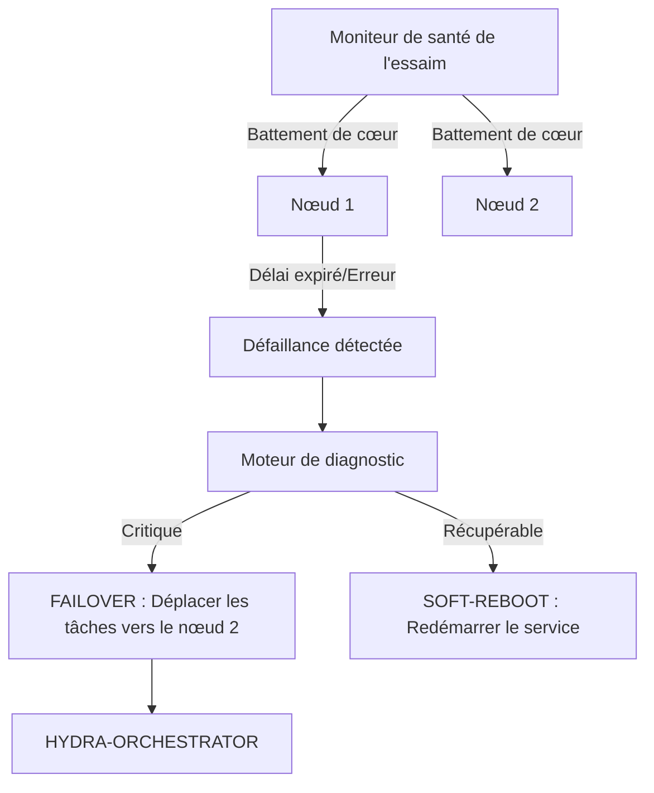

<p align="center">
  
</p>

# 💊 HYDRA-UMC-NODE-HEALING

<p align="center"><a href="README.md">🇺🇸 English</a> | <a href="README_spa.md">🇪🇸 Español</a> | 🇫🇷 <b>Français</b> | <a href="README_ita.md">🇮🇹 Italiano</a> | <a href="README_deu.md">🇩🇪 Deutsch</a> | <a href="README_zho.md">🇨🇳 简体中文</a> | <a href="README_jpn.md">🇯🇵 日本語</a> | <a href="README_por.md">🇵🇹 Português</a></p>

### 🛡️ Moniteur de haute disponibilité et gestionnaire de basculement pour HydraNodes

<p align="center">
  
  
  
</p>

---

**Vérification d'honnêteté - ce qui fonctionne réellement aujourd'hui :** la boucle de sondage/classification (`src/watchdog/watchdog.go`), la politique de nouvelle tentative bornée (`src/watchdog/retry.go`), le vrai câblage de demande de récupération vers HYDRA-UMC-ORCHESTRATOR (`src/watchdog/orchestrator_reactor.go`), et le chargeur statique du registre de nœuds (`src/config/config.go`) sont tous réels et testés (78 tests passants entre `src/config` et `src/watchdog`) - et ce sont de vrais allers-retours gRPC sur de vrais sockets loopback, pas un client simulé. Ce qui est une lacune connue et documentée : le registre de nœuds est un fichier JSON statique (`nodes.json`), pas une requête en direct vers HYDRA-UMC-SWARM-SYNC, car ce projet n'a lui non plus encore de vraie API à interroger - c'est la v0 honnête, pas un placeholder qui prétend être dynamique. Rediriger le travail de mission réellement en cours loin d'un nœud défaillant n'est pas non plus le rôle de ce dépôt - il demande une récupération via `OrchestratorReactor` et s'arrête là ; la couche suivante (déplacer réellement les tâches) vit ailleurs. Les 4 phases de la feuille de route (synchronisation de jumeau numérique, intégration physique Isaac Sim, patrons de récupération automatisée, guérison prédictive pilotée par IA) sont du travail futur aspirationnel sans aucun code derrière pour l'instant. Voir `CHANGELOG.md` pour ce qui a été livré exactement jusqu'à présent.

---

> **État de la sûreté et de la cybersécurité :** cet écosystème n'est pas un système de sécurité certifié. Il n'existe pas encore de chaîne d'E-STOP matérielle, ni de limites ou de verrouillages imposés par le firmware, ni de commande de mouvement vérifiée ; les images de firmware sont contrôlées par CRC32 et un HMAC-SHA256 à clé partagée, pas par une signature asymétrique ; TLS et TLS mutuel sont optionnels et désactivés par défaut ; aucune carte propre n'a encore été assemblée ni testée. Lisez la [base de sécurité](https://github.com/JuanenRac/HYDRA-UMC-DOCS/blob/main/docs/SECURITY_BASELINE.md) et le [modèle de menaces](https://github.com/JuanenRac/HYDRA-UMC-DOCS/blob/main/docs/THREAT_MODEL.md) avant de vous fier à une affirmation d'ici pour la sécurité d'une personne.

## 📋 En un coup d'œil

| | |
|---|---|
| Version | `0.1.9` |
| Maturité | Fonctionnel |
| Tests | 98 |
| Technologie | Go / gRPC health checks / HTTP health probes |
| Cible | Le Raspberry Pi CM5 d'une cellule HYDRA-UMC |
| Sur matériel réel | Pas encore : aucune exécution sur du matériel réel n'est consignée pour cette version |

## 🚦 État du projet

Chaque ligne est une partie de ce dépôt et le feu dit où elle en est aujourd'hui. Elle est écrite d'après ce que le dépôt peut montrer (tests, compilations, exécutions), pas d'après ce qui est prévu.

🟢 Fait et vérifié · 🟡 Fonctionne, avec des limites connues · 🟠 À moitié fait ou pas encore vérifié · 🔴 Pas fait ou ne fonctionne pas

| Domaine | État | Ce que cela veut dire ici |
|---|---|---|
| Logiciel | 🟡 | Fonctionne pour son usage principal ; la vérification d'honnêteté ci-dessus liste ce qui manque encore |
| Tests | 🟢 | 98 tests automatiques, exécutés à chaque modification |
| Matériel réel | 🔴 | Pas encore : aucune exécution sur du matériel réel n'est consignée pour cette version |
| Documentation | 🟢 | README en huit langues, vérifié par rapport au manifeste à chaque modification |

## 1. 🛠️ APERÇU TECHNIQUE

**HYDRA-UMC-NODE-HEALING** est la couche de résilience de l'essaim. Il surveille en permanence la santé de tous les HydraNodes physiques (contrôleurs) et des services logiques, garantissant un temps d'arrêt nul dans la micro-usine.

Si un nœud échoue en raison d'un dysfonctionnement matériel ou d'une panne de réseau, le gestionnaire de « Healing » déclenche automatiquement un processus de basculement (failover), redirigeant ses missions actives vers d'autres nœuds et avertissant l'opérateur via l'orchestrateur.

### Caractéristiques principales :
* 💓 **Battement de santé :** chaque nœud est interrogé toutes les 5 secondes (HealthService gRPC ou URL de santé HTTP) et classé HEALTHY, DEGRADED, UNHEALTHY, UNREACHABLE, INVALID ou MISCONFIGURED ; aucune donnée thermique n'est lue. Chaque nœud est interrogé indépendamment : un nœud qui répond lentement ou pas du tout (son interrogation peut durer plus que l'intervalle) ne retarde pas les autres et n'empile pas d'interrogations ; son prochain tick est sauté jusqu'à la fin de l'interrogation en cours.
* 🔄 **Basculement protégé :** demande à l'orchestrateur de remettre en file les missions d'un nœud qui RESTE en panne (attente de confirmation, grâce au démarrage, délai par nœud et budget global), uniquement pour les entrées du registre qui indiquent leur `dispatchNode`.
* 🛡️ **Redémarrage doux :** *(prévu)* le watchdog ne redémarre rien aujourd'hui ; il signale et demande à l'orchestrateur de remettre en file.
* 📡 **Alertes opérateur :** *(prévu)* aujourd'hui chaque transition va uniquement au journal.
* 🔁 **Réessais bornés + identité de nœud vérifiée (v0, réel) :** un incident réseau transitoire ne fait plus basculer un nœud vers `UNREACHABLE` dès le premier échec - `checkNode` réessaie avec un backoff exponentiel déterministe et plafonné avant d'abandonner ; un nœud qui répond mais ne peut pas s'auto-identifier correctement est classé `INVALID` et n'est jamais ni fait confiance, ni réessayé, ni rapporté comme sain.
* 📓 **Journal persistant (v0, réel) :** avec `-journal CHEMIN`, chaque transition, demande de récupération et demande retenue est aussi écrite comme une ligne JSON, chaînée à la précédente par son SHA-256 et tournée selon la taille (`-journal-max-bytes`, `-journal-backups`) ; après un redémarrage, on sait donc encore pourquoi un nœud a été redémarré. `-journal-verify` vérifie la chaîne. Désactivé par défaut ; une ligne impossible à écrire est signalée et n'arrête jamais le chien de garde. L'unité systemd démarre avec le journal désactivé ; on l'active en mettant `HYDRA_UMC_NODE_HEALING_JOURNAL_ARGS=--journal /var/lib/hydra-umc-node-healing/journal.jsonl` dans `/etc/hydra-umc-node-healing/journal.env` (l'option `--journal` de l'installateur de l'OS l'écrit). Tout ce qui arrive au journal ou au détail d'une sonde passe par la rédaction de secrets partagée. `hydra-umc-node-healing -nodes-from-ports CHEMIN/contracts/ports.yaml` affiche un registre de nœuds construit à partir du registre des services de l'écosystème (chaque service ayant un chemin de santé, sondé en HTTP) et liste les services laissés de côté, si bien que `nodes.json` n'a pas à être écrit à la main.
* 📈 **Surveiller le gardien (v0, réel) :** avec `-listen HÔTE:PORT` il sert `GET /health` (vivant : version, durée de marche, nombre de nœuds ; sans noms) et `GET /metrics` (Prometheus : l'état de chaque nœud, dernière vérification, durée, vérifications, transitions et demandes de reprise). Une adresse hors loopback exige `-status-token` (ou `STATUS_TOKEN`), demandé sur `/metrics`. `kill -HUP` relit le registre (un registre invalide est refusé et les nœuds restent comme ils étaient ; un nœud qui reste garde son état) et `-check-config` valide un registre puis quitte. Un nœud sain est sondé sur une connexion gRPC conservée entre les sondages. Testé contre des simulacres et un serveur local ; jamais contre la vraie flotte.

---

## 2. 🔄 FLUX DE TRAVAIL DE « HEALING »



---

## 3. 🧱 ARCHITECTURE & DÉCISIONS DE CONCEPTION

* **Pourquoi la logique réelle vit sous `src/`, pas à la racine du dépôt.** `src/healthpb` (stubs gRPC générés), `src/watchdog` (le moteur de sondage) et `src/config` (le chargeur du registre de nœuds) contiennent l'implémentation réelle ; `main.go`/`version.go` restent à la racine comme point d'entrée qui les relie.
* **Pourquoi la détection est séparée de l'orchestrateur qu'elle protège.** Un chien de garde de guérison de nœud tournant À L'INTÉRIEUR du processus de l'orchestrateur ne pourrait pas détecter que ce même processus est bloqué - tourner comme service indépendant est ce qui rend réellement possible 'détecter un nœud sans réponse et rediriger son travail', y compris quand le nœud sans réponse est l'orchestrateur lui-même.
* **La détection ET le vrai basculement sont désormais tous les deux câblés.** `src/watchdog` interroge le `HealthService.Check()` (le contrat gRPC partagé `hydra.common.v1` de `HYDRA-UMC-ORCHESTRATOR/proto/hydra_common.proto`) de chaque nœud enregistré, sur un intervalle réel via une vraie connexion réseau, classe le résultat en HEALTHY/DEGRADED/UNHEALTHY/UNREACHABLE, et déclenche un callback `Reactor` seulement lors d'un *changement* d'état (jamais à chaque cycle). `OrchestratorReactor` (`src/watchdog/orchestrator_reactor.go`) est la véritable implémentation de `Reactor` utilisée en production : elle appelle le vrai `POST /nodes/:node/recover` de HYDRA-UMC-ORCHESTRATOR à chaque transition vers un état non sain, demandant une véritable action de récupération plutôt que de simplement journaliser la détection.
* **Pourquoi le registre de nœuds est un fichier JSON statique et non une requête en direct vers HYDRA-UMC-SWARM-SYNC.** SWARM-SYNC (la source de vérité citée à l'origine par le README pour "chaque cellule de l'essaim") n'a pas non plus de vraie API pour l'instant - il en est encore au stade d'andamiaje. Un `nodes.json` statique (voir `nodes.example.json`) est le v0 honnête, pas un placeholder qui prétend être dynamique. Remplacer `src/config.LoadNodes` par un vrai client SWARM-SYNC dès que ce projet en aura un.
* 🩺 **Sonde en HTTP les services qui existent, et envoie son jeton (v0) :** une entrée de `nodes.json` peut porter un `healthUrl` (`http://…` ou `https://…`) au lieu d'une `address` gRPC : le watchdog envoie un `GET` et classe la réponse — `2xx` sain (un `status` JSON `degraded`/`unhealthy` est respecté, et un `name` JSON différent du nom du registre est `INVALID`), `5xx` malsain, pas de réponse `UNREACHABLE` (réessayé), une redirection ou un `4xx` `INVALID` (une URL erronée ou un identifiant manquant relève de la configuration, pas d'une panne du nœud, donc jamais réessayé, et les redirections ne sont jamais suivies). Jusqu'ici chaque nœud était sondé via un `HealthService` gRPC qu'aucun service de l'écosystème n'implémente, si bien qu'un service parfaitement sain était signalé `UNREACHABLE`. La demande de récupération envoyée à l'orchestrateur porte `Authorization: Bearer` lorsque `-orchestrator-token` / `ORCHESTRATOR_TOKEN` est défini (un orchestrateur sur une adresse réseau la refuse sinon), et le nom du nœud est échappé comme un seul segment de chemin. *(implémenté)*
* **Comment cela s'intègre dans le reste de l'écosystème.** Un service frère sous HYDRA-UMC-ORCHESTRATOR - surveille chaque nœud de son registre, signale les changements d'état, et demande maintenant une vraie récupération via `OrchestratorReactor` quand l'un d'eux devient non sain ; rediriger le travail réellement en cours loin de ce nœud est la couche suivante au-dessus de celle-ci.
* **Pourquoi un échec de transport est réessayé (borné) mais jamais une identité incohérente.** Une connexion refusée ou un timeout RPC peut être un incident vraiment transitoire - un nœud en cours de redémarrage, un bref accroc réseau - donc `checkNode` réessaie jusqu'à `RetryPolicy.MaxAttempts` fois avec un backoff exponentiel avant d'abandonner. Un nœud qui répond mais rapporte le mauvais nom (ou aucun) est un problème d'une tout autre nature : aucune attente ne répare un service branché sur le mauvais port, donc ce cas est classé `StatusInvalid` immédiatement, sans aucun réessai.
* **Pourquoi le backoff n'a pas de gigue (jitter) aléatoire.** Une vraie flotte de production voudrait de la gigue pour éviter une ruée de reconnexions simultanées, mais ce chien de garde interroge déjà chaque nœud depuis sa propre goroutine à son propre rythme - le seul coût de la gigue ici serait de rendre `RetryPolicy.Backoff()` non déterministe et plus difficile à vérifier dans les tests. À ajouter si/quand ce chien de garde interroge un jour des centaines de nœuds contre une ressource partagée goulot d'étranglement.

Pour plus de détails, voir [`docs/ARCHITECTURE.md`](docs/ARCHITECTURE.md) (guide d'architecture), [`docs/BUILD_AND_RUN.md`](docs/BUILD_AND_RUN.md) (flux de build release vs test) et [`docs/INTEGRATION_CONTRACT.md`](docs/INTEGRATION_CONTRACT.md) (le contrat de snapshot de santé versionné qu'un futur adaptateur doit respecter).

---

## 📂 STRUCTURE DES RÉPERTOIRES

```text
HYDRA-UMC-NODE-HEALING/
├── src/
│   ├── healthpb/      # Stubs Go générés pour hydra.common.v1
│   │                  # (issus de HYDRA-UMC-ORCHESTRATOR/proto/
│   │                  # hydra_common.proto - voir le proto/README.md de
│   │                  # ce dépôt pour la commande de génération)
│   ├── watchdog/      # Boucle de sondage réelle : dial, Check(), classer,
│   │                  # réagir uniquement lors d'un changement d'état,
│   │                  # plus retry.go (RetryPolicy)
│   ├── redact/        # Masque les formes connues de secrets dans le texte et les valeurs de type JSON (un portage de l'expurgation partagée du SDK, avec ses vecteurs de test)
│   └── config/        # Chargeur du registre statique de nœuds (JSON)
├── build/             # Binaires compilés (sortie de build.sh/build.bat)
├── images/            # Médias et diagrammes
├── systemd/
│   └── hydra-umc-node-healing.service # Unité systemd du watchdog sur la CM5 locale
├── tools/
│   ├── build_test.py  # Vérification de build sans versionnage
│   ├── ci_validate.py # Validation manifeste/CHANGELOG/docs utilisée par CI
│   ├── _doc_policy.py # Règles de documentation partagées par la famille (copie de celle de HYDRA-UMC-SDK, tenue synchronisée)
│   ├── _readme_parity.py # Contrôle que les huit README partagent la même structure (copie de celui de HYDRA-UMC-SDK, tenue synchronisée)
│   └── hydra_project_tool.py # Les mêmes commandes dans chaque dépôt : validate, test, ci, version, status, bump
├── nodes.example.json # Registre de nœuds d'exemple (voir src/config)
├── go.mod / go.sum    # Définition du module Go
├── version.go         # const Version = "X.Y.Z" (go.mod n'a pas ce champ)
├── main.go            # Point d'entrée : charge le registre et lance le watchdog
├── main_test.go       # Le binaire compilé lancé comme le ferait un opérateur (-check-config, le refus d'un point d'état ouvert)
├── bump_version.py    # Incrément de version type compteur kilométrique (exécuté seulement par la commande `bump` explicite)
├── bump_manifest_version.py # Synchronise la version de hydra-umc.project.json avec la version native (--sync)
├── build.sh/.bat      # Valide et compile (compiler ne change jamais la version)
├── build-test.sh/.bat # Vérification de build sans versionnage
├── run.sh/.bat        # Exécute le binaire compilé
├── docs/
│   ├── ARCHITECTURE.md
│   ├── BUILD_AND_RUN.md
│   └── INTEGRATION_CONTRACT.md
└── README.md
```

Élagué du modèle original : `hardware/`, `firmware/`, `os/` et `scripts/` — il s'agit d'un service purement logiciel (binaire Go) sans matériel ni firmware propres, sans image de système d'exploitation à maintenir et sans contenu de scripts utilitaires qui justifie encore un dossier à part.

---

## 🔧 BUILD ET EXÉCUTION

Un vrai watchdog, pas seulement un squelette qui compile : il contacte
chaque nœud de `nodes.example.json` (ou `-nodes <chemin>` pour pointer
vers votre propre registre) (par URL de santé HTTP, ou par gRPC quand l'entrée a une `address`) et signale les changements d'état
sur stdout.

```bash
# Windows
build.bat
run.bat -nodes nodes.example.json

# Linux / macOS
./build.sh
./run.sh -nodes nodes.example.json
```

`build.sh`/`build.bat` ne changent jamais la version (seule `python tools/hydra_project_tool.py bump` la fait monter) puis
exécutent `go build`. `run.sh`/`run.bat` exécutent directement le binaire
résultant.

Chaque entrée du registre a besoin de quelque chose de réel à l'écoute
sur son `address` et implémentant `hydra.common.v1.HealthService` (voir
`HYDRA-UMC-ORCHESTRATOR/proto/hydra_common.proto`) pour un jour se
signaler en bonne santé - rien ne tournant encore sur les ports
d'exemple, on s'attend à voir `UNKNOWN -> UNREACHABLE` dès le premier
cycle pour les trois (désormais seulement après épuisement des tentatives
bornées de `RetryPolicy`, pas dès le premier dial - voir la
caractéristique « Réessais bornés » ci-dessus), ce qui est le résultat
correct et honnête aujourd'hui (chaque nœud de l'écosystème en est encore
au stade d'andamiaje au-delà de la propre logique de détection de ce
dépôt). Un nœud qui répond mais ne peut pas s'auto-identifier
correctement affiche plutôt `UNKNOWN -> INVALID`, immédiatement.

```bash
go test ./...   # src/config + src/watchdog, allers-retours gRPC
                 # réels sur de vraies sockets loopback, sans client simulé
```

---

## 🚀 FEUILLE DE ROUTE
* **Phase 1 :** (fait, `-journal`) Un journal persistant en JSON par lignes, chaîné par hachage, de chaque transition et demande de récupération. Reste : les réponses de l'orchestrateur en champs structurés.
* **Phase 2 :** Une sonde plus rapide : une boucle par nœud avec des connexions gRPC persistantes et des en-têtes par entrée pour la sonde HTTP.
* **Phase 3 :** Une observabilité propre (un point d'accès de métriques) et un rechargement du registre des nœuds sans redémarrage.
* **Phase 4 :** Un test de contrat contre un vrai HYDRA-UMC-SERVER et un bail (lease) pour qu'un seul réparateur agisse à la fois.

---

## 🔗 Projets Liés

Ce projet fait partie de l'écosystème robotique HYDRA-UMC du même auteur (JuanenRac / Electro Hobby 3D). Bon à savoir, car une demande pourrait en réalité concerner l'un de ceux-ci plutôt que ce dépôt.

**Projet Parent**
- **[HYDRA-UMC-ORCHESTRATOR](https://github.com/JuanenRac/HYDRA-UMC-ORCHESTRATOR)** — hub d'intégration avec un vrai contrat de rapport de santé gRPC/Protobuf et une machine à états de mission ; le parent dont ce dépôt est un service d'orchestration spécifique, au sein de sa propre couche de coordination d'essaim.

**Projets Frères** — les autres services d'orchestration de la propre couche de coordination d'essaim de HYDRA-UMC-ORCHESTRATOR
- **[HYDRA-UMC-SWARM-SYNC](https://github.com/JuanenRac/HYDRA-UMC-SWARM-SYNC)** — vraie synchronisation d'état CRDT LWW-Element-Map, testée par propriétés pour la convergence multi-cellule.
- **[HYDRA-UMC-PATH-PLANNER-3D](https://github.com/JuanenRac/HYDRA-UMC-PATH-PLANNER-3D)** — vrai planificateur de trajectoire 3D basé sur RRT, avec vraie validation des collisions obstacle/espace de travail.
- **[HYDRA-UMC-JOB-DISPATCHER](https://github.com/JuanenRac/HYDRA-UMC-JOB-DISPATCHER)** — vraie file de tâches basée sur la priorité avec déduplication, via une vraie API HTTP.

**Directement Liés**
- **[HYDRA-UMC-SERVER](https://github.com/JuanenRac/HYDRA-UMC-SERVER)** — le vrai backend headless (REST/WebSocket) auquel parle réellement chaque client de contrôle — ce service de guérison peut surveiller son point d'accès de santé comme tout autre nœud de son registre (le registre d'exemple surveille ORCHESTRATOR, VOICE-UI, DATALAKE, ANOMALY-DETECTOR et COGNITIVE-NODE, pas le serveur).

**Fait Également Partie de l'Écosystème**

*Matériel & Plateforme de Base*
- **[HYDRA-UMC](https://github.com/JuanenRac/HYDRA-UMC)** — la conception de la carte mère du bras robotique : hôte CM5 + coprocesseur STM32H745 double cœur, destinée à coordonner jusqu'à 8 bras-outils via CAN-OTA/SPI-OTA (firmware à un stade précoce ; aucune carte assemblée pour l'instant).
- **[HYDRA-UMC-OS](https://github.com/JuanenRac/HYDRA-UMC-OS)** — couche produit reproductible sur Raspberry Pi OS pour le CM5 : agent en lecture seule, config/profils validés, provisionnement WiFi de premier contact.
- **[HYDRA-UMC-SDK](https://github.com/JuanenRac/HYDRA-UMC-SDK)** — le contrat JSON-Schema partagé et la barrière logicielle de contrôle des jobs contre laquelle chaque bridge valide ses commandes (pas une fonction de sécurité certifiée).
- **[HYDRA-UMC-CONNECTOR-HUB](https://github.com/JuanenRac/HYDRA-UMC-CONNECTOR-HUB)** — registre déclaratif et validateur de manifestes d'adaptateur pour les connecteurs de machines externes ; étend la propre idée de contrat du SDK aux machines externes sans remplacer les projets de passerelle industrielle.

*Backend Central & Clients*
- **[HYDRA-UMC-STUDIO](https://github.com/JuanenRac/HYDRA-UMC-STUDIO)** — tableau de bord de contrôle web avec visualisation 3D multi-robot en temps réel.
- **[HYDRA-UMC-SUITE](https://github.com/JuanenRac/HYDRA-UMC-SUITE)** — centre de commande d'essaim de bureau (PySide6) pour plusieurs serveurs à la fois, empaqueté en exécutable autonome.
- **[HYDRA-UMC-ANDROID-CONTROL](https://github.com/JuanenRac/HYDRA-UMC-ANDROID-CONTROL)** — application de contrôle Android native avec connexion biométrique et un compagnon Wear OS jumelé.
- **[HYDRA-UMC-IOS-CONTROL](https://github.com/JuanenRac/HYDRA-UMC-IOS-CONTROL)** — application de contrôle iOS/iPadOS (Flutter) avec synchronisation WebSocket en temps réel.
- **[HYDRA-UMC-DSI](https://github.com/JuanenRac/HYDRA-UMC-DSI)** — interface tactile native pour l'écran tactile DSI 7" embarqué, intégrée directement sur le CM5.
- **[HYDRA-UMC-EDITOR-URDF](https://github.com/JuanenRac/HYDRA-UMC-EDITOR-URDF)** — créateur/éditeur graphique de bureau pour URDF qui envoie les modèles terminés vers le propre catalogue de STUDIO.
- **[HYDRA-UMC-EDITOR-STL](https://github.com/JuanenRac/HYDRA-UMC-EDITOR-STL)** — éditeur de bureau de modèles STL, transformant/remplaçant/retirant/ajoutant de vraies pièces dans le même catalogue de modèles qu'édite aussi HYDRA-UMC-EDITOR-URDF.
- **[HYDRA-UMC-BRIDGE-AMR](https://github.com/JuanenRac/HYDRA-UMC-BRIDGE-AMR)** — frontière de coordination pour les flottes AGV/AMR via un éditeur MQTT VDA 5050 (testé uniquement contre une flotte émulée).
- **[HYDRA-UMC-BRIDGE-CNC](https://github.com/JuanenRac/HYDRA-UMC-BRIDGE-CNC)** — coordinateur haut niveau pour cellules CNC avec accès au statut/octets de contrôle GRBL (testé uniquement contre un émulateur).
- **[HYDRA-UMC-BRIDGE-DROIDS](https://github.com/JuanenRac/HYDRA-UMC-BRIDGE-DROIDS)** — frontière de coordination pour droïdes à pattes/humanoïdes, avec un émetteur de commandes Boston Dynamics Spot (testé uniquement contre un émulateur).
- **[HYDRA-UMC-BRIDGE-LASER](https://github.com/JuanenRac/HYDRA-UMC-BRIDGE-LASER)** — coordinateur de cellules laser lisant 3 signaux GPIO de clé/enceinte/verrouillage (testé uniquement contre une puce simulée ; il ne peut ni armer ni tirer un laser).
- **[HYDRA-UMC-BRIDGE-OPENPNP](https://github.com/JuanenRac/HYDRA-UMC-BRIDGE-OPENPNP)** — coordinateur haut niveau sûr pour le flux de cartes du pick-and-place OpenPnP.
- **[HYDRA-UMC-BRIDGE-PRINTER3D](https://github.com/JuanenRac/HYDRA-UMC-BRIDGE-PRINTER3D)** — frontière de coordination sûre pour imprimantes 3D Moonraker/Klipper, avec de vraies commandes de tâche contrôlées.
- **[HYDRA-UMC-BRIDGE-ROS2](https://github.com/JuanenRac/HYDRA-UMC-BRIDGE-ROS2)** — coordinateur avec un transport ROS 2 rclpy à importation paresseuse (pas encore exécuté contre une installation ROS 2).
- **[HYDRA-UMC-BRIDGE-UAV](https://github.com/JuanenRac/HYDRA-UMC-BRIDGE-UAV)** — frontière de coordination pour UAV équipés de caméra, avec un émetteur de commandes MAVLink (testé uniquement contre un émulateur).

*Plateforme d'Outils URTC*
- **[URTC](https://github.com/JuanenRac/URTC)** — firmware pour la carte physique Universal Robot Tool Controller, plus de 25 profils d'outil sur bus CAN.
- **[URTC-FLASHER](https://github.com/JuanenRac/URTC-FLASHER)** — outil de bureau à interface graphique pour flasher les cartes URTC, CAN-OTA plus SWD/JTAG puce complète.
- **[URTC-TESTER](https://github.com/JuanenRac/URTC-TESTER)** — outil de bureau de diagnostic CAN-bus en direct pour cartes URTC, un panneau par profil d'outil.
- **[URTC-WEB-STUDIO](https://github.com/JuanenRac/URTC-WEB-STUDIO)** — alternative basée navigateur à URTC-TESTER via la Web Serial API, sans installation locale.
- **[URTC-GATEWAY](https://github.com/JuanenRac/URTC-GATEWAY)** — passerelle devant le bus CAN d'URTC : liste d'identifiants autorisés, limite de débit et clé de session ; logiciel testé sur ordinateur, pas encore sur un bus réel.

*Nœud IA de Vision (Hailo-8)*
- **[HYDRA-UMC-VISION-NODE](https://github.com/JuanenRac/HYDRA-UMC-VISION-NODE)** — hub d'intégration pour le pipeline de vision Hailo-8, avec une vraie vérification de disponibilité matérielle par étape.
- **[HYDRA-UMC-DETECTION-HEF](https://github.com/JuanenRac/HYDRA-UMC-DETECTION-HEF)** — registre réel de modèles compilés avec vérification de chargement sécurisé par architecture Hailo/checksum.
- **[HYDRA-UMC-VISION-STREAMER](https://github.com/JuanenRac/HYDRA-UMC-VISION-STREAMER)** — générateur réel de pipeline GStreamer + config MediaMTX, avec une vraie frontière d'intégration HailoRT.
- **[HYDRA-UMC-VISUAL-SERVOING-API](https://github.com/JuanenRac/HYDRA-UMC-VISUAL-SERVOING-API)** — loi de correction Position-Based Visual Servoing avec autorisation conditionnée à l'état de zone ; pas encore d'estimation de pose par caméra.
- **[HYDRA-UMC-SAFETY-ZONES](https://github.com/JuanenRac/HYDRA-UMC-SAFETY-ZONES)** — logique v0 de violation de zone, de fraîcheur de calibration et de demande d'E-STOP qui lit les positions d'objets dans un fichier ; aucun détecteur ne l'alimente et aucun E-STOP physique n'y est encore relié.

*Nœud IA Cognitif (Hailo-10)*
- **[HYDRA-UMC-COGNITIVE-NODE](https://github.com/JuanenRac/HYDRA-UMC-COGNITIVE-NODE)** — hub d'intégration pour le pipeline cognitif Hailo-10 (orchestration LLM/VLA/voix).
- **[HYDRA-UMC-VLA-ENGINE](https://github.com/JuanenRac/HYDRA-UMC-VLA-ENGINE)** — vrai encodage/décodage de jetons d'action et génération de trajectoire pour un modèle Vision-Language-Action.
- **[HYDRA-UMC-VOICE-UI](https://github.com/JuanenRac/HYDRA-UMC-VOICE-UI)** — vrai front-end vocal (VAD + analyseur d'intention) avec un relais Watch borné et soumis à confirmation.
- **[HYDRA-UMC-SEMANTIC-PLANNER](https://github.com/JuanenRac/HYDRA-UMC-SEMANTIC-PLANNER)** — vraie décomposition de tâches basée sur des règles et récupération sémantique d'erreurs sur les codes d'erreur MCU.
- **[HYDRA-UMC-DOCS-QA](https://github.com/JuanenRac/HYDRA-UMC-DOCS-QA)** — vraie recherche documentaire TF-IDF (bibliothèque standard uniquement) sur les propres documents Markdown de cet écosystème.
- **[HYDRA-UMC-LOCAL-TECHNICIAN](https://github.com/JuanenRac/HYDRA-UMC-LOCAL-TECHNICIAN)** — technicien de maintenance IA local et à portes de politique pour l'écosystème lui-même - observe, diagnostique et propose des corrections ; les deux niveaux de risque les plus élevés ne sont délibérément pas encore implémentés.

*Jumeau Numérique & Simulation*
- **[HYDRA-UMC-TWIN](https://github.com/JuanenRac/HYDRA-UMC-TWIN)** — hub d'intégration pour le moteur de jumeau numérique, avec un vrai contrat de synchronisation par compatibilité de version.
- **[HYDRA-UMC-HIL-BRIDGE](https://github.com/JuanenRac/HYDRA-UMC-HIL-BRIDGE)** — routeur hardware-in-the-loop avec un verrouillage logiciel de collision entre simulation et matériel réel (testé sans matériel réel).
- **[HYDRA-UMC-PHYSICS-REPLICA](https://github.com/JuanenRac/HYDRA-UMC-PHYSICS-REPLICA)** — vraie cinématique directe et validation des limites articulaires sur un vrai sous-ensemble URDF.
- **[HYDRA-UMC-SYNTHETIC-DATA-GEN](https://github.com/JuanenRac/HYDRA-UMC-SYNTHETIC-DATA-GEN)** — vrai générateur procédural de scènes 2D avec export d'annotations YOLO/COCO.

*Données & Analytique*
- **[HYDRA-UMC-DATALAKE](https://github.com/JuanenRac/HYDRA-UMC-DATALAKE)** — vrai magasin de séries temporelles basé sur sqlite3, avec une vraie API HTTP d'ingestion/requête.
- **[HYDRA-UMC-ANOMALY-DETECTOR](https://github.com/JuanenRac/HYDRA-UMC-ANOMALY-DETECTOR)** — vrai détecteur d'anomalies FFT + ligne de base statistique, avec surveillance de dérive.
- **[HYDRA-UMC-PRODUCTION-REPORTS](https://github.com/JuanenRac/HYDRA-UMC-PRODUCTION-REPORTS)** — vrai calcul OEE/disponibilité sur l'historique de DATALAKE, avec export CSV reproductible.
- **[HYDRA-UMC-TELEMETRY-COLLECTOR](https://github.com/JuanenRac/HYDRA-UMC-TELEMETRY-COLLECTOR)** — vrai pipeline d'ingestion CAN/WebSocket vers DATALAKE, avec déduplication par séquence.

*Passerelle Industrielle*
- **[HYDRA-UMC-GATEWAY-INDUSTRIAL](https://github.com/JuanenRac/HYDRA-UMC-GATEWAY-INDUSTRIAL)** — hub d'intégration relayant vers les protocoles industriels, avec une vraie couche de liste blanche de commandes/contre-pression.
- **[HYDRA-UMC-OPCUA-SERVER](https://github.com/JuanenRac/HYDRA-UMC-OPCUA-SERVER)** — vrai espace d'adressage OPC-UA, vérifié avec une vraie session client du protocole binaire.
- **[HYDRA-UMC-MQTT-BROKER](https://github.com/JuanenRac/HYDRA-UMC-MQTT-BROKER)** — vrai broker MQTT avec authentification par client optionnelle et ACL de sujets.
- **[HYDRA-UMC-MTCONNECT-ADAPTER](https://github.com/JuanenRac/HYDRA-UMC-MTCONNECT-ADAPTER)** — vrais points de terminaison XML MTConnect `/probe` et `/current`, avec sortie en mode dégradé.

*Outils Complémentaires & Opérations de l'Écosystème*
- **[HYDRA-UMC-DASHBOARD-AI](https://github.com/JuanenRac/HYDRA-UMC-DASHBOARD-AI)** — panneaux Smart Summaries et Anomaly Highlighting sur DATALAKE/ANOMALY-DETECTOR, avec un repli statistique honnête.
- **[HYDRA-UMC-TOOL-CLI](https://github.com/JuanenRac/HYDRA-UMC-TOOL-CLI)** — CLI de flotte avec un vrai contrat de codes de sortie stable, un vrai client en direct de la propre API de HYDRA-UMC-SERVER.
- **[HYDRA-UMC-WATCH](https://github.com/JuanenRac/HYDRA-UMC-WATCH)** — application compagnon WearOS avec des motifs d'alerte haptique et un relais vocal vers le téléphone jumelé (pas encore exécutée sur une montre physique).
- **[URTC-SMART-RACK](https://github.com/JuanenRac/URTC-SMART-RACK)** — firmware pour un rack de montage de cartes avec décodage réel d'ID d'outil et logique de préchauffage Smart Idle.
- **[URTC-VISION-TOOL](https://github.com/JuanenRac/URTC-VISION-TOOL)** — firmware plus un vrai compagnon de vision Python pour une tête d'outil d'inspection thermique/RGB.
- **[HYDRA-UMC-UPDATER](https://github.com/JuanenRac/HYDRA-UMC-UPDATER)** — outil administratif de bureau qui découvre, clone et met à jour chaque dépôt de cet écosystème.
- **[HYDRA-UMC-OS-REBUILDER](https://github.com/JuanenRac/HYDRA-UMC-OS-REBUILDER)** — outil de bureau Windows/Linux qui construit une image de la CM5 prête à graver, préchargée avec les versions les plus actuelles de l'écosystème, avec une configuration de premier démarrage Wi-Fi/utilisateur/SSH façon Raspberry Pi Imager.
- **[HYDRA-UMC-OPS-AGENT](https://github.com/JuanenRac/HYDRA-UMC-OPS-AGENT)** — coordinateur d'incidents de maintenance : un rôle edge à faible privilège collecte un instantané d'inventaire/santé assaini, un rôle control-plane le rend en lecture seule et demande à un fournisseur d'IA de suggérer un diagnostic - n'applique jamais de correctif ni ne déploie rien.
- **[HYDRA-UMC-DEV-SERVER](https://github.com/JuanenRac/HYDRA-UMC-DEV-SERVER)** — hôte de développement reproductible (Raspberry Pi 5 / CM5) qui héberge le code source de l'écosystème et exécute des tâches de compilation/test délimitées via une file d'attente durable ; un rôle de développement dédié, explicitement distinct d'un CM5 opérationnel.


---

## 📚 Documentation & Communauté

- **[CONTRIBUTING.md](CONTRIBUTING.md)** — pile technologique et lignes directrices de codage pour une pull request.
- **[CODE_OF_CONDUCT.md](CODE_OF_CONDUCT.md)** — les normes de comportement attendues dans cette communauté.
- **[SECURITY.md](SECURITY.md)** — comment signaler une vulnérabilité, et les véritables axes de sécurité de ce projet.
- **[SUPPORT.md](SUPPORT.md)** — où poser des questions et signaler des bugs.
- **[LICENSE.md](LICENSE.md)** — la licence propre de ce projet.

## 👤 AUTEUR
**JuanenRac** (Electro Hobby 3D)
📧 electrohobby3d@gmail.com
📺 [youtube.com/@electrohobby3d](https://youtube.com/@electrohobby3d)

## 📜 LICENCE
GPL-3.0-or-later - Voir le fichier LICENSE pour plus de détails.
