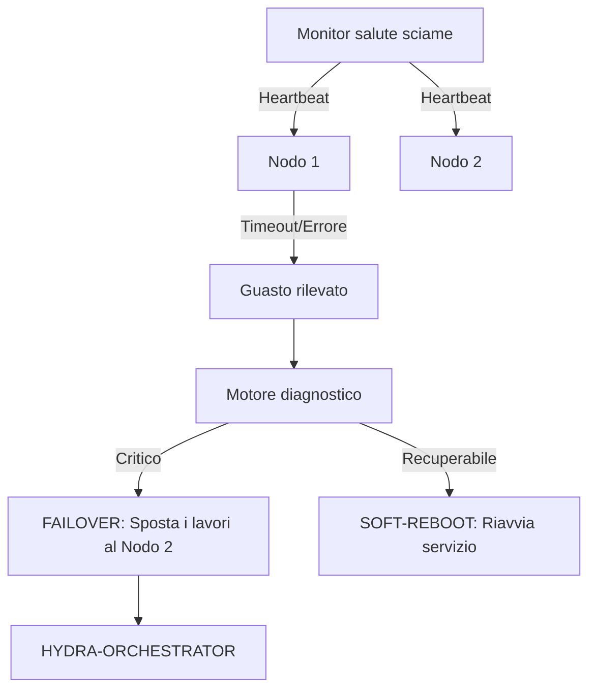

<!-- =============================================================================
HYDRA-UMC-NODE-HEALING - Fleet health watchdog
Copyright (C) JuanenRac (Electro Hobby 3D) <electrohobby3d@gmail.com>
GPL-3.0-or-later - see LICENSE
============================================================================= -->

<p align="center">
  
</p>

# 💊 HYDRA-UMC-NODE-HEALING

<p align="center"><a href="README.md">🇺🇸 English</a> | <a href="README_spa.md">🇪🇸 Español</a> | <a href="README_fra.md">🇫🇷 Français</a> | 🇮🇹 <b>Italiano</b> | <a href="README_deu.md">🇩🇪 Deutsch</a> | <a href="README_zho.md">🇨🇳 简体中文</a> | <a href="README_jpn.md">🇯🇵 日本語</a> | <a href="README_por.md">🇵🇹 Português</a></p>

### 🛡️ Monitor di alta disponibilità e gestore failover per HydraNode

<p align="center">
  
  
  
  
  
  
</p>

---

**Controllo di onestà - cosa funziona davvero oggi:** il ciclo di polling/classificazione (`src/watchdog/watchdog.go`), la policy di retry limitato (`src/watchdog/retry.go`), il vero cablaggio della richiesta di recupero verso HYDRA-UMC-ORCHESTRATOR (`src/watchdog/orchestrator_reactor.go`), e il caricatore statico del registro dei nodi (`src/config/config.go`) sono tutti reali e testati (115 test superati tra `src/config` e `src/watchdog`) - e sono veri round-trip gRPC su veri socket loopback, non un client simulato. Ciò che è una lacuna nota e documentata: il registro dei nodi è un file JSON statico (`nodes.json`), non una query live verso HYDRA-UMC-SWARM-SYNC, perché anche quel progetto non ha ancora una vera API da interrogare - questa è la v0 onesta, non un placeholder che finge di essere dinamico. Anche reindirizzare il lavoro di missione realmente in corso lontano da un nodo guasto non è compito di questo repository - richiede il recupero tramite `OrchestratorReactor` e si ferma lì; il livello successivo (spostare realmente i lavori) vive altrove. Le 4 fasi della roadmap (sincronizzazione del gemello digitale, integrazione fisica Isaac Sim, pattern di recupero automatizzato, guarigione predittiva basata su IA) sono lavoro futuro aspirazionale senza alcun codice dietro per ora. Vedi `CHANGELOG.md` per ciò che è stato consegnato esattamente finora.

---

> **Stato di sicurezza (safety e security):** questo ecosistema non è un sistema di sicurezza certificato. Non esiste ancora un percorso E-STOP hardware, né limiti o interblocchi imposti dal firmware, né un comando di movimento verificato; le immagini firmware sono controllate con CRC32 e un HMAC-SHA256 a chiave condivisa, non con una firma asimmetrica; TLS e TLS reciproco sono opzionali e disattivati per impostazione predefinita; nessuna scheda propria è stata ancora assemblata o provata. Leggi la [base di sicurezza](https://github.com/JuanenRac/HYDRA-UMC-DOCS/blob/main/docs/SECURITY_BASELINE.md) e il [modello delle minacce](https://github.com/JuanenRac/HYDRA-UMC-DOCS/blob/main/docs/THREAT_MODEL.md) prima di fidarti di qualsiasi affermazione qui per la sicurezza di una persona.

---

## 📋 In breve

| | |
|---|---|
| Versione | `0.1.9` |
| Maturità | Funzionale |
| Test | 115 (`go test ./...`) |
| Tecnologia | Go / gRPC health checks / HTTP health probes |
| Destinazione | Il Raspberry Pi CM5 di una cella HYDRA-UMC |
| Su hardware reale | Non ancora: per questa versione non risulta alcuna esecuzione su hardware reale |

**Vai a:** [Panoramica](#-panoramica) · [Architettura](#-architettura) · [Avvio rapido](#-avvio-rapido) · [Test](#-test) · [Struttura del repository](#-struttura-del-repository) · [Progetti correlati](#-progetti-correlati)

## 🚦 Stato del progetto

Ogni riga è una parte di questo repository e il semaforo dice a che punto è oggi. È scritta in base a ciò che il repository può mostrare (test, compilazioni, esecuzioni), non a ciò che è previsto.

🟢 Fatto e verificato · 🟡 Funziona, con limiti noti · 🟠 Fatto a metà o non ancora verificato · 🔴 Non fatto o non funzionante

| Area | Stato | Cosa significa qui |
|---|---|---|
| Software | 🟡 | Funziona per il suo scopo principale; la verifica di onestà qui sopra elenca ciò che manca ancora |
| Test | 🟢 | 115 test automatici, eseguiti a ogni modifica |
| Hardware reale | 🔴 | Non ancora: per questa versione non risulta alcuna esecuzione su hardware reale |
| Documentazione | 🟢 | README in otto lingue, verificato rispetto al manifesto a ogni modifica |

## 🎯 Panoramica

**HYDRA-UMC-NODE-HEALING** è lo strato di resilienza dello sciame. Monitora continuamente lo stato di salute di tutti gli HydraNode fisici (controller) e dei servizi logici, garantendo tempi di inattività zero nella micro-fabbrica.

Se un nodo fallisce a causa di un malfunzionamento dell'hardware o di un'interruzione della rete, l'Healing Manager attiva automaticamente un processo di failover, reindirizzando le sue missioni attive ad altri nodi e notificando l'operatore tramite l'Orchestratore.

### Caratteristiche principali:
* 💓 **Heartbeat di salute:** ogni nodo viene interrogato ogni 5 secondi (HealthService gRPC o URL di salute HTTP) e classificato HEALTHY, DEGRADED, UNHEALTHY, UNREACHABLE, INVALID o MISCONFIGURED; non vengono letti dati termici. Ogni nodo viene interrogato per conto suo: un nodo che risponde lentamente o per niente (la sua interrogazione può durare più dell'intervallo) non ritarda gli altri né accumula interrogazioni; il suo tick successivo viene saltato finché quella in corso non termina.
* 🔄 **Failover protetto:** chiede all'orchestratore di rimettere in coda le missioni di un nodo che RESTA inattivo (attesa di conferma, tolleranza all'avvio, pausa per nodo e budget globale), solo per le voci del registro che indicano il loro `dispatchNode`.
* 🛡️ **Riavvio morbido:** *(pianificato)* oggi il watchdog non riavvia nulla; segnala soltanto e chiede all'orchestratore di rimettere in coda.
* 📡 **Avvisi all'operatore:** *(pianificato)* oggi ogni transizione va solo nel journal.
* 🔁 **Retry limitati + identità del nodo verificata (v0, reale):** un guasto di rete transitorio non fa più passare un nodo a `UNREACHABLE` al primo fallimento - `checkNode` riprova con un backoff esponenziale deterministico e limitato prima di arrendersi; un nodo che risponde ma non riesce ad autoidentificarsi correttamente viene classificato `INVALID` e non viene mai considerato affidabile, ritentato, o riportato come sano.
* 📓 **Giornale persistente (v0, reale):** con `-journal PERCORSO` ogni transizione, richiesta di recupero e richiesta trattenuta viene scritta anche come riga JSON, concatenata alla precedente con il suo SHA-256 e ruotata per dimensione (`-journal-max-bytes`, `-journal-backups`); dopo un riavvio resta traccia del motivo per cui un nodo è stato riavviato. `-journal-verify` controlla la catena. Disattivato per impostazione predefinita; una riga che non si può scrivere viene segnalata e non ferma mai il watchdog. L'unità systemd parte con il registro disattivato; si attiva mettendo `HYDRA_UMC_NODE_HEALING_JOURNAL_ARGS=--journal /var/lib/hydra-umc-node-healing/journal.jsonl` in `/etc/hydra-umc-node-healing/journal.env` (l'opzione `--journal` dell'installatore dell'OS lo scrive). Tutto ciò che arriva al registro o al dettaglio di una sonda passa dalla redazione dei segreti condivisa. `hydra-umc-node-healing -nodes-from-ports PERCORSO/contracts/ports.yaml` stampa un registro dei nodi costruito dal registro dei servizi dell'ecosistema (ogni servizio con un percorso di salute, sondato via HTTP) ed elenca i servizi lasciati fuori, così `nodes.json` non va scritto a mano.
* 📈 **Sorvegliare il sorvegliante (v0, reale):** con `-listen HOST:PORTA` serve `GET /health` (in vita: versione, tempo di attività, quanti nodi; senza nomi) e `GET /metrics` (Prometheus: lo stato di ogni nodo, ultimo controllo, durata, controlli, transizioni e richieste di ripristino). Un indirizzo non loopback richiede `-status-token` (o `STATUS_TOKEN`), chiesto su `/metrics`. `kill -HUP` rilegge il registro (uno non valido viene rifiutato e i nodi restano come erano; un nodo che resta conserva il suo stato) e `-check-config` valida un registro ed esce. Un nodo sano viene sondato su una connessione gRPC mantenuta tra i sondaggi. Provato contro simulacri e un server locale; mai contro la flotta reale.

## 🧩 Ruolo in HYDRA-UMC

**HYDRA-UMC-NODE-HEALING** è il guardiano della salute della flotta: interroga ogni nodo via HTTP o gRPC, lo classifica e chiede a `HYDRA-UMC-ORCHESTRATOR` di recuperare le sue missioni quando un nodo scompare. Sorveglia e segnala; non riavvia hardware.

## 🏛️ Architettura

<p align="center">
  
</p>

<details>
<summary>Versione testuale del diagramma (Mermaid)</summary>



</details>

### ARCHITETTURA E DECISIONI DI PROGETTAZIONE

* **Perché la logica reale vive sotto `src/` e non nella radice del repo.** `src/healthpb` (stub gRPC generati), `src/watchdog` (il motore di polling) e `src/config` (il caricatore del registro nodi) contengono l'implementazione reale; `main.go`/`version.go` restano nella radice come punto di ingresso che li collega.
* **Perché il rilevamento è separato dall'orchestratore che protegge.** Un watchdog di guarigione dei nodi eseguito DENTRO il processo dell'orchestratore non potrebbe rilevare che quello stesso processo si è bloccato - girare come servizio indipendente è ciò che rende realmente possibile 'rilevare un nodo non rispondente e reindirizzare il suo lavoro', anche quando il nodo non rispondente è l'orchestratore stesso.
* **Rilevamento E vero failover sono ora entrambi collegati.** `src/watchdog` interroga `HealthService.Check()` (il contratto gRPC condiviso `hydra.common.v1` di `HYDRA-UMC-ORCHESTRATOR/proto/hydra_common.proto`) di ogni nodo registrato, su un intervallo reale e una connessione di rete reale, classifica il risultato in HEALTHY/DEGRADED/UNHEALTHY/UNREACHABLE, e attiva un callback `Reactor` solo quando lo stato *cambia* (mai a ogni ciclo). `OrchestratorReactor` (`src/watchdog/orchestrator_reactor.go`) è la vera implementazione di `Reactor` usata in produzione: chiama il vero `POST /nodes/:node/recover` di HYDRA-UMC-ORCHESTRATOR a ogni transizione verso uno stato non sano, richiedendo una vera azione di recupero invece di limitarsi a registrare il rilevamento.
* **Perché il registro dei nodi è un JSON statico e non una query live a HYDRA-UMC-SWARM-SYNC.** SWARM-SYNC (la fonte di verità originariamente citata dal README per "ogni cella dello sciame") non ha ancora nemmeno lei un'API reale - è ancora in fase di andamiaje. Un `nodes.json` statico (vedi `nodes.example.json`) è il v0 onesto, non un placeholder che finge di essere dinamico. Sostituire `src/config.LoadNodes` con un vero client SWARM-SYNC non appena quel progetto ne avrà uno.
* 🩺 **Sonda via HTTP i servizi che esistono, e invia il suo token (v0):** una voce di `nodes.json` può portare un `healthUrl` (`http://…` o `https://…`) al posto di un `address` gRPC: il watchdog invia un `GET` e classifica la risposta — `2xx` sano (viene rispettato uno `status` JSON `degraded`/`unhealthy`, e un `name` JSON diverso dal nome del registro è `INVALID`), `5xx` non sano, nessuna risposta `UNREACHABLE` (ritentato), un reindirizzamento o un `4xx` `INVALID` (un URL errato o una credenziale mancante è configurazione, non un guasto del nodo, quindi non viene mai ritentato, e i reindirizzamenti non vengono mai seguiti). Finora ogni nodo veniva sondato con un `HealthService` gRPC che nessun servizio dell'ecosistema implementa, così un servizio perfettamente sano veniva segnalato `UNREACHABLE`. La richiesta di ripristino all'orchestratore porta `Authorization: Bearer` quando `-orchestrator-token` / `ORCHESTRATOR_TOKEN` è impostato (un orchestratore su un indirizzo di rete la rifiuta altrimenti), e il nome del nodo viene sottoposto a escape come un unico segmento di percorso. *(implementato)*
* **Come si inserisce nel resto dell'ecosistema.** Un servizio fratello sotto HYDRA-UMC-ORCHESTRATOR - sorveglia ogni nodo del suo registro, segnala i cambi di stato, e ora richiede un vero recupero tramite `OrchestratorReactor` quando uno di essi diventa non sano; reindirizzare il lavoro effettivamente in corso lontano da quel nodo è il livello successivo sopra questo.
* **Perché un fallimento di trasporto viene ritentato (in modo limitato) ma un'identità non corrispondente mai.** Una connessione rifiutata o un timeout RPC può essere un guasto genuinamente transitorio - un nodo in fase di riavvio, un breve intoppo di rete - quindi `checkNode` lo ritenta fino a `RetryPolicy.MaxAttempts` volte con backoff esponenziale prima di arrendersi. Un nodo che risponde ma segnala il nome sbagliato (o nessuno) è un problema di natura completamente diversa: nessuna attesa risolve un servizio collegato alla porta sbagliata, quindi quel caso viene classificato `StatusInvalid` immediatamente, senza alcun retry.
* **Perché il backoff non ha jitter casuale.** Una vera flotta di produzione vorrebbe jitter per evitare un'ondata di riconnessioni simultanee, ma questo watchdog interroga già ogni nodo dalla propria goroutine al proprio ritmo - l'unico costo del jitter qui sarebbe rendere `RetryPolicy.Backoff()` non deterministico e più difficile da verificare nei test. Da aggiungere se/quando questo watchdog dovesse interrogare centinaia di nodi contro una risorsa condivisa che fa da collo di bottiglia.

Per maggiori dettagli, vedere [`docs/ARCHITECTURE.md`](docs/ARCHITECTURE.md) (guida all'architettura), [`docs/BUILD_AND_RUN.md`](docs/BUILD_AND_RUN.md) (flusso di build release vs test) e [`docs/INTEGRATION_CONTRACT.md`](docs/INTEGRATION_CONTRACT.md) (il contratto di snapshot di salute versionato che un futuro adattatore deve rispettare).

## 🚀 Avvio rapido

Richiede Go 1.25 o successivo.

```bash
./build.sh  # Linux, macOS (build.bat on Windows)
./run.sh -nodes nodes.example.json
go test ./...
```

## 🧪 Test

115 test automatici si eseguono con `go test ./...`. Ogni numero è un test Go di primo livello; i sotto-test non sono sommati. Non richiedono hardware.

La CI esegue `HYDRA_UMC_CI=1 python tools/ci_validate.py`, che controlla il manifesto, i documenti, gli otto README e le immagini.

## 🏗️ Compilazione e rilascio

Un watchdog reale, non solo uno scheletro che compila: contatta ogni nodo
in `nodes.example.json` (o `-nodes <percorso>` per puntare a un proprio
registro) (via URL di salute HTTP o, se la voce ha un `address`, via gRPC) e riporta i cambi di stato su stdout.

```bash
# Windows
build.bat
run.bat -nodes nodes.example.json

# Linux / macOS
./build.sh
./run.sh -nodes nodes.example.json
```

`build.sh`/`build.bat` non cambiano mai la versione (solo `python tools/hydra_project_tool.py bump` la alza) e poi eseguono
`go build`. `run.sh`/`run.bat` eseguono direttamente il binario risultante.

Ogni voce del registro ha bisogno di qualcosa di reale in ascolto sul suo
`address` che implementi `hydra.common.v1.HealthService` (vedi
`HYDRA-UMC-ORCHESTRATOR/proto/hydra_common.proto`) per poter mai
risultare in salute - non essendoci ancora nulla in esecuzione sulle porte
di esempio, ci si aspetta `UNKNOWN -> UNREACHABLE` al primo ciclo per
tutti e tre (ora solo dopo l'esaurimento dei tentativi limitati di
`RetryPolicy`, non al primo dial - vedi la funzionalità "Retry limitati"
sopra), che è il risultato corretto e onesto oggi (ogni nodo
dell'ecosistema è ancora in fase di andamiaje al di là della logica di
rilevamento di questo stesso repo). Un nodo che risponde ma non riesce ad
autoidentificarsi correttamente stampa invece `UNKNOWN -> INVALID`,
immediatamente.

```bash
go test ./...   # src/config + src/watchdog, round-trip gRPC
                 # reali su socket loopback reali, senza client simulato
```

## 📂 Struttura del repository

<p align="center">
  
</p>

<details>
<summary>Versione testuale dell'albero</summary>

```text
HYDRA-UMC-NODE-HEALING/
├── tools/                      codice sorgente
│   ├── build_test.py           Controllo build senza versionamento
│   ├── ci_validate.py          Validazione manifest/CHANGELOG/docs usata dalla CI
│   ├── _doc_policy.py          Regole di documentazione condivise dalla famiglia (copia di quella di HYDRA-UMC-SDK, mantenuta sincronizzata)
│   ├── _readme_parity.py       Verifica che gli otto README abbiano la stessa struttura (copia di quella di HYDRA-UMC-SDK, mantenuta sincronizzata)
│   └── hydra_project_tool.py   Gli stessi comandi in ogni repository: validate, test, ci, version, status, bump
├── src/                        codice sorgente
├── images/                     Media e diagrammi
├── systemd/                    unità di servizio
├── docs/                       documenti del progetto
├── .github/                    workflow di CI e modelli di segnalazione
├── nodes.example.json          registro di nodi di esempio
├── go.mod / go.sum             Definizione del modulo Go
├── version.go                  const Version = "X.Y.Z" (go.mod non ha questo campo)
├── main.go                     Punto di ingresso: carica il registro e avvia il watchdog
├── main_test.go                Il binario compilato eseguito come farebbe un operatore (-check-config, il rifiuto di un endpoint di stato aperto)
├── bump_version.py             Incremento di versione stile contachilometri (eseguito solo dal comando `bump` esplicito)
├── bump_manifest_version.py    Sincronizza la versione di hydra-umc.project.json con quella nativa (--sync)
├── CHANGELOG.md                cosa è cambiato in ogni versione
├── build-test.sh               controllo di build senza modifiche
├── build.sh                    compila e controlla; non cambia mai la versione
├── hydra-umc.project.json      manifesto: versione, maturità, famiglia
├── run.sh                      avvia il programma
└── test.sh                     esegue i test
```

</details>

## 🗺️ Roadmap e limiti noti

**Limiti noti oggi**

* **Fase 1:** (fatto, `-journal`) Un giornale persistente in JSON per righe, concatenato con hash, di ogni transizione e richiesta di recupero. Manca: le risposte dell'orchestratore come campi strutturati.
* **Fase 2:** Una sonda più veloce: un ciclo per nodo con connessioni gRPC persistenti e intestazioni per voce per la sonda HTTP.
* **Fase 3:** Un'osservabilità propria (un endpoint di metriche) e il ricaricamento del registro dei nodi senza riavvio.
* **Fase 4:** Un test di contratto contro un vero HYDRA-UMC-SERVER e un lease perché agisca un solo riparatore alla volta.

## 🌍 Lingue

Questo README e i documenti del repository esistono in otto lingue: inglese, spagnolo, tedesco, francese, italiano, giapponese, cinese e portoghese (Portogallo). Sono scritti insieme e la CI verifica che gli otto file abbiano le stesse sezioni e gli stessi link. Questo repository non ha uno schermo né un catalogo di messaggi propri, quindi non ci sono stringhe di interfaccia da tradurre.

## 🔗 Progetti correlati

Questo progetto fa parte dell'ecosistema robotico HYDRA-UMC dello stesso autore (JuanenRac / Electro Hobby 3D). Vale la pena conoscerlo, poiché una richiesta potrebbe in realtà riguardare uno di questi invece di questo repository.

**Progetto Padre**
- **[HYDRA-UMC-ORCHESTRATOR](https://github.com/JuanenRac/HYDRA-UMC-ORCHESTRATOR)** — hub di integrazione con un vero contratto di health-report gRPC/Protobuf e una macchina a stati di missione; il genitore di cui questo repository è un servizio di orchestrazione specifico, all'interno del proprio livello di coordinamento dello sciame.

**Progetti Fratelli** — gli altri servizi di orchestrazione del livello di coordinamento dello sciame proprio di HYDRA-UMC-ORCHESTRATOR
- **[HYDRA-UMC-SWARM-SYNC](https://github.com/JuanenRac/HYDRA-UMC-SWARM-SYNC)** — vera sincronizzazione di stato CRDT LWW-Element-Map, con property test per la convergenza multi-cella.
- **[HYDRA-UMC-PATH-PLANNER-3D](https://github.com/JuanenRac/HYDRA-UMC-PATH-PLANNER-3D)** — vero pianificatore di percorsi 3D basato su RRT, con vera validazione delle collisioni ostacolo/spazio di lavoro.
- **[HYDRA-UMC-JOB-DISPATCHER](https://github.com/JuanenRac/HYDRA-UMC-JOB-DISPATCHER)** — vera coda di lavori basata su priorità con deduplicazione, su una vera API HTTP.

**Direttamente Correlati**
- **[HYDRA-UMC-SERVER](https://github.com/JuanenRac/HYDRA-UMC-SERVER)** — il vero backend headless (REST/WebSocket) con cui parla davvero ogni client di controllo — questo servizio di guarigione può sorvegliare il suo endpoint di salute come qualsiasi altro nodo del suo registro (il registro di esempio sorveglia ORCHESTRATOR, VOICE-UI, DATALAKE, ANOMALY-DETECTOR e COGNITIVE-NODE, non il server).

**Fa Anche Parte dell'Ecosistema**

*Hardware e Piattaforma di Base*
- **[HYDRA-UMC](https://github.com/JuanenRac/HYDRA-UMC)** — il progetto della scheda madre del braccio robotico: host CM5 + coprocessore STM32H745 dual-core, pensato per coordinare fino a 8 bracci utensile via CAN-OTA/SPI-OTA (firmware in fase iniziale; nessuna scheda assemblata per ora).
- **[HYDRA-UMC-OS](https://github.com/JuanenRac/HYDRA-UMC-OS)** — livello prodotto riproducibile su Raspberry Pi OS per il CM5: agente in sola lettura, config/profili validati, provisioning WiFi al primo contatto.
- **[HYDRA-UMC-SDK](https://github.com/JuanenRac/HYDRA-UMC-SDK)** — il contratto JSON-Schema condiviso e la barriera software di controllo dei job contro cui ogni bridge valida i propri comandi (non è una funzione di sicurezza certificata).
- **[HYDRA-UMC-CONNECTOR-HUB](https://github.com/JuanenRac/HYDRA-UMC-CONNECTOR-HUB)** — registro dichiarativo e validatore di manifesti adattatore per connettori di macchine esterne; estende la propria idea di contratto dell'SDK alle macchine esterne senza sostituire i progetti di gateway industriale.

*Backend Centrale e Client*
- **[HYDRA-UMC-STUDIO](https://github.com/JuanenRac/HYDRA-UMC-STUDIO)** — dashboard di controllo web con visualizzazione 3D multi-robot in tempo reale.
- **[HYDRA-UMC-SUITE](https://github.com/JuanenRac/HYDRA-UMC-SUITE)** — centro di comando sciame desktop (PySide6) per più server contemporaneamente, pacchettizzato come eseguibile standalone.
- **[HYDRA-UMC-ANDROID-CONTROL](https://github.com/JuanenRac/HYDRA-UMC-ANDROID-CONTROL)** — app di controllo nativa per Android con login biometrico e un companion Wear OS abbinato.
- **[HYDRA-UMC-IOS-CONTROL](https://github.com/JuanenRac/HYDRA-UMC-IOS-CONTROL)** — app di controllo per iOS/iPadOS (Flutter) con sincronizzazione WebSocket in tempo reale.
- **[HYDRA-UMC-DSI](https://github.com/JuanenRac/HYDRA-UMC-DSI)** — interfaccia touch nativa per il touchscreen DSI da 7" a bordo, incorporata direttamente nel CM5.
- **[HYDRA-UMC-EDITOR-URDF](https://github.com/JuanenRac/HYDRA-UMC-EDITOR-URDF)** — creatore/editor grafico desktop di URDF che invia i modelli finiti al catalogo di STUDIO.
- **[HYDRA-UMC-EDITOR-STL](https://github.com/JuanenRac/HYDRA-UMC-EDITOR-STL)** — editor desktop di modelli STL, che trasforma/sostituisce/rimuove/aggiunge veri pezzi nello stesso catalogo di modelli modificato anche da HYDRA-UMC-EDITOR-URDF.
- **[HYDRA-UMC-BRIDGE-AMR](https://github.com/JuanenRac/HYDRA-UMC-BRIDGE-AMR)** — barriera di coordinamento per flotte AGV/AMR tramite un publisher MQTT VDA 5050 (testato solo contro una flotta emulata).
- **[HYDRA-UMC-BRIDGE-CNC](https://github.com/JuanenRac/HYDRA-UMC-BRIDGE-CNC)** — coordinatore ad alto livello per celle CNC con accesso a stato/byte di controllo GRBL (testato solo contro un emulatore).
- **[HYDRA-UMC-BRIDGE-DROIDS](https://github.com/JuanenRac/HYDRA-UMC-BRIDGE-DROIDS)** — barriera di coordinamento per droidi con zampe/umanoidi, con un mittente di comandi per Boston Dynamics Spot (testato solo contro un emulatore).
- **[HYDRA-UMC-BRIDGE-LASER](https://github.com/JuanenRac/HYDRA-UMC-BRIDGE-LASER)** — coordinatore per celle laser che legge 3 segnali GPIO di chiave/involucro/interblocco (testato solo contro un chip simulato; non può armare né far partire un laser).
- **[HYDRA-UMC-BRIDGE-OPENPNP](https://github.com/JuanenRac/HYDRA-UMC-BRIDGE-OPENPNP)** — coordinatore ad alto livello sicuro per il flusso schede del pick-and-place OpenPnP.
- **[HYDRA-UMC-BRIDGE-PRINTER3D](https://github.com/JuanenRac/HYDRA-UMC-BRIDGE-PRINTER3D)** — barriera di coordinamento sicura per stampanti 3D Moonraker/Klipper, con comandi di lavoro reali e controllati.
- **[HYDRA-UMC-BRIDGE-ROS2](https://github.com/JuanenRac/HYDRA-UMC-BRIDGE-ROS2)** — coordinatore con un trasporto ROS 2 rclpy importato in modo lazy (non ancora eseguito contro un'installazione ROS 2).
- **[HYDRA-UMC-BRIDGE-UAV](https://github.com/JuanenRac/HYDRA-UMC-BRIDGE-UAV)** — barriera di coordinamento per UAV dotati di fotocamera, con un mittente di comandi MAVLink (testato solo contro un emulatore).

*Piattaforma Strumenti URTC*
- **[URTC](https://github.com/JuanenRac/URTC)** — firmware per la scheda fisica dell'Universal Robot Tool Controller, oltre 25 profili utensile su bus CAN.
- **[URTC-FLASHER](https://github.com/JuanenRac/URTC-FLASHER)** — strumento desktop con GUI per il flashing delle schede URTC, CAN-OTA più SWD/JTAG a chip intero.
- **[URTC-TESTER](https://github.com/JuanenRac/URTC-TESTER)** — strumento desktop di diagnostica CAN-bus dal vivo per schede URTC, un pannello per profilo utensile.
- **[URTC-WEB-STUDIO](https://github.com/JuanenRac/URTC-WEB-STUDIO)** — alternativa basata su browser a URTC-TESTER tramite la Web Serial API, senza installazione locale.
- **[URTC-GATEWAY](https://github.com/JuanenRac/URTC-GATEWAY)** — gateway davanti al bus CAN di URTC: elenco di identificatori consentiti, limite di frequenza e chiave di sessione; software provato su computer, non ancora su un bus reale.

*Nodo IA Visione (Hailo-8)*
- **[HYDRA-UMC-VISION-NODE](https://github.com/JuanenRac/HYDRA-UMC-VISION-NODE)** — hub di integrazione per la pipeline di visione Hailo-8, con un vero controllo di prontezza hardware per fase.
- **[HYDRA-UMC-DETECTION-HEF](https://github.com/JuanenRac/HYDRA-UMC-DETECTION-HEF)** — registro reale di modelli compilati con verifica di caricamento sicuro per architettura Hailo/checksum.
- **[HYDRA-UMC-VISION-STREAMER](https://github.com/JuanenRac/HYDRA-UMC-VISION-STREAMER)** — generatore reale di pipeline GStreamer + config MediaMTX, con una vera barriera di integrazione HailoRT.
- **[HYDRA-UMC-VISUAL-SERVOING-API](https://github.com/JuanenRac/HYDRA-UMC-VISUAL-SERVOING-API)** — legge di correzione Position-Based Visual Servoing con autorizzazione condizionata allo stato di zona; ancora nessuna stima di posa da telecamera.
- **[HYDRA-UMC-SAFETY-ZONES](https://github.com/JuanenRac/HYDRA-UMC-SAFETY-ZONES)** — logica v0 di violazione zona, freschezza di calibrazione e richiesta E-STOP che legge le posizioni degli oggetti da un file; nessun rilevatore la alimenta e nessun E-STOP fisico è ancora collegato.

*Nodo IA Cognitivo (Hailo-10)*
- **[HYDRA-UMC-COGNITIVE-NODE](https://github.com/JuanenRac/HYDRA-UMC-COGNITIVE-NODE)** — hub di integrazione per la pipeline cognitiva Hailo-10 (orchestrazione LLM/VLA/voce).
- **[HYDRA-UMC-VLA-ENGINE](https://github.com/JuanenRac/HYDRA-UMC-VLA-ENGINE)** — vera codifica/decodifica di token d'azione e generazione di traiettoria per un modello Vision-Language-Action.
- **[HYDRA-UMC-VOICE-UI](https://github.com/JuanenRac/HYDRA-UMC-VOICE-UI)** — vero front-end vocale (VAD + parser di intenti) con un relay verso Watch limitato e soggetto a conferma.
- **[HYDRA-UMC-SEMANTIC-PLANNER](https://github.com/JuanenRac/HYDRA-UMC-SEMANTIC-PLANNER)** — vera scomposizione dei task basata su regole e recupero semantico degli errori sui codici errore MCU.
- **[HYDRA-UMC-DOCS-QA](https://github.com/JuanenRac/HYDRA-UMC-DOCS-QA)** — vera ricerca documentale TF-IDF (solo libreria standard) sui documenti Markdown di questo ecosistema.
- **[HYDRA-UMC-LOCAL-TECHNICIAN](https://github.com/JuanenRac/HYDRA-UMC-LOCAL-TECHNICIAN)** — tecnico di manutenzione IA locale e con cancelli di policy per l'ecosistema stesso - osserva, diagnostica e propone correzioni; i due livelli di rischio più alti non sono deliberatamente ancora implementati.

*Gemello Digitale e Simulazione*
- **[HYDRA-UMC-TWIN](https://github.com/JuanenRac/HYDRA-UMC-TWIN)** — hub di integrazione per il motore di gemello digitale, con un vero contratto di sincronizzazione per compatibilità di versione.
- **[HYDRA-UMC-HIL-BRIDGE](https://github.com/JuanenRac/HYDRA-UMC-HIL-BRIDGE)** — router hardware-in-the-loop con un interblocco software di collisione tra simulazione e hardware reale (testato senza hardware reale).
- **[HYDRA-UMC-PHYSICS-REPLICA](https://github.com/JuanenRac/HYDRA-UMC-PHYSICS-REPLICA)** — vera cinematica diretta e validazione dei limiti articolari su un vero sottoinsieme URDF.
- **[HYDRA-UMC-SYNTHETIC-DATA-GEN](https://github.com/JuanenRac/HYDRA-UMC-SYNTHETIC-DATA-GEN)** — vero generatore procedurale di scene 2D con esportazione di annotazioni YOLO/COCO.

*Dati e Analisi*
- **[HYDRA-UMC-DATALAKE](https://github.com/JuanenRac/HYDRA-UMC-DATALAKE)** — vero archivio di serie temporali basato su sqlite3, con una vera API HTTP di ingestione/query.
- **[HYDRA-UMC-ANOMALY-DETECTOR](https://github.com/JuanenRac/HYDRA-UMC-ANOMALY-DETECTOR)** — vero rilevatore di anomalie FFT + baseline statistica, con monitoraggio della deriva.
- **[HYDRA-UMC-PRODUCTION-REPORTS](https://github.com/JuanenRac/HYDRA-UMC-PRODUCTION-REPORTS)** — vero calcolo OEE/disponibilità sullo storico di DATALAKE, con esportazione CSV riproducibile.
- **[HYDRA-UMC-TELEMETRY-COLLECTOR](https://github.com/JuanenRac/HYDRA-UMC-TELEMETRY-COLLECTOR)** — vera pipeline di ingestione CAN/WebSocket verso DATALAKE, con deduplicazione per sequenza.

*Gateway Industriale*
- **[HYDRA-UMC-GATEWAY-INDUSTRIAL](https://github.com/JuanenRac/HYDRA-UMC-GATEWAY-INDUSTRIAL)** — hub di integrazione che inoltra ai protocolli industriali, con un vero livello di allowlist dei comandi/backpressure.
- **[HYDRA-UMC-OPCUA-SERVER](https://github.com/JuanenRac/HYDRA-UMC-OPCUA-SERVER)** — vero spazio di indirizzi OPC-UA, verificato con una vera sessione client del protocollo binario.
- **[HYDRA-UMC-MQTT-BROKER](https://github.com/JuanenRac/HYDRA-UMC-MQTT-BROKER)** — vero broker MQTT con autenticazione opzionale per client e ACL sui topic.
- **[HYDRA-UMC-MTCONNECT-ADAPTER](https://github.com/JuanenRac/HYDRA-UMC-MTCONNECT-ADAPTER)** — veri endpoint XML `/probe` e `/current` di MTConnect, con output in modalità degradata.

*Strumenti Complementari e Operazioni dell'Ecosistema*
- **[HYDRA-UMC-DASHBOARD-AI](https://github.com/JuanenRac/HYDRA-UMC-DASHBOARD-AI)** — pannelli Smart Summaries e Anomaly Highlighting su DATALAKE/ANOMALY-DETECTOR, con un fallback statistico onesto.
- **[HYDRA-UMC-TOOL-CLI](https://github.com/JuanenRac/HYDRA-UMC-TOOL-CLI)** — CLI di flotta con un vero e stabile contratto di exit-code, un client live reale della stessa API di HYDRA-UMC-SERVER.
- **[HYDRA-UMC-WATCH](https://github.com/JuanenRac/HYDRA-UMC-WATCH)** — app companion WearOS con schemi di avviso aptico e un relay vocale verso il telefono abbinato (non ancora eseguita su un orologio fisico).
- **[URTC-SMART-RACK](https://github.com/JuanenRac/URTC-SMART-RACK)** — firmware per un rack di montaggio schede con decodifica reale dell'ID utensile e logica di preriscaldamento Smart Idle.
- **[URTC-VISION-TOOL](https://github.com/JuanenRac/URTC-VISION-TOOL)** — firmware più un vero companion di visione Python per una testa utensile di ispezione termica/RGB.
- **[HYDRA-UMC-UPDATER](https://github.com/JuanenRac/HYDRA-UMC-UPDATER)** — strumento amministrativo desktop che scopre, clona e aggiorna ogni repository di questo ecosistema.
- **[HYDRA-UMC-OS-REBUILDER](https://github.com/JuanenRac/HYDRA-UMC-OS-REBUILDER)** — strumento desktop Windows/Linux che costruisce un'immagine della CM5 pronta da scrivere, precaricata con le versioni più aggiornate dell'ecosistema, con configurazione di primo avvio Wi-Fi/utente/SSH in stile Raspberry Pi Imager.
- **[HYDRA-UMC-OPS-AGENT](https://github.com/JuanenRac/HYDRA-UMC-OPS-AGENT)** — coordinatore di incidenti di manutenzione: un ruolo edge a basso privilegio raccoglie uno snapshot di inventario/salute sanificato, un ruolo control-plane lo rende in sola lettura e chiede a un provider di IA di suggerire una diagnosi - non applica mai una patch né distribuisce nulla.
- **[HYDRA-UMC-DEV-SERVER](https://github.com/JuanenRac/HYDRA-UMC-DEV-SERVER)** — host di sviluppo riproducibile (Raspberry Pi 5 / CM5) che conserva il codice sorgente dell'ecosistema ed esegue attività delimitate di build/test tramite una coda durevole; un ruolo di sviluppo dedicato, esplicitamente distinto da un CM5 operativo.

## 📚 Documentazione

Dove leggere di più:

* [Base di sicurezza dell'ecosistema](https://github.com/JuanenRac/HYDRA-UMC-DOCS/blob/main/docs/SECURITY_BASELINE.md)
* [Modello delle minacce dell'ecosistema](https://github.com/JuanenRac/HYDRA-UMC-DOCS/blob/main/docs/THREAT_MODEL.md)
* [Registro delle modifiche di questo repository](CHANGELOG.md)
* [Licenza di questo repository](LICENSE.md)

## 🤝 Contribuire e comunità

* Prima di una pull request esegui `HYDRA_UMC_CI=1 py -3 tools/ci_validate.py` (oppure `HYDRA_UMC_CI=1 python3 tools/ci_validate.py`): deve stampare `CI_VALIDATION=PASS`. Non eseguire `build.sh` né `build.bat` per questa verifica; compilare non è verificare.
* I otto README sono scritti da un'unica fonte in HYDRA-UMC-DOCS; non modificarli a mano. Cambia la fonte e riscrivili con `tools/make_readmes.py`.
* Non affermare in un README ciò che non è stato eseguito: scrivi «simulato» o «non provato su hardware» quando è la verità.
* Vedi [CONTRIBUTING.md](CONTRIBUTING.md), il [codice di condotta](CODE_OF_CONDUCT.md), [SECURITY.md](SECURITY.md) e [SUPPORT.md](SUPPORT.md).

## 👤 AUTORE

**JuanenRac (Electro Hobby 3D)** · electrohobby3d@gmail.com

## 📜 LICENZA

GPL-3.0-or-later - [LICENSE](LICENSE).
