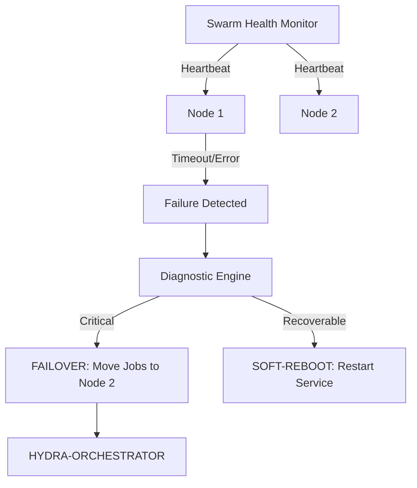

<p align="center">
  
</p>

# 💊 HYDRA-UMC-NODE-HEALING

<p align="center"><a href="README.md">🇺🇸 English</a> | <a href="README_spa.md">🇪🇸 Español</a> | <a href="README_fra.md">🇫🇷 Français</a> | <a href="README_ita.md">🇮🇹 Italiano</a> | <a href="README_deu.md">🇩🇪 Deutsch</a> | <a href="README_zho.md">🇨🇳 简体中文</a> | 🇯🇵 <b>日本語</b> | <a href="README_por.md">🇵🇹 Português</a></p>

### 🛡️ HydraNode 向け高可用性モニター & フェイルオーバーマネージャー

<p align="center">
  
  
  
</p>

---

**正直な現状確認 - 今日実際に動くもの:** ポーリング/分類ループ(`src/watchdog/watchdog.go`)、制限付きリトライポリシー(`src/watchdog/retry.go`)、HYDRA-UMC-ORCHESTRATOR への本物の復旧リクエスト配線(`src/watchdog/orchestrator_reactor.go`)、そして静的ノードレジストリのローダー(`src/config/config.go`)はすべて本物であり、テスト済みである(`src/config` と `src/watchdog` 全体で 78 件のテストが成功) - これらはモック化されたクライアントではなく、本物のループバックソケット上での本物の gRPC 往復通信である。既知かつ文書化されているギャップ: ノードレジストリは静的な JSON ファイル(`nodes.json`)であり、HYDRA-UMC-SWARM-SYNC へのライブクエリではない。なぜならそのプロジェクト自体にも、まだ問い合わせ可能な本物の API が存在しないからである - これは動的であるふりをしたプレースホルダーではなく、正直な v0 である。障害の発生したノードから実際に進行中のミッション作業をリルーティングすることも、このリポジトリの役割ではない - `OrchestratorReactor` を通じて復旧を要求するところで止まっており、その先の層(実際にジョブを移動させること)は別の場所にある。ロードマップの 4 つのフェーズ(デジタルツイン同期、Isaac Sim 物理統合、自動化された復旧パターン、AI 駆動の予測的自己修復)は、今のところ裏付けとなるコードが一切ない、将来に向けた願望である。これまでに何が実際に出荷されたかは `CHANGELOG.md` を参照。

---

> **安全性とセキュリティの現状:** このエコシステムは認証された安全システムではありません。ハードウェアの E-STOP 経路、ファームウェアが強制する制限やインターロック、検証済みの動作コマンドはまだありません。ファームウェアイメージは CRC32 と共有鍵の HMAC-SHA256 で検査しており、非対称署名ではありません。TLS と相互 TLS は任意で、既定では無効です。独自基板はまだ実装も試験もされていません。ここに書かれた内容を人の安全のために頼る前に、[セキュリティベースライン](https://github.com/JuanenRac/HYDRA-UMC-DOCS/blob/main/docs/SECURITY_BASELINE.md)と[脅威モデル](https://github.com/JuanenRac/HYDRA-UMC-DOCS/blob/main/docs/THREAT_MODEL.md)をお読みください。

## 📋 ひと目で

| | |
|---|---|
| バージョン | `0.1.9` |
| 成熟度 | 機能する |
| テスト | 98 |
| 技術 | Go / gRPC health checks / HTTP health probes |
| 対象 | HYDRA-UMC セルの Raspberry Pi CM5 |
| 実機での確認 | まだです：このバージョンについて実機での動作記録はありません |

## 🚦 プロジェクトの状況

各行はこのリポジトリの一部分で、信号は今日どこまで進んでいるかを示します。計画ではなく、リポジトリが示せるもの（テスト、ビルド、実行）に基づいて書かれています。

🟢 完了・検証済み · 🟡 動作する（既知の制限あり） · 🟠 一部のみ、または未検証 · 🔴 未実装または動作しない

| 領域 | 状態 | ここでの意味 |
|---|---|---|
| ソフトウェア | 🟡 | 主な目的では動作します。足りない点は上の正直さの確認に書かれています |
| テスト | 🟢 | 自動テスト 98 件。変更のたびに実行されます |
| 実機 | 🔴 | まだです：このバージョンについて実機での動作記録はありません |
| ドキュメント | 🟢 | 8 言語の README。変更のたびにマニフェストと照合されます |

## 1. 🛠️ 技術概要

**HYDRA-UMC-NODE-HEALING** は、スウォームのレジリエンス層です。すべての
物理的な HydraNode（コントローラー）と論理サービスの健全性を継続的に
監視し、マイクロファクトリーにおけるダウンタイムをゼロに保ちます。

ハードウェアの故障やネットワーク障害によりノードが機能しなくなった場合、
自己修復マネージャーは自動的にフェイルオーバープロセスをトリガーし、
そのアクティブなミッションを他のノードにリダイレクトし、オーケストレー
ター経由でオペレーターに通知します。

### 主な機能：
* 💓 **ヘルスハートビート：** 各ノードを 5 秒ごとにポーリング（gRPC HealthService または HTTP ヘルス URL）し、HEALTHY、DEGRADED、UNHEALTHY、UNREACHABLE、INVALID、MISCONFIGURED に分類します。温度データは読み取りません。 各ノードは個別にポーリングされます。応答が遅い、または応答しないノード(そのポーリングは間隔より長くかかることがあります)が他のノードを遅らせたりポーリングを溜め込んだりすることはなく、実行中のポーリングが終わるまで次のティックはスキップされます。
* 🔄 **保護付きフェイルオーバー：** ダウンしたままのノードのミッションを再キューするようオーケストレーターに依頼します（確認待ち、起動猶予、ノードごとのクールダウン、全体の予算）。`dispatchNode` を指定したレジストリ項目のみが対象です。
* 🛡️ **ソフトリブート：** *（計画中）* 現在のウォッチドッグは何も再起動しません。報告と、オーケストレーターへの再キュー依頼のみです。
* 📡 **オペレーター通知：** *（計画中）* 現在はすべての遷移がジャーナルにのみ出力されます。
* 🔁 **上限付きリトライ + 検証済みノード識別情報（v0、実装済み）：** 一時的なネットワーク障害が発生しても、最初の失敗だけでノードが `UNREACHABLE` になることはもうありません——`checkNode` は決定的で上限のある指数バックオフでリトライしてから諦めます。応答はするが自身を正しく識別できないノードは `INVALID` に分類され、決して信頼されず、リトライもされず、健全と報告されることもありません。
* 📓 **永続ジャーナル(v0、実装済み):** `-journal パス` を指定すると、すべての状態遷移、復旧要求、保留された要求が JSON 行としても書き込まれ、各行は前の行の SHA-256 で連鎖し、サイズでローテーションされます(`-journal-max-bytes`、`-journal-backups`)。再起動後もノードが再起動された理由の記録が残ります。`-journal-verify` で連鎖を検査します。既定ではオフで、書き込めない行は報告されますがウォッチドッグを止めることはありません。 systemd ユニットは記録を無効にして起動します。有効にするには `/etc/hydra-umc-node-healing/journal.env` に `HYDRA_UMC_NODE_HEALING_JOURNAL_ARGS=--journal /var/lib/hydra-umc-node-healing/journal.jsonl` を書きます(OS インストーラーの `--journal` オプションが書き込みます)。記録やプローブの詳細に入るものはすべて、共有の機密マスキングを通ります。 `hydra-umc-node-healing -nodes-from-ports パス/contracts/ports.yaml` は、エコシステムのサービス登録簿(ヘルスパスを持つ各サービスを HTTP で監視)からノード登録簿を作って出力し、除外したサービスを一覧表示します。`nodes.json` を手で書く必要はありません。
* 📈 **監視役を監視する(v0、実装済み):** `-listen HOST:PORT` を付けると `GET /health`(生存確認:バージョン、稼働時間、ノード数。名前は含まない)と `GET /metrics`(Prometheus:各ノードの状態、最終確認、所要時間、確認回数、遷移回数、復旧要求数)を提供します。ループバック以外のアドレスには `-status-token`(または `STATUS_TOKEN`)が必要で、`/metrics` で要求されます。`kill -HUP` でレジストリを再読込し(検証に通らないものは拒否され、ノードはそのまま。残るノードは状態を保ちます)、`-check-config` はレジストリを検証して終了します。正常なノードはポーリング間で保持される 1 本の gRPC 接続で確認されます。代用品とローカルサーバーに対してテスト済みで、実際の機器群には未実施です。

---

## 2. 🔄 自己修復ワークフロー



---

## 3. 🧱 アーキテクチャと設計上の決定

* **実際のロジックがリポジトリのルートではなく `src/` の下にある理由。** `src/healthpb`(生成された gRPC スタブ)、`src/watchdog`(ポーリングエンジン)、`src/config`(ノードレジストリのローダー)が実際の実装を保持しています。`main.go`/`version.go` はそれらを結びつけるエントリポイントとしてリポジトリのルートに残ります。
* **検知機能が、それが保護しているオーケストレーターから独立している理由。** オーケストレータープロセスの*内部*で実行されるノード自己修復ウォッチドッグは、そのプロセス自体がハングしたことを検知できません——独立したサービスとして実行することで、「応答しないノードを検知しその作業を再ルーティングする」ことが、応答しないノードがオーケストレーター自身である場合も含めて、実際に可能になります。
* **検知機能と実際のフェイルオーバーの両方が、今はもう本物として接続されています。** `src/watchdog` は、登録済みの各ノードに対して実際の間隔・実際のネットワーク接続で `HealthService.Check()`(`HYDRA-UMC-ORCHESTRATOR/proto/hydra_common.proto` の共有 `hydra.common.v1` gRPC 契約)を呼び出し、結果を HEALTHY/DEGRADED/UNHEALTHY/UNREACHABLE のいずれかに分類し、状態が実際に*変化した*ときにのみ `Reactor` コールバックを発火します(毎ポーリング周期ではありません)。`OrchestratorReactor`(`src/watchdog/orchestrator_reactor.go`)は本番で実際に使われている `Reactor` の実装で、ノードが不健全な状態に遷移するたびに HYDRA-UMC-ORCHESTRATOR 自身の `POST /nodes/:node/recover` を呼び出し、検知結果を記録するだけでなく実際の復旧アクションを要求します。
* **ノードレジストリが HYDRA-UMC-SWARM-SYNC へのライブクエリではなく静的な JSON である理由。** SWARM-SYNC(README がもともと「群れの全セル」の情報源として挙げていたもの)にも実際の API はまだありません——依然として足場(アンダミアヘ)段階です。静的な `nodes.json`(`nodes.example.json` を参照)は、動的であるふりをするプレースホルダーではなく、正直な v0 です。SWARM-SYNC プロジェクトに実際のクライアントができ次第、`src/config.LoadNodes` を置き換えてください。
* 🩺 **実在するサービスを HTTP で監視し、トークンを送ります（v0）：** `nodes.json` のエントリは gRPC の `address` の代わりに `healthUrl`（`http://…` または `https://…`）を持てます。ウォッチドッグは `GET` を 1 回送り、応答を分類します — `2xx` は正常（JSON の `status` が `degraded`/`unhealthy` ならそれに従い、レジストリ名と異なる JSON の `name` は `INVALID`）、`5xx` は異常、応答なしは `UNREACHABLE`（再試行されます）、リダイレクトや `4xx` は `INVALID`（誤った URL や認証情報の不足はノードの故障ではなく設定の問題なので再試行されず、リダイレクトも決して追従しません）。これまでは、エコシステムのどのサービスも実装していない gRPC の `HealthService` で全ノードを監視していたため、完全に正常なサービスが `UNREACHABLE` と報告されていました。オーケストレーターへの復旧要求は、`-orchestrator-token` / `ORCHESTRATOR_TOKEN` が設定されていれば `Authorization: Bearer` を付けて送られ（ネットワークアドレス上のオーケストレーターは、そうでなければ拒否します）、ノード名は 1 つのパスセグメントとしてエスケープされます。*（実装済み）*
* **エコシステムの他の部分との関係。** HYDRA-UMC-ORCHESTRATOR の下の兄弟サービスです——自身のレジストリ内の各ノードを監視し、状態変化を報告し、いずれかが不健全になると `OrchestratorReactor` を通じて実際の復旧を要求するようになりました。実際に進行中の作業をそのノードから再ルーティングする機能は、この上に構築される次の層です。
* **トランスポート障害はリトライされる（上限付きで）が、識別情報の不一致は決してリトライされない理由。** 接続拒否や RPC タイムアウトは、再起動中のノードや一時的なネットワークの不調のような、本当に一過性の障害であることがあります——そのため `checkNode` は諦める前に `RetryPolicy.MaxAttempts` 回まで指数バックオフでリトライします。応答はするが誤った名前(またはまったく名前がない)を報告するノードはまったく別種の問題です——どれだけ待っても間違ったポートに束縛されたサービスは直りません。そのためこのケースは即座に、一切リトライすることなく `StatusInvalid` に分類されます。
* **バックオフにランダムなジッターがない理由。** 実際の本番フリートであれば、同時再接続の「サンダリングハード」を避けるためにジッターが欲しくなるでしょうが、このウォッチドッグはすでに各ノードを独自の goroutine から独自のペースでポーリングしています——ここでジッターを追加すると唯一犠牲になるのは `RetryPolicy.Backoff()` が非決定的になり、テストでの検証が難しくなることです。このウォッチドッグがいつか共有のボトルネックリソースに対して数百のノードをポーリングするようになったら、ジッターを追加してください。

詳細は [`docs/ARCHITECTURE.md`](docs/ARCHITECTURE.md)(アーキテクチャガイド)、[`docs/BUILD_AND_RUN.md`](docs/BUILD_AND_RUN.md)(リリースビルドとテストビルドの流れ)、[`docs/INTEGRATION_CONTRACT.md`](docs/INTEGRATION_CONTRACT.md)(将来のアダプターが従うべきバージョン管理されたヘルススナップショット契約)を参照してください。

---

## 📂 リポジトリ構成

```text
HYDRA-UMC-NODE-HEALING/
├── src/
│   ├── healthpb/      # hydra.common.v1 向けに生成された Go スタブ
│   │                  # (HYDRA-UMC-ORCHESTRATOR/proto/hydra_common.proto
│   │                  # から取得——生成コマンドは同リポジトリの
│   │                  # proto/README.md を参照)
│   ├── watchdog/      # 実際のポーリングループ：dial、Check()、分類、
│   │                  # 状態変化時のみ反応、および retry.go
│   │                  # (RetryPolicy)
│   ├── redact/        # テキストや JSON 風の値に含まれる既知の秘密情報の形を隠す (SDK 共通の伏せ字処理の移植、テストベクタ付き)
│   └── config/        # 静的 JSON ノードレジストリのローダー
├── build/             # コンパイル済みバイナリ(build.sh/build.bat の出力)
├── images/            # メディアと図版
├── systemd/
│   └── hydra-umc-node-healing.service # CM5 上のローカルウォッチドッグ用 systemd ユニット
├── tools/
│   ├── build_test.py  # バージョンを増やさないビルドチェック
│   ├── ci_validate.py # CI が使用するマニフェスト/CHANGELOG/ドキュメント検証
│   ├── _doc_policy.py # ファミリー共通のドキュメント規則 (HYDRA-UMC-SDK のコピーで、同期を維持)
│   ├── _readme_parity.py # 8つの README が同じ構造であることの検査 (HYDRA-UMC-SDK のコピーで、同期を維持)
│   └── hydra_project_tool.py # すべてのリポジトリで共通のコマンド: validate、test、ci、version、status、bump
├── nodes.example.json # サンプルノードレジストリ(src/config を参照)
├── go.mod / go.sum    # Go モジュール定義
├── version.go         # const Version = "X.Y.Z"(go.mod にはアプリバージョンフィールドがありません)
├── main.go            # エントリポイント：レジストリを読み込みウォッチドッグを起動
├── main_test.go       # オペレーターと同じようにビルド済みバイナリを実行 (-check-config、開放されたステータスエンドポイントの拒否)
├── bump_version.py    # オドメーター式バージョンインクリメント（明示的な `bump` コマンドのみが実行）
├── bump_manifest_version.py # hydra-umc.project.json のバージョンをネイティブ側と同期（--sync）
├── build.sh/.bat      # バージョンを増加させ、その後 `go build` を実行
├── build-test.sh/.bat # バージョンを増やさないビルドチェック
├── run.sh/.bat        # コンパイル済みバイナリを実行
├── docs/
│   ├── ARCHITECTURE.md
│   ├── BUILD_AND_RUN.md
│   └── INTEGRATION_CONTRACT.md
└── README.md
```

元のテンプレートから省略：`hardware/`、`firmware/`、`os/`、`scripts/` —— これは純粋なソフトウェアサービス（Go バイナリ）であり、専用のハードウェアやファームウェアはなく、維持すべきオペレーティングシステムイメージもなく、独立したフォルダーを正当化するだけのユーティリティスクリプトもまだありません。

---

## 🔧 ビルドと実行

コンパイルできるだけの骨組みではなく、本物のウォッチドッグです：
`nodes.example.json`（または独自のレジストリを指す `-nodes <パス>`）
に列挙された各ノードに（HTTP のヘルス URL で、`address` を持つ項目は gRPC で）接続し、状態変化を標準出力に報告します。

```bash
# Windows
build.bat
run.bat -nodes nodes.example.json

# Linux / macOS
./build.sh
./run.sh -nodes nodes.example.json
```

`build.sh`/`build.bat` はバージョンを変更せず（上げるのは `python tools/hydra_project_tool.py bump` だけです）、その後 `go build` を実行します。
`run.sh`/`run.bat` は生成されたバイナリを直接実行します。

レジストリの各エントリは、その `address` で実際に待ち受け、
`hydra.common.v1.HealthService`（`HYDRA-UMC-ORCHESTRATOR/proto/
hydra_common.proto` 参照）を実装する本物のサービスを必要とします——
サンプルのポートではまだ何も稼働していないため、最初のポーリング
周期では3つとも `UNKNOWN -> UNREACHABLE` と表示されるのが予想されます
（現在は `RetryPolicy` の上限付き試行がすべて尽きた後にのみそうなり、
最初の dial では判定されません——上記の「上限付きリトライ」機能を
参照）。これは今日時点で正しく誠実な結果です（このリポジトリ自身の
検知ロジックを除けば、エコシステムのすべてのノードはまだ足場段階に
あります）。応答はするが自身を正しく識別できないノードは、代わりに
即座に `UNKNOWN -> INVALID` と表示されます。

```bash
go test ./...   # src/config + src/watchdog、実際のループバック
                 # ソケット上での本物の gRPC 往復テスト、モッククライアント不使用
```

---

## 🚀 ロードマップ
* **フェーズ 1：** (完了、`-journal`)すべての状態遷移と復旧要求の、永続的でハッシュ連鎖した JSON Lines ジャーナル。残り:オーケストレーターの応答を構造化フィールドとして記録すること。
* **フェーズ 2：** より高速なプローブ：ノードごとに1つのループと永続的な gRPC 接続、HTTP プローブのエントリごとのヘッダー。
* **フェーズ 3：** 独自の可観測性（メトリクスのエンドポイント）と、再起動なしでのノードレジストリの再読み込み。
* **フェーズ 4：** 本物の HYDRA-UMC-SERVER に対する契約テストと、同時に1つの修復役だけが動くためのリース。

---

## 🔗 関連プロジェクト

本プロジェクトは、同じ作者(JuanenRac / Electro Hobby 3D)による HYDRA-UMC ロボティクスエコシステムの一部です。リクエストが実はこの中のどれかについてのものである可能性があるため、知っておく価値があります。

**親プロジェクト**
- **[HYDRA-UMC-ORCHESTRATOR](https://github.com/JuanenRac/HYDRA-UMC-ORCHESTRATOR)** — 実際の gRPC/Protobuf ヘルスレポート契約とミッションステートマシンを持つ統合ハブ。本リポジトリは、その自身のスウォーム調整レイヤー内における特定のオーケストレーションサービスとして、この親の一部を成す。

**兄弟プロジェクト** —— HYDRA-UMC-ORCHESTRATOR 自身のスウォーム調整レイヤーにおける他のオーケストレーションサービス
- **[HYDRA-UMC-SWARM-SYNC](https://github.com/JuanenRac/HYDRA-UMC-SWARM-SYNC)** — 複数セルの収束についてプロパティテストされた、実際の CRDT LWW-Element-Map 状態同期。
- **[HYDRA-UMC-PATH-PLANNER-3D](https://github.com/JuanenRac/HYDRA-UMC-PATH-PLANNER-3D)** — 実際の障害物/ワークスペース衝突検証を備えた、実際の RRT ベースの 3D 経路プランナー。
- **[HYDRA-UMC-JOB-DISPATCHER](https://github.com/JuanenRac/HYDRA-UMC-JOB-DISPATCHER)** — 実際の HTTP API 上に構築された、優先度ベースの実際のジョブキュー(重複排除付き)。

**直接関連**
- **[HYDRA-UMC-SERVER](https://github.com/JuanenRac/HYDRA-UMC-SERVER)** — すべての制御クライアントが実際に通信する、本物のヘッドレスバックエンド(REST/WebSocket) ——本ヒーリングサービスは、レジストリの他のノードと同じようにそのヘルスエンドポイントを監視できます（サンプルのレジストリが監視するのは ORCHESTRATOR、VOICE-UI、DATALAKE、ANOMALY-DETECTOR、COGNITIVE-NODE で、サーバーではありません）。

**エコシステムの他のプロジェクト**

*コアハードウェア&プラットフォーム*
- **[HYDRA-UMC](https://github.com/JuanenRac/HYDRA-UMC)** — ロボットアームのマザーボードの設計——CM5 ホスト + デュアルコア STM32H745、CAN-OTA/SPI-OTA 経由で最大 8 本のツールアームを統括することを目指す(ファームウェアは初期段階で、実装済みの基板はまだない)。
- **[HYDRA-UMC-OS](https://github.com/JuanenRac/HYDRA-UMC-OS)** — CM5 向けの再現可能な Raspberry Pi OS プロダクト層——読み取り専用エージェント、検証済み設定/プロファイル、WiFi 初回接続プロビジョニング。
- **[HYDRA-UMC-SDK](https://github.com/JuanenRac/HYDRA-UMC-SDK)** — すべてのブリッジが自身のコマンドを検証する共有 JSON-Schema 契約とソフトウェアのジョブゲート境界(認証済みの安全機能ではない)。
- **[HYDRA-UMC-CONNECTOR-HUB](https://github.com/JuanenRac/HYDRA-UMC-CONNECTOR-HUB)** — 外部マシン用コネクタのための宣言的アダプターマニフェストのレジストリとバリデーター。SDK 自身の契約という発想を外部マシンにまで拡張し、産業用ゲートウェイ系のプロジェクトを置き換えることはありません。

*コアバックエンド&クライアント*
- **[HYDRA-UMC-STUDIO](https://github.com/JuanenRac/HYDRA-UMC-STUDIO)** — リアルタイムのマルチロボット 3D 可視化を備えたウェブ制御ダッシュボード。
- **[HYDRA-UMC-SUITE](https://github.com/JuanenRac/HYDRA-UMC-SUITE)** — 複数のサーバーを同時に扱えるデスクトップ(PySide6)スウォームコマンドセンター、スタンドアロン実行ファイルとしてパッケージ化。
- **[HYDRA-UMC-ANDROID-CONTROL](https://github.com/JuanenRac/HYDRA-UMC-ANDROID-CONTROL)** — 生体認証ログインとペアリングされた Wear OS コンパニオンを備えたネイティブ Android 制御アプリ。
- **[HYDRA-UMC-IOS-CONTROL](https://github.com/JuanenRac/HYDRA-UMC-IOS-CONTROL)** — リアルタイム WebSocket 同期を備えた iOS/iPadOS 制御アプリ(Flutter)。
- **[HYDRA-UMC-DSI](https://github.com/JuanenRac/HYDRA-UMC-DSI)** — 本体搭載の 7 インチ DSI タッチスクリーン向けネイティブタッチ UI、CM5 自体に組み込み。
- **[HYDRA-UMC-EDITOR-URDF](https://github.com/JuanenRac/HYDRA-UMC-EDITOR-URDF)** — 完成したモデルを STUDIO 自身のカタログへ送信するデスクトップ用グラフィカル URDF 作成/編集ツール。
- **[HYDRA-UMC-EDITOR-STL](https://github.com/JuanenRac/HYDRA-UMC-EDITOR-STL)** — HYDRA-UMC-EDITOR-URDF も編集する同じモデルカタログ内で、実在するパーツを変換/置換/削除/追加するデスクトップ STL モデルエディタ。
- **[HYDRA-UMC-BRIDGE-AMR](https://github.com/JuanenRac/HYDRA-UMC-BRIDGE-AMR)** — VDA 5050 MQTT パブリッシャーによる AGV/AMR フリートの調整境界(エミュレートしたフリートに対してのみテスト済み)。
- **[HYDRA-UMC-BRIDGE-CNC](https://github.com/JuanenRac/HYDRA-UMC-BRIDGE-CNC)** — GRBL ステータス/制御バイトへのアクセスを持つ、CNC セルの高レベルコーディネーター(エミュレーターに対してのみテスト済み)。
- **[HYDRA-UMC-BRIDGE-DROIDS](https://github.com/JuanenRac/HYDRA-UMC-BRIDGE-DROIDS)** — Boston Dynamics Spot コマンド送信機能を持つ、脚型/ヒューマノイドドロイドの調整境界(エミュレーターに対してのみテスト済み)。
- **[HYDRA-UMC-BRIDGE-LASER](https://github.com/JuanenRac/HYDRA-UMC-BRIDGE-LASER)** — キー/筐体/インターロックの GPIO 信号 3 系統を読み取るレーザーセルのコーディネーター(模擬チップに対してのみテスト済み。レーザーの武装や発射はできない)。
- **[HYDRA-UMC-BRIDGE-OPENPNP](https://github.com/JuanenRac/HYDRA-UMC-BRIDGE-OPENPNP)** — OpenPnP ピックアンドプレースの基板フローを安全に統括する高レベルコーディネーター。
- **[HYDRA-UMC-BRIDGE-PRINTER3D](https://github.com/JuanenRac/HYDRA-UMC-BRIDGE-PRINTER3D)** — 実際にゲート制御されたジョブコマンドを持つ、Moonraker/Klipper 3D プリンター向けの安全な調整境界。
- **[HYDRA-UMC-BRIDGE-ROS2](https://github.com/JuanenRac/HYDRA-UMC-BRIDGE-ROS2)** — 遅延インポートの rclpy ROS 2 トランスポートを持つコーディネーター(ROS 2 環境ではまだ実行していない)。
- **[HYDRA-UMC-BRIDGE-UAV](https://github.com/JuanenRac/HYDRA-UMC-BRIDGE-UAV)** — MAVLink コマンド送信機能を持つ、カメラ搭載 UAV の調整境界(エミュレーターに対してのみテスト済み)。

*URTC ツールプラットフォーム*
- **[URTC](https://github.com/JuanenRac/URTC)** — 物理的な Universal Robot Tool Controller 基板向けファームウェア、CAN バス経由の 25 以上のツールプロファイル。
- **[URTC-FLASHER](https://github.com/JuanenRac/URTC-FLASHER)** — URTC 基板用のデスクトップ GUI 書き込みツール、CAN-OTA およびフルチップ SWD/JTAG。
- **[URTC-TESTER](https://github.com/JuanenRac/URTC-TESTER)** — URTC 基板向けのデスクトップ CAN バスライブ診断ツール、ツールプロファイルごとに 1 パネル。
- **[URTC-WEB-STUDIO](https://github.com/JuanenRac/URTC-WEB-STUDIO)** — Web Serial API を使ったブラウザベースの URTC-TESTER の代替、ローカルインストール不要。
- **[URTC-GATEWAY](https://github.com/JuanenRac/URTC-GATEWAY)** — URTC の CAN バスの前に置くゲートウェイ：許可する識別子のリスト、レート制限、セッション鍵。コンピューター上でテスト済みで、実際のバスではまだ試していません。

*ビジョン AI ノード(Hailo-8)*
- **[HYDRA-UMC-VISION-NODE](https://github.com/JuanenRac/HYDRA-UMC-VISION-NODE)** — Hailo-8 ビジョンパイプラインの統合ハブ、段階ごとの実際のハードウェア準備状況チェック付き。
- **[HYDRA-UMC-DETECTION-HEF](https://github.com/JuanenRac/HYDRA-UMC-DETECTION-HEF)** — Hailo アーキテクチャ/チェックサムによる安全読み込み検証を備えた、実際のコンパイル済みモデルレジストリ。
- **[HYDRA-UMC-VISION-STREAMER](https://github.com/JuanenRac/HYDRA-UMC-VISION-STREAMER)** — 実際の HailoRT 統合境界を持つ、実際の GStreamer パイプライン + MediaMTX 設定生成器。
- **[HYDRA-UMC-VISUAL-SERVOING-API](https://github.com/JuanenRac/HYDRA-UMC-VISUAL-SERVOING-API)** — ゾーン状態を条件に承認する Position-Based Visual Servoing 補正則。カメラによる姿勢推定はまだない。
- **[HYDRA-UMC-SAFETY-ZONES](https://github.com/JuanenRac/HYDRA-UMC-SAFETY-ZONES)** — ファイルから物体位置を受け取る、ゾーン侵入・キャリブレーション鮮度・E-STOP 要求の v0 ロジック。検出器は接続されておらず、物理 E-STOP もまだ配線されていない。

*コグニティブ AI ノード(Hailo-10)*
- **[HYDRA-UMC-COGNITIVE-NODE](https://github.com/JuanenRac/HYDRA-UMC-COGNITIVE-NODE)** — Hailo-10 コグニティブパイプライン(LLM/VLA/音声オーケストレーション)の統合ハブ。
- **[HYDRA-UMC-VLA-ENGINE](https://github.com/JuanenRac/HYDRA-UMC-VLA-ENGINE)** — Vision-Language-Action モデル向けの、実際のアクショントークンのエンコード/デコードと軌道生成。
- **[HYDRA-UMC-VOICE-UI](https://github.com/JuanenRac/HYDRA-UMC-VOICE-UI)** — 確認ゲート付きの限定的な Watch リレーを備えた、実際の音声フロントエンド(VAD + 意図解析)。
- **[HYDRA-UMC-SEMANTIC-PLANNER](https://github.com/JuanenRac/HYDRA-UMC-SEMANTIC-PLANNER)** — MCU エラーコードに対する、実際のルールベースのタスク分解と意味的エラー復旧。
- **[HYDRA-UMC-DOCS-QA](https://github.com/JuanenRac/HYDRA-UMC-DOCS-QA)** — このエコシステム自身の Markdown ドキュメントに対する、標準ライブラリのみの実際の TF-IDF 文書検索。
- **[HYDRA-UMC-LOCAL-TECHNICIAN](https://github.com/JuanenRac/HYDRA-UMC-LOCAL-TECHNICIAN)** — エコシステム自身のための、ローカルでポリシーゲート付きのAIメンテナンス技術者 — 観察、診断し、修正を提案する;最上位の2つのリスクレベルは意図的にまだ実装されていない。

*デジタルツイン&シミュレーション*
- **[HYDRA-UMC-TWIN](https://github.com/JuanenRac/HYDRA-UMC-TWIN)** — 実際のバージョン互換性同期契約を持つ、デジタルツインエンジンの統合ハブ。
- **[HYDRA-UMC-HIL-BRIDGE](https://github.com/JuanenRac/HYDRA-UMC-HIL-BRIDGE)** — シミュレーションと実機の間にソフトウェアの衝突インターロックを備えたハードウェア・イン・ザ・ループのルーター(実機なしでテスト済み)。
- **[HYDRA-UMC-PHYSICS-REPLICA](https://github.com/JuanenRac/HYDRA-UMC-PHYSICS-REPLICA)** — 実際の URDF サブセットに対する、実際の順運動学と関節限界検証。
- **[HYDRA-UMC-SYNTHETIC-DATA-GEN](https://github.com/JuanenRac/HYDRA-UMC-SYNTHETIC-DATA-GEN)** — YOLO/COCO アノテーションのエクスポート機能を持つ、実際のプロシージャル 2D シーンジェネレーター。

*データ&分析*
- **[HYDRA-UMC-DATALAKE](https://github.com/JuanenRac/HYDRA-UMC-DATALAKE)** — 実際の取り込み/クエリ HTTP API を備えた、実際の sqlite3 ベースの時系列ストア。
- **[HYDRA-UMC-ANOMALY-DETECTOR](https://github.com/JuanenRac/HYDRA-UMC-ANOMALY-DETECTOR)** — ドリフト監視を備えた、実際の FFT + 統計ベースラインによる異常検知器。
- **[HYDRA-UMC-PRODUCTION-REPORTS](https://github.com/JuanenRac/HYDRA-UMC-PRODUCTION-REPORTS)** — DATALAKE の履歴に対する実際の OEE/稼働率計算、再現可能な CSV エクスポート付き。
- **[HYDRA-UMC-TELEMETRY-COLLECTOR](https://github.com/JuanenRac/HYDRA-UMC-TELEMETRY-COLLECTOR)** — シーケンス重複排除機能を備えた、DATALAKE への実際の CAN/WebSocket 取り込みパイプライン。

*産業用ゲートウェイ*
- **[HYDRA-UMC-GATEWAY-INDUSTRIAL](https://github.com/JuanenRac/HYDRA-UMC-GATEWAY-INDUSTRIAL)** — 実際のコマンド許可リスト/バックプレッシャー層を持つ、産業用プロトコルへ中継する統合ハブ。
- **[HYDRA-UMC-OPCUA-SERVER](https://github.com/JuanenRac/HYDRA-UMC-OPCUA-SERVER)** — 実際のバイナリプロトコルクライアントセッションで検証された、実際の OPC-UA アドレス空間。
- **[HYDRA-UMC-MQTT-BROKER](https://github.com/JuanenRac/HYDRA-UMC-MQTT-BROKER)** — クライアント単位のオプション認証とトピック ACL を備えた、実際の MQTT ブローカー。
- **[HYDRA-UMC-MTCONNECT-ADAPTER](https://github.com/JuanenRac/HYDRA-UMC-MTCONNECT-ADAPTER)** — 縮退モード出力を備えた、実際の MTConnect `/probe` および `/current` XML エンドポイント。

*補完ツール&エコシステム運用*
- **[HYDRA-UMC-DASHBOARD-AI](https://github.com/JuanenRac/HYDRA-UMC-DASHBOARD-AI)** — 誠実な統計フォールバックを備えた、DATALAKE/ANOMALY-DETECTOR 上のスマートサマリーと異常ハイライトパネル。
- **[HYDRA-UMC-TOOL-CLI](https://github.com/JuanenRac/HYDRA-UMC-TOOL-CLI)** — 実際の安定した終了コード契約を持つフリート CLI、HYDRA-UMC-SERVER 自身の API の本物のライブクライアント。
- **[HYDRA-UMC-WATCH](https://github.com/JuanenRac/HYDRA-UMC-WATCH)** — 触覚アラートのパターンとペアリング済みスマートフォンへの音声リレーを備えた WearOS コンパニオンアプリ(物理的なウォッチではまだ実行していない)。
- **[URTC-SMART-RACK](https://github.com/JuanenRac/URTC-SMART-RACK)** — 実際の工具 ID デコードと Smart Idle 予熱ロジックを備えた、基板搭載ラック用ファームウェア。
- **[URTC-VISION-TOOL](https://github.com/JuanenRac/URTC-VISION-TOOL)** — サーマル/RGB 検査ツールヘッド向けの、ファームウェアと実際の Python ビジョンコンパニオン。
- **[HYDRA-UMC-UPDATER](https://github.com/JuanenRac/HYDRA-UMC-UPDATER)** — このエコシステム内のすべてのリポジトリを検出・クローン・更新する、管理用デスクトップツール。
- **[HYDRA-UMC-OS-REBUILDER](https://github.com/JuanenRac/HYDRA-UMC-OS-REBUILDER)** — エコシステムの最新バージョンをプリロードした、書き込み可能なCM5イメージを構築するWindows/Linuxデスクトップツール。Raspberry Pi Imager方式の初回起動Wi-Fi/ユーザー/SSH設定を備える。
- **[HYDRA-UMC-OPS-AGENT](https://github.com/JuanenRac/HYDRA-UMC-OPS-AGENT)** — 保守インシデントコーディネーター: 低権限のエッジ役割がサニタイズされたインベントリ/ヘルスのスナップショットを収集し、コントロールプレーン役割がそれを読み取り専用でレンダリングして AI プロバイダーに診断の提案を依頼します - パッチを適用することも、何かをデプロイすることも決してありません。
- **[HYDRA-UMC-DEV-SERVER](https://github.com/JuanenRac/HYDRA-UMC-DEV-SERVER)** — 再現可能な開発ホスト（Raspberry Pi 5 / CM5）。エコシステムのソースコードを保管し、永続キューのもとで境界の明確なビルド/テストタスクを実行する。運用中の CM5 とは明確に異なる、開発専用の役割。


---

## 📚 ドキュメント & コミュニティ

- **[CONTRIBUTING.md](CONTRIBUTING.md)** —— プルリクエストのための技術スタックとコーディング指針。
- **[CODE_OF_CONDUCT.md](CODE_OF_CONDUCT.md)** —— このコミュニティで期待される行動規範。
- **[SECURITY.md](SECURITY.md)** —— 脆弱性の報告方法と、このプロジェクトの実際のセキュリティ重点領域。
- **[SUPPORT.md](SUPPORT.md)** —— 質問の投稿先とバグの報告先。
- **[LICENSE.md](LICENSE.md)** —— このプロジェクト自身のライセンス。

## 👤 作者
**JuanenRac** (Electro Hobby 3D)
📧 electrohobby3d@gmail.com
📺 [youtube.com/@electrohobby3d](https://youtube.com/@electrohobby3d)

## 📜 ライセンス
GPL-3.0-or-later —— 詳細は LICENSE を参照してください。
