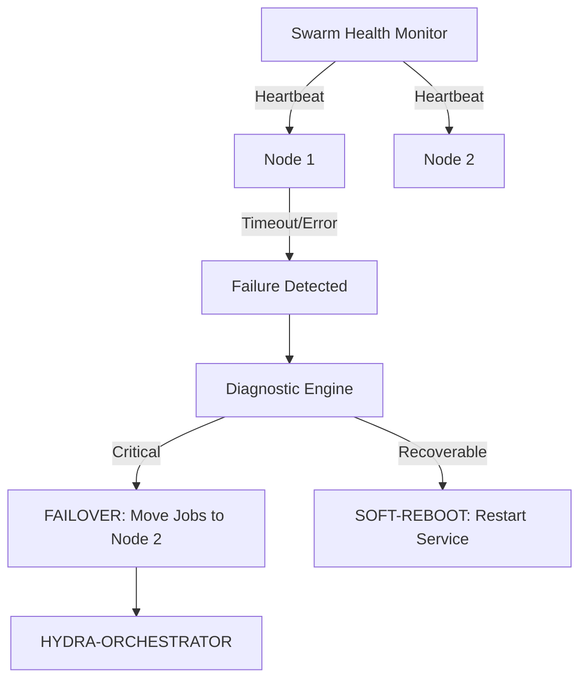

<p align="center">
  
</p>

# 💊 HYDRA-UMC-NODE-HEALING

<p align="center"><a href="README.md">🇺🇸 English</a> | <a href="README_spa.md">🇪🇸 Español</a> | <a href="README_fra.md">🇫🇷 Français</a> | <a href="README_ita.md">🇮🇹 Italiano</a> | <a href="README_deu.md">🇩🇪 Deutsch</a> | <a href="README_zho.md">🇨🇳 简体中文</a> | <a href="README_jpn.md">🇯🇵 日本語</a> | 🇵🇹 <b>Português</b></p>

### 🛡️ Monitor de alta disponibilidade e gestor de failover para HydraNodes

<p align="center">
  
  
  
</p>

---

**Verificação de honestidade - o que realmente funciona hoje:** o ciclo de sondagem/classificação (`src/watchdog/watchdog.go`), a política de repetição limitada (`src/watchdog/retry.go`), a ligação real do pedido de recuperação ao HYDRA-UMC-ORCHESTRATOR (`src/watchdog/orchestrator_reactor.go`) e o carregador estático do registo de nós (`src/config/config.go`) são todos reais e testados (78 testes a passar em `src/config` e `src/watchdog`) - e são idas e voltas gRPC reais sobre sockets loopback reais, não um cliente simulado. Uma lacuna conhecida e documentada: o registo de nós é um ficheiro JSON estático (`nodes.json`), não uma consulta em direto ao HYDRA-UMC-SWARM-SYNC, porque esse projeto também ainda não tem uma API real para consultar - esta é a v0 honesta, não um marcador de posição a fingir ser dinâmico. Redirecionar o trabalho de missão em curso para longe de um nó avariado também não é tarefa deste repositório - pede a recuperação através do `OrchestratorReactor` e fica por aí; a camada seguinte (mover de facto os trabalhos) vive noutro sítio. As 4 fases do roteiro (sincronização do gémeo digital, integração da física do Isaac Sim, padrões de recuperação automatizada, cura preditiva guiada por IA) são trabalho futuro aspiracional, ainda sem código por trás. Consulte o `CHANGELOG.md` para saber exatamente o que já foi entregue.

---

> **Estado de segurança (safety e security):** este ecossistema não é um sistema de segurança certificado. Ainda não existe um caminho de E-STOP por hardware, nem limites ou interlocks impostos pelo firmware, nem um comando de movimento verificado; as imagens de firmware são verificadas com CRC32 e um HMAC-SHA256 de chave partilhada, não com uma assinatura assimétrica; TLS e TLS mútuo são opcionais e estão desativados por defeito; nenhuma placa própria foi ainda montada ou testada. Leia a [base de segurança](https://github.com/JuanenRac/HYDRA-UMC-DOCS/blob/main/docs/SECURITY_BASELINE.md) e o [modelo de ameaças](https://github.com/JuanenRac/HYDRA-UMC-DOCS/blob/main/docs/THREAT_MODEL.md) antes de confiar em qualquer afirmação aqui para a segurança de uma pessoa.

## 📋 Num relance

| | |
|---|---|
| Versão | `0.1.8` |
| Maturidade | Funcional |
| Testes | 98 |
| Tecnologia | Go / gRPC health checks / HTTP health probes |
| Destino | O Raspberry Pi CM5 de uma célula HYDRA-UMC |
| Em hardware real | Ainda não: não há registo de execução em hardware real para esta versão |

## 1. 🛠️ VISÃO TÉCNICA GERAL

O **HYDRA-UMC-NODE-HEALING** é a camada de resiliência do enxame. Monitoriza continuamente a saúde de todos os HydraNodes físicos (controladores) e dos serviços lógicos, garantindo tempo de inatividade zero na microfábrica.

Se um nó falhar por avaria de hardware ou falha de rede, o Healing Manager aciona automaticamente um processo de failover, redirecionando as suas missões ativas para outros nós e notificando o operador através do Orchestrator.

### Funcionalidades principais:
* 💓 **Batimento de saúde:** cada nó é consultado a cada 5 segundos (HealthService gRPC ou URL de saúde HTTP) e classificado como HEALTHY, DEGRADED, UNHEALTHY, UNREACHABLE, INVALID ou MISCONFIGURED; não são lidos dados térmicos. Cada nó é consultado por si: um nó que responde devagar ou não responde (a sua consulta pode durar mais do que o intervalo) não atrasa os outros nem acumula consultas; o seu próximo tique é saltado até a consulta em curso terminar.
* 🔄 **Failover com salvaguardas:** pede ao orquestrador que volte a pôr em fila as missões de um nó que CONTINUA em baixo (espera de confirmação, tolerância no arranque, pausa por nó e orçamento global), apenas para entradas do registo que indiquem o seu `dispatchNode`.
* 🛡️ **Reinício suave:** *(planeado)* hoje o watchdog não reinicia nada; apenas reporta e pede ao orquestrador que volte a pôr em fila.
* 📡 **Alertas ao operador:** *(planeado)* hoje cada transição vai apenas para o journal.
* 🔁 **Repetição limitada + identidade de nó verificada (v0, real):** uma falha de rede transitória deixa de passar o nó para `UNREACHABLE` à primeira falha - o `checkNode` repete com um backoff exponencial determinístico e limitado antes de desistir; um nó que responde mas não consegue identificar-se corretamente é classificado como `INVALID` e nunca é considerado de confiança, repetido nem dado como saudável.
* 📓 **Diário persistente (v0, real):** com `-journal CAMINHO` cada transição, pedido de recuperação e pedido retido é também escrito como uma linha JSON, encadeada à anterior pelo seu SHA-256 e rodada por tamanho (`-journal-max-bytes`, `-journal-backups`); depois de um reinício fica registo do motivo pelo qual um nó foi reiniciado. `-journal-verify` verifica a cadeia. Desativado por predefinição; uma linha que não possa ser escrita é comunicada e nunca pára o vigilante. A unidade systemd arranca com o registo desativado; ativa-se pondo `HYDRA_UMC_NODE_HEALING_JOURNAL_ARGS=--journal /var/lib/hydra-umc-node-healing/journal.jsonl` em `/etc/hydra-umc-node-healing/journal.env` (a opção `--journal` do instalador do OS escreve-o). Tudo o que chega ao registo ou ao detalhe de uma sonda passa pela redação de segredos partilhada. `hydra-umc-node-healing -nodes-from-ports CAMINHO/contracts/ports.yaml` imprime um registo de nós construído a partir do registo de serviços do ecossistema (cada serviço com caminho de saúde, sondado por HTTP) e lista os serviços que deixou de fora, para que o `nodes.json` não tenha de ser escrito à mão.
* 📈 **Vigiar o vigilante (v0, real):** com `-listen ANFITRIÃO:PORTA` serve `GET /health` (vivo: versão, tempo em execução, quantos nós; sem nomes) e `GET /metrics` (Prometheus: o estado de cada nó, última verificação, duração, verificações, transições e pedidos de recuperação). Um endereço que não seja loopback exige `-status-token` (ou `STATUS_TOKEN`), pedido em `/metrics`. `kill -HUP` volta a ler o registo (um que não valida é recusado e os nós ficam como estavam; um nó que permanece conserva o seu estado) e `-check-config` valida um registo e termina. Um nó saudável é sondado por uma ligação gRPC mantida entre sondagens. Testado contra simulacros e um servidor local; nunca contra a frota real.

---

## 2. 🔄 FLUXO DE CURA



---

## 3. 🧱 ARQUITETURA E DECISÕES DE DESIGN

* **Porque é que a lógica real vive em `src/` e não na raiz do repositório.** `src/healthpb` (stubs gRPC gerados), `src/watchdog` (o motor de sondagem) e `src/config` (o carregador do registo de nós) contêm a implementação real; `main.go`/`version.go` ficam na raiz como o ponto de entrada que os liga.
* **Porque é que a deteção está separada do orquestrador que protege.** Um watchdog de cura de nós que corresse DENTRO do processo do orquestrador não conseguiria detetar que esse mesmo processo ficou bloqueado - correr como serviço independente é o que torna realmente possível «detetar um nó que não responde e redirecionar o seu trabalho», incluindo quando o nó que não responde é o próprio orquestrador.
* **Deteção E failover real estão ambos ligados agora.** `src/watchdog` sonda o `HealthService.Check()` de cada nó registado (o contrato gRPC partilhado `hydra.common.v1` de `HYDRA-UMC-ORCHESTRATOR/proto/hydra_common.proto`) a um intervalo real, sobre uma ligação de rede real, classifica HEALTHY/DEGRADED/UNHEALTHY/UNREACHABLE e dispara um callback `Reactor` em cada *mudança* de estado (nunca a cada tick). O `OrchestratorReactor` (`src/watchdog/orchestrator_reactor.go`) é a implementação real de `Reactor` usada em produção: chama o `POST /nodes/:node/recover` do próprio HYDRA-UMC-ORCHESTRATOR numa transição para um estado não saudável, pedindo uma ação de recuperação real em vez de apenas registar a deteção.
* **Porque é que o registo de nós é um ficheiro JSON estático e não uma consulta em direto ao HYDRA-UMC-SWARM-SYNC.** O SWARM-SYNC (a fonte de verdade que o README original indicava para «cada célula do enxame») também ainda não tem uma API real - continua em fase de andaime. Um `nodes.json` estático (ver `nodes.example.json`) é a v0 honesta, não um marcador de posição a fingir ser dinâmico. Substitua `src/config.LoadNodes` por um cliente real do SWARM-SYNC assim que esse projeto tiver algo para chamar.
* 🩺 **Sonda por HTTP os serviços que existem e envia o seu token (v0):** uma entrada de `nodes.json` pode levar um `healthUrl` (`http://…` ou `https://…`) em vez de um `address` gRPC: o watchdog envia um `GET` e classifica a resposta — `2xx` saudável (respeita-se um `status` JSON `degraded`/`unhealthy`, e um `name` JSON diferente do nome do registo é `INVALID`), `5xx` não saudável, sem resposta `UNREACHABLE` (é repetido), um redirecionamento ou um `4xx` `INVALID` (um URL errado ou uma credencial em falta é configuração, não uma falha do nó, pelo que nunca é repetido, e os redirecionamentos nunca são seguidos). Até agora cada nó era sondado através de um `HealthService` gRPC que nenhum serviço do ecossistema implementa, pelo que um serviço perfeitamente saudável era reportado como `UNREACHABLE`. O pedido de recuperação ao orquestrador leva `Authorization: Bearer` quando `-orchestrator-token` / `ORCHESTRATOR_TOKEN` está definido (um orquestrador num endereço de rede recusa-o caso contrário), e o nome do nó é escapado como um único segmento de caminho. *(implementado)*
* **Como isto se encaixa no resto do ecossistema.** Um serviço irmão sob o HYDRA-UMC-ORCHESTRATOR - vigia todos os nós do seu registo, reporta as mudanças de estado e agora pede uma recuperação real através do `OrchestratorReactor` quando um deles deixa de estar saudável; redirecionar o trabalho em curso para longe desse nó é a camada seguinte, acima deste serviço.
* **Porque é que uma falha de transporte é repetida (de forma limitada) mas uma identidade que não coincide nunca é.** Uma ligação recusada ou um timeout de RPC pode ser uma falha genuinamente transitória - um nó a meio de um reinício, um soluço breve da rede - pelo que o `checkNode` repete-a até `RetryPolicy.MaxAttempts` vezes com backoff exponencial antes de desistir. Um nó que responde mas dá o nome errado (ou nenhum) é um tipo de problema completamente diferente: nenhuma espera corrige um serviço ligado à porta errada, por isso esse caso é classificado de imediato como `StatusInvalid`, sem qualquer repetição.
* **Porque é que o backoff não tem jitter aleatório.** Uma frota de produção real quereria jitter para evitar uma debandada de religações simultâneas, mas este watchdog já sonda cada nó a partir da sua própria goroutine ao seu próprio ritmo - o único custo do jitter aqui seria tornar o `RetryPolicy.Backoff()` não determinístico e mais difícil de verificar nos testes. Acrescente jitter se e quando este watchdog alguma vez sondar centenas de nós contra um recurso partilhado que seja gargalo.

Para o quadro completo, consulte o [`docs/ARCHITECTURE.md`](docs/ARCHITECTURE.md) para o guia de arquitetura, o [`docs/BUILD_AND_RUN.md`](docs/BUILD_AND_RUN.md) para o fluxo de compilação de lançamento versus teste e o [`docs/INTEGRATION_CONTRACT.md`](docs/INTEGRATION_CONTRACT.md) para o contrato versionado de instantâneo de saúde que um futuro adaptador tem de respeitar.

---

## 📂 ESTRUTURA DE DIRETORIAS

```text
HYDRA-UMC-NODE-HEALING/
├── src/
│   ├── healthpb/      # Stubs Go gerados para hydra.common.v1
│   │                  # (copiados de HYDRA-UMC-ORCHESTRATOR/proto/
│   │                  # hydra_common.proto - ver o proto/README.md desse
│   │                  # repositório para o comando de geração)
│   ├── watchdog/      # Ciclo de sondagem real: ligar, Check(), classificar,
│   │                  # reagir só quando o estado muda, mais retry.go
│   │                  # (RetryPolicy) e a sonda HTTP
│   └── config/        # Carregador do registo de nós em JSON estático
├── build/             # Binários compilados (saída de build.sh/build.bat)
├── images/            # Multimédia e diagramas
├── systemd/
│   └── hydra-umc-node-healing.service # Unidade systemd do watchdog local da CM5
├── tools/
│   ├── build_test.py  # Verificação de compilação sem alterar versões
│   └── ci_validate.py # Validação de manifesto/CHANGELOG/docs usada pelo CI
├── nodes.example.json # Registo de nós de exemplo (ver src/config)
├── go.mod / go.sum    # Definição do módulo Go
├── version.go         # const Version = "X.Y.Z" (o go.mod não tem campo de versão da aplicação)
├── main.go            # Ponto de entrada: carrega o registo, executa o watchdog
├── bump_version.py    # Subida de versão ao estilo conta-quilómetros (executada só pelo comando `bump` explícito)
├── bump_manifest_version.py # Sincroniza a versão do hydra-umc.project.json com a nativa (--sync)
├── build.sh/.bat      # Valida e compila (compilar nunca altera a versão)
├── build-test.sh/.bat # Verificação de compilação sem subir versão (sem CHANGELOG/versão)
├── run.sh/.bat        # Executa o binário compilado
├── docs/
│   ├── ARCHITECTURE.md
│   ├── BUILD_AND_RUN.md
│   └── INTEGRATION_CONTRACT.md
└── README.md
```

Retirado do modelo original: `hardware/`, `firmware/`, `os/` e `scripts/` — este é um serviço puramente de software (binário Go), sem hardware nem firmware dedicados, sem imagem de sistema operativo para manter e sem conteúdo de scripts utilitários que justifique ainda uma pasta própria.

---

## 🔧 GUIA DE COMPILAÇÃO E EXECUÇÃO

Um watchdog real, não apenas um esqueleto que compila: liga-se a cada nó de `nodes.example.json` (ou de `-nodes <caminho>` para apontar ao seu próprio registo) (por URL de saúde HTTP ou, se a entrada tiver `address`, por gRPC) e reporta as mudanças de estado no stdout.

```bash
# Windows
build.bat
run.bat -nodes nodes.example.json

# Linux / macOS
./build.sh
./run.sh -nodes nodes.example.json
```

`build.sh`/`build.bat` nunca altera a versão (só `python tools/hydra_project_tool.py bump` a sobe) e depois executa `go build`. O `run.sh`/`run.bat` executa diretamente o binário resultante.

Uma entrada com `healthUrl` (`http://…`, a forma de vigiar os serviços deste ecossistema) precisa de que esse URL responda `2xx`; uma entrada com `address` precisa de algo real a escutar aí e a implementar o `hydra.common.v1.HealthService` (ver `HYDRA-UMC-ORCHESTRATOR/proto/hydra_common.proto`) para alguma vez reportar saúde - com nada ainda a correr em nenhuma das portas de exemplo, espere que cada nó imprima `UNKNOWN -> UNREACHABLE` no primeiro tick (agora só depois de o `RetryPolicy` esgotar as suas tentativas limitadas, não à primeira ligação - ver a funcionalidade «Repetição limitada» acima), que é o resultado correto e honesto hoje (todos os nós deste ecossistema continuam em fase de andaime para lá da lógica de deteção deste repositório). Um nó que responde mas não consegue identificar-se corretamente imprime antes `UNKNOWN -> INVALID`, de imediato.

```bash
go test ./...   # src/config + src/watchdog, idas e voltas gRPC reais
                 # sobre sockets loopback reais, sem cliente simulado
```

---

## 🚀 ROTEIRO
* **Fase 1:** (feito, `-journal`) Um diário persistente em JSON por linhas, encadeado por hash, de cada transição e pedido de recuperação. Falta: as respostas do orquestrador como campos estruturados.
* **Fase 2:** Um sondeio mais rápido: um ciclo por nó com ligações gRPC persistentes e cabeçalhos por entrada para o sondeio HTTP.
* **Fase 3:** Observabilidade própria (um endpoint de métricas) e recarga do registo de nós sem reiniciar.
* **Fase 4:** Um teste de contrato contra um HYDRA-UMC-SERVER real e um arrendamento (lease) para que só um reparador aja de cada vez.

---

## 🔗 Projetos relacionados

Este projeto faz parte do ecossistema de robótica HYDRA-UMC do mesmo autor (JuanenRac / Electro Hobby 3D). Vale a pena conhecê-los, porque um pedido pode ser, na verdade, sobre um destes e não sobre este repositório.

**Projeto-mãe**
- **[HYDRA-UMC-ORCHESTRATOR](https://github.com/JuanenRac/HYDRA-UMC-ORCHESTRATOR)** — hub de integração com um contrato real gRPC/Protobuf de relatórios de saúde e uma máquina de estados de missões; o pai de que este repositório é um serviço de orquestração específico, dentro da sua própria camada de coordenação de enxame.

**Projetos irmãos** — os outros serviços de orquestração da própria camada de coordenação de enxame do HYDRA-UMC-ORCHESTRATOR
- **[HYDRA-UMC-SWARM-SYNC](https://github.com/JuanenRac/HYDRA-UMC-SWARM-SYNC)** — sincronização real de estado CRDT LWW-Element-Map, testada por propriedades para a convergência de várias células.
- **[HYDRA-UMC-PATH-PLANNER-3D](https://github.com/JuanenRac/HYDRA-UMC-PATH-PLANNER-3D)** — planeador real de trajetórias 3D baseado em RRT com validação real de colisões com obstáculos e espaço de trabalho.
- **[HYDRA-UMC-JOB-DISPATCHER](https://github.com/JuanenRac/HYDRA-UMC-JOB-DISPATCHER)** — fila real de trabalhos por prioridade com deduplicação, sobre uma API HTTP real.

**Diretamente relacionados**
- **[HYDRA-UMC-SERVER](https://github.com/JuanenRac/HYDRA-UMC-SERVER)** — o back-end headless real (REST/WebSocket) com que todos os clientes de controlo realmente comunicam — este serviço de cura pode vigiar o seu endpoint de saúde como qualquer outro nó do seu registo (o registo de exemplo vigia ORCHESTRATOR, VOICE-UI, DATALAKE, ANOMALY-DETECTOR e COGNITIVE-NODE, não o servidor).

**Também fazem parte do ecossistema**

*Hardware e plataforma centrais*
- **[HYDRA-UMC](https://github.com/JuanenRac/HYDRA-UMC)** — o desenho da placa-mãe do braço robótico: anfitrião CM5 + STM32H745 de dois núcleos, pensado para orquestrar até 8 braços de ferramenta por CAN-OTA/SPI-OTA (firmware numa fase inicial; ainda sem placa montada).
- **[HYDRA-UMC-OS](https://github.com/JuanenRac/HYDRA-UMC-OS)** — camada de produto reproduzível do Raspberry Pi OS para o CM5: agente só de leitura, configuração/perfis validados, aprovisionamento Wi-Fi de primeiro contacto.
- **[HYDRA-UMC-SDK](https://github.com/JuanenRac/HYDRA-UMC-SDK)** — o contrato JSON-Schema partilhado e a fronteira de software de controlo de trabalhos contra a qual cada bridge valida os seus comandos (não é uma função de segurança certificada).
- **[HYDRA-UMC-CONNECTOR-HUB](https://github.com/JuanenRac/HYDRA-UMC-CONNECTOR-HUB)** — registo declarativo de manifestos de adaptador e validador para conectores de máquinas externas; estende a ideia de contrato do SDK a máquinas externas sem substituir os projetos de gateway industrial.

*Backend central e clientes*
- **[HYDRA-UMC-STUDIO](https://github.com/JuanenRac/HYDRA-UMC-STUDIO)** — painel web de controlo com visualização 3D em tempo real de vários robôs.
- **[HYDRA-UMC-SUITE](https://github.com/JuanenRac/HYDRA-UMC-SUITE)** — centro de comando de enxame para desktop (PySide6) para vários servidores ao mesmo tempo, empacotado como executável independente.
- **[HYDRA-UMC-ANDROID-CONTROL](https://github.com/JuanenRac/HYDRA-UMC-ANDROID-CONTROL)** — aplicação Android nativa de controlo, com início de sessão biométrico e um companheiro Wear OS emparelhado.
- **[HYDRA-UMC-IOS-CONTROL](https://github.com/JuanenRac/HYDRA-UMC-IOS-CONTROL)** — aplicação de controlo para iOS/iPadOS (Flutter) com sincronização WebSocket em tempo real.
- **[HYDRA-UMC-DSI](https://github.com/JuanenRac/HYDRA-UMC-DSI)** — interface tátil nativa para o ecrã tátil DSI de 7" integrado, executada no próprio CM5.
- **[HYDRA-UMC-EDITOR-URDF](https://github.com/JuanenRac/HYDRA-UMC-EDITOR-URDF)** — criador/editor gráfico de URDF para desktop que envia os modelos concluídos para o catálogo do STUDIO.
- **[HYDRA-UMC-EDITOR-STL](https://github.com/JuanenRac/HYDRA-UMC-EDITOR-STL)** — editor de modelos STL para desktop que transforma/substitui/remove/adiciona peças reais no mesmo catálogo de modelos que o HYDRA-UMC-EDITOR-URDF também edita.
- **[HYDRA-UMC-BRIDGE-AMR](https://github.com/JuanenRac/HYDRA-UMC-BRIDGE-AMR)** — fronteira de coordenação para frotas AGV/AMR através de um publicador MQTT VDA 5050 (testado apenas contra uma frota emulada).
- **[HYDRA-UMC-BRIDGE-CNC](https://github.com/JuanenRac/HYDRA-UMC-BRIDGE-CNC)** — coordenador de células CNC de alto nível com acesso ao estado GRBL e aos bytes de controlo (testado apenas contra um emulador).
- **[HYDRA-UMC-BRIDGE-DROIDS](https://github.com/JuanenRac/HYDRA-UMC-BRIDGE-DROIDS)** — fronteira de coordenação para droides com patas/humanoides, com um emissor de comandos para o Boston Dynamics Spot (testado apenas contra um emulador).
- **[HYDRA-UMC-BRIDGE-LASER](https://github.com/JuanenRac/HYDRA-UMC-BRIDGE-LASER)** — coordenador de células laser que lê 3 sinais GPIO (chave, caixa e interlock) (testado apenas contra um chip simulado; não pode armar nem disparar um laser).
- **[HYDRA-UMC-BRIDGE-OPENPNP](https://github.com/JuanenRac/HYDRA-UMC-BRIDGE-OPENPNP)** — coordenador seguro de fluxo de placa de alto nível para pick-and-place com OpenPnP.
- **[HYDRA-UMC-BRIDGE-PRINTER3D](https://github.com/JuanenRac/HYDRA-UMC-BRIDGE-PRINTER3D)** — fronteira de coordenação segura para impressoras 3D Moonraker/Klipper, com comandos de trabalho reais protegidos por portas.
- **[HYDRA-UMC-BRIDGE-ROS2](https://github.com/JuanenRac/HYDRA-UMC-BRIDGE-ROS2)** — coordenador com um transporte ROS 2 baseado em rclpy importado sob demanda (ainda não executado contra uma instalação ROS 2).
- **[HYDRA-UMC-BRIDGE-UAV](https://github.com/JuanenRac/HYDRA-UMC-BRIDGE-UAV)** — fronteira de coordenação para UAV com câmara, com um emissor de comandos MAVLink (testado apenas contra um emulador).

*Plataforma de ferramentas URTC*
- **[URTC](https://github.com/JuanenRac/URTC)** — firmware da placa física Universal Robot Tool Controller, mais de 25 perfis de ferramenta por barramento CAN.
- **[URTC-FLASHER](https://github.com/JuanenRac/URTC-FLASHER)** — ferramenta gráfica de gravação para desktop das placas URTC, por CAN-OTA e também SWD/JTAG de chip completo.
- **[URTC-TESTER](https://github.com/JuanenRac/URTC-TESTER)** — ferramenta de diagnóstico CAN em tempo real para desktop das placas URTC, com um painel por perfil de ferramenta.
- **[URTC-WEB-STUDIO](https://github.com/JuanenRac/URTC-WEB-STUDIO)** — alternativa no navegador ao URTC-TESTER através da Web Serial API, sem instalação local.
- **[URTC-GATEWAY](https://github.com/JuanenRac/URTC-GATEWAY)** — gateway à frente do barramento CAN do URTC: lista de identificadores permitidos, limite de taxa e chave de sessão; software testado num computador, ainda não num barramento real.

*Nó de IA de visão (Hailo-8)*
- **[HYDRA-UMC-VISION-NODE](https://github.com/JuanenRac/HYDRA-UMC-VISION-NODE)** — centro de integração do pipeline de visão Hailo-8, com uma verificação real de prontidão de hardware por fase.
- **[HYDRA-UMC-DETECTION-HEF](https://github.com/JuanenRac/HYDRA-UMC-DETECTION-HEF)** — registo real de modelos compilados com verificação segura de carga por arquitetura Hailo e soma de verificação.
- **[HYDRA-UMC-VISION-STREAMER](https://github.com/JuanenRac/HYDRA-UMC-VISION-STREAMER)** — pipeline GStreamer real e gerador de configuração MediaMTX com uma fronteira de integração HailoRT real.
- **[HYDRA-UMC-VISUAL-SERVOING-API](https://github.com/JuanenRac/HYDRA-UMC-VISUAL-SERVOING-API)** — lei de correção de servovisão baseada em posição com autorização condicionada ao estado da zona; ainda sem estimativa de pose por câmara.
- **[HYDRA-UMC-SAFETY-ZONES](https://github.com/JuanenRac/HYDRA-UMC-SAFETY-ZONES)** — lógica v0 de violação de zonas, atualidade da calibração e pedido de E-STOP que lê as posições dos objetos de um ficheiro; nenhum detetor a alimenta e ainda não há E-STOP físico ligado.

*Nó de IA cognitiva (Hailo-10)*
- **[HYDRA-UMC-COGNITIVE-NODE](https://github.com/JuanenRac/HYDRA-UMC-COGNITIVE-NODE)** — centro de integração do pipeline cognitivo do Hailo-10 (orquestração de LLM/VLA/voz).
- **[HYDRA-UMC-VLA-ENGINE](https://github.com/JuanenRac/HYDRA-UMC-VLA-ENGINE)** — codificação/descodificação real de tokens de ação e geração de trajetórias para um modelo Visão-Linguagem-Ação.
- **[HYDRA-UMC-VOICE-UI](https://github.com/JuanenRac/HYDRA-UMC-VOICE-UI)** — front-end de voz real (VAD + analisador de intenções) com um relé para o relógio limitado e protegido por confirmação.
- **[HYDRA-UMC-SEMANTIC-PLANNER](https://github.com/JuanenRac/HYDRA-UMC-SEMANTIC-PLANNER)** — decomposição real de tarefas baseada em regras e recuperação semântica de erros sobre os códigos de erro do MCU.
- **[HYDRA-UMC-DOCS-QA](https://github.com/JuanenRac/HYDRA-UMC-DOCS-QA)** — pesquisa real de documentos TF-IDF só com a biblioteca padrão sobre a documentação Markdown deste ecossistema.
- **[HYDRA-UMC-LOCAL-TECHNICIAN](https://github.com/JuanenRac/HYDRA-UMC-LOCAL-TECHNICIAN)** — técnico de manutenção de IA local, protegido por políticas, para o próprio ecossistema: observa, diagnostica e propõe correções; os dois níveis de maior risco não estão implementados de propósito.

*Gémeo digital e simulação*
- **[HYDRA-UMC-TWIN](https://github.com/JuanenRac/HYDRA-UMC-TWIN)** — centro de integração do motor de gémeo digital, com um contrato real de sincronização de compatibilidade de versões.
- **[HYDRA-UMC-HIL-BRIDGE](https://github.com/JuanenRac/HYDRA-UMC-HIL-BRIDGE)** — encaminhador hardware-in-the-loop com um interlock de software de colisão entre a simulação e o hardware real (testado sem hardware real).
- **[HYDRA-UMC-PHYSICS-REPLICA](https://github.com/JuanenRac/HYDRA-UMC-PHYSICS-REPLICA)** — cinemática direta real e validação de limites de juntas sobre um subconjunto real de URDF.
- **[HYDRA-UMC-SYNTHETIC-DATA-GEN](https://github.com/JuanenRac/HYDRA-UMC-SYNTHETIC-DATA-GEN)** — gerador procedural real de cenas 2D com exportação de anotações YOLO/COCO.

*Dados e análise*
- **[HYDRA-UMC-DATALAKE](https://github.com/JuanenRac/HYDRA-UMC-DATALAKE)** — armazém real de séries temporais sobre sqlite3 com uma API HTTP real de ingestão/consulta.
- **[HYDRA-UMC-ANOMALY-DETECTOR](https://github.com/JuanenRac/HYDRA-UMC-ANOMALY-DETECTOR)** — detetor real de anomalias por FFT e linha de base estatística, com monitorização de deriva.
- **[HYDRA-UMC-PRODUCTION-REPORTS](https://github.com/JuanenRac/HYDRA-UMC-PRODUCTION-REPORTS)** — cálculo real de OEE/disponibilidade sobre o histórico do DATALAKE, com exportação CSV reprodutível.
- **[HYDRA-UMC-TELEMETRY-COLLECTOR](https://github.com/JuanenRac/HYDRA-UMC-TELEMETRY-COLLECTOR)** — pipeline real de ingestão CAN/WebSocket para o DATALAKE, com deduplicação por sequência.

*Gateway industrial*
- **[HYDRA-UMC-GATEWAY-INDUSTRIAL](https://github.com/JuanenRac/HYDRA-UMC-GATEWAY-INDUSTRIAL)** — centro de integração que retransmite para protocolos industriais, com uma camada real de lista de comandos permitidos e contrapressão.
- **[HYDRA-UMC-OPCUA-SERVER](https://github.com/JuanenRac/HYDRA-UMC-OPCUA-SERVER)** — espaço de endereços OPC-UA real, verificado com uma sessão de cliente real do protocolo binário.
- **[HYDRA-UMC-MQTT-BROKER](https://github.com/JuanenRac/HYDRA-UMC-MQTT-BROKER)** — broker MQTT real com autenticação opcional por cliente e ACL de tópicos.
- **[HYDRA-UMC-MTCONNECT-ADAPTER](https://github.com/JuanenRac/HYDRA-UMC-MTCONNECT-ADAPTER)** — endpoints XML MTConnect `/probe` e `/current` reais com saída em modo degradado.

*Ferramentas complementares e operações do ecossistema*
- **[HYDRA-UMC-DASHBOARD-AI](https://github.com/JuanenRac/HYDRA-UMC-DASHBOARD-AI)** — painéis de Resumos Inteligentes e Realce de Anomalias sobre o DATALAKE/ANOMALY-DETECTOR, com um recurso estatístico honesto.
- **[HYDRA-UMC-TOOL-CLI](https://github.com/JuanenRac/HYDRA-UMC-TOOL-CLI)** — CLI da frota com um contrato de códigos de saída real e estável, um cliente vivo genuíno da API do HYDRA-UMC-SERVER.
- **[HYDRA-UMC-WATCH](https://github.com/JuanenRac/HYDRA-UMC-WATCH)** — aplicação companheira WearOS com padrões de alerta tátil e um relé de voz para o telemóvel emparelhado (ainda não executada num relógio físico).
- **[URTC-SMART-RACK](https://github.com/JuanenRac/URTC-SMART-RACK)** — firmware de um rack de montagem de placas com descodificação real do ID da ferramenta e lógica de pré-aquecimento Smart Idle.
- **[URTC-VISION-TOOL](https://github.com/JuanenRac/URTC-VISION-TOOL)** — firmware mais um companheiro de visão em Python real para uma cabeça de ferramenta de inspeção térmica/RGB.
- **[HYDRA-UMC-UPDATER](https://github.com/JuanenRac/HYDRA-UMC-UPDATER)** — ferramenta administrativa de desktop que descobre, clona e atualiza todos os repositórios deste ecossistema.
- **[HYDRA-UMC-OS-REBUILDER](https://github.com/JuanenRac/HYDRA-UMC-OS-REBUILDER)** — ferramenta de desktop para Windows/Linux que constrói uma imagem do CM5 pronta a gravar com as versões mais recentes do ecossistema, com configuração de primeiro arranque de Wi-Fi/utilizador/SSH ao estilo do Raspberry Pi Imager.
- **[HYDRA-UMC-OPS-AGENT](https://github.com/JuanenRac/HYDRA-UMC-OPS-AGENT)** — coordenador de incidentes de manutenção: um papel de borda de poucos privilégios recolhe um inventário/estado higienizado, um papel de plano de controlo mostra-o só de leitura e pede a um fornecedor de IA que sugira um diagnóstico; nunca aplica um patch nem implanta nada.
- **[HYDRA-UMC-DEV-SERVER](https://github.com/JuanenRac/HYDRA-UMC-DEV-SERVER)** — anfitrião de desenvolvimento reproduzível (Raspberry Pi 5 / CM5) que guarda o código-fonte do ecossistema e executa tarefas limitadas de compilação/teste numa fila durável; um papel de desenvolvimento dedicado, explicitamente não um CM5 operacional.

---

## 📚 Documentação e comunidade

- **[CONTRIBUTING.md](CONTRIBUTING.md)** — pilha tecnológica e diretrizes de código para um pull request.
- **[CODE_OF_CONDUCT.md](CODE_OF_CONDUCT.md)** — as normas de comportamento esperadas nesta comunidade.
- **[SECURITY.md](SECURITY.md)** — como comunicar uma vulnerabilidade e as áreas de segurança em que este projeto se concentra.
- **[SUPPORT.md](SUPPORT.md)** — onde fazer perguntas e comunicar erros.
- **[LICENSE.md](LICENSE.md)** — a licença deste projeto.

## 👤 AUTOR
**JuanenRac** (Electro Hobby 3D)
📧 electrohobby3d@gmail.com
📺 [youtube.com/@electrohobby3d](https://youtube.com/@electrohobby3d)

## 📜 LICENÇA
GPL-3.0-or-later - consulte LICENSE para mais detalhes.

