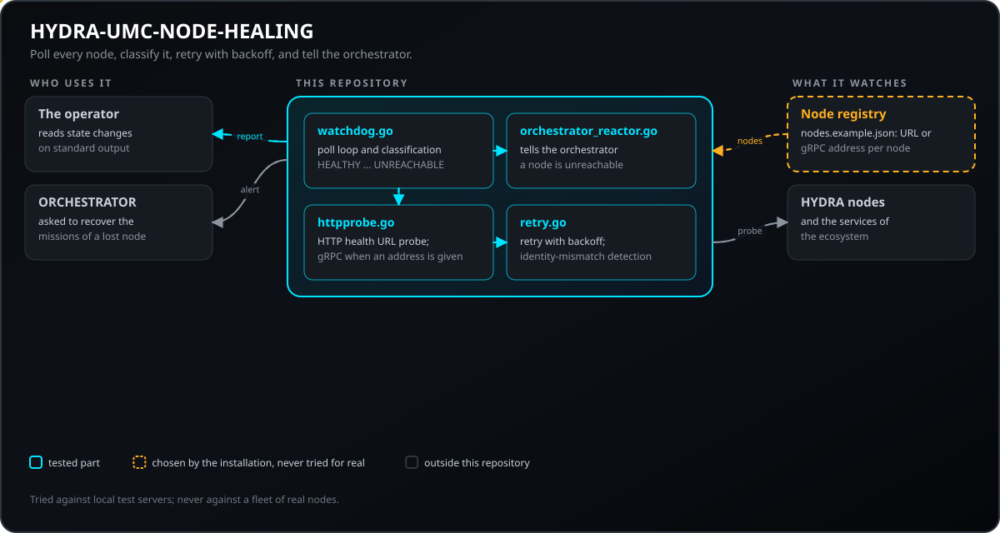
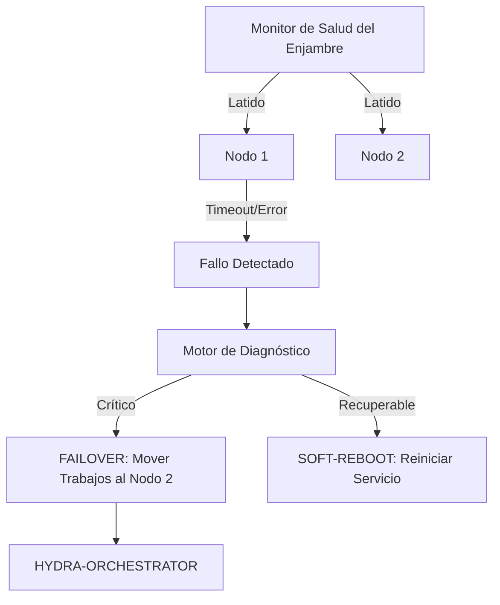
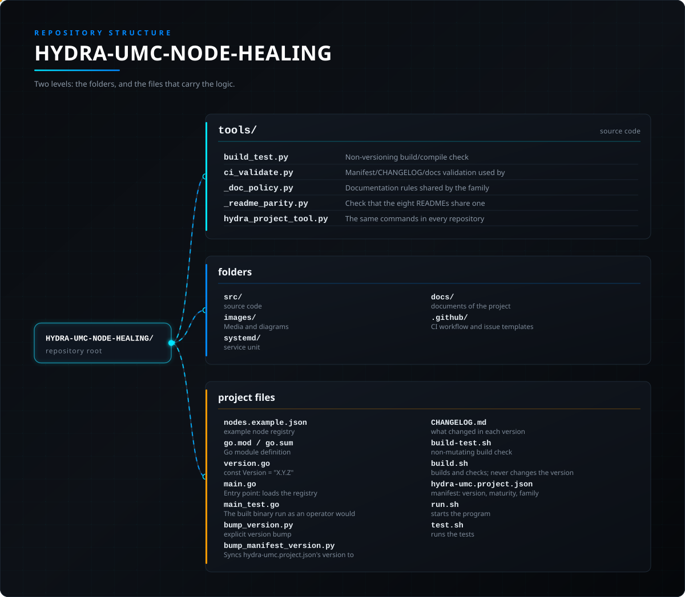

<!-- =============================================================================
HYDRA-UMC-NODE-HEALING - Fleet health watchdog
Copyright (C) JuanenRac (Electro Hobby 3D) <electrohobby3d@gmail.com>
GPL-3.0-or-later - see LICENSE
============================================================================= -->

<p align="center">
  
</p>

# 💊 HYDRA-UMC-NODE-HEALING

<p align="center"><a href="README.md">🇺🇸 English</a> | 🇪🇸 <b>Español</b> | <a href="README_fra.md">🇫🇷 Français</a> | <a href="README_ita.md">🇮🇹 Italiano</a> | <a href="README_deu.md">🇩🇪 Deutsch</a> | <a href="README_zho.md">🇨🇳 简体中文</a> | <a href="README_jpn.md">🇯🇵 日本語</a> | <a href="README_por.md">🇵🇹 Português</a></p>

### 🛡️ Monitor de Alta Disponibilidad y Gestor de Failover para HydraNodes

<p align="center">
  
  
  
  
  
  
</p>

---

**Comprobación de honestidad - qué funciona realmente hoy:** el bucle de sondeo/clasificación (`src/watchdog/watchdog.go`), la política de reintento acotado (`src/watchdog/retry.go`), el cableado real de solicitud de recuperación a HYDRA-UMC-ORCHESTRATOR (`src/watchdog/orchestrator_reactor.go`), y el cargador estático del registro de nodos (`src/config/config.go`) son todos reales y están testeados (115 tests pasando entre `src/config` y `src/watchdog`) - y son round-trips gRPC reales sobre sockets loopback reales, no un cliente simulado. Lo que es una brecha conocida y documentada: el registro de nodos es un archivo JSON estático (`nodes.json`), no una consulta en vivo a HYDRA-UMC-SWARM-SYNC, porque ese proyecto tampoco tiene todavía una API real que consultar - esta es la v0 honesta, no un placeholder que finge ser dinámico. Redirigir el trabajo de misión en curso lejos de un nodo caído tampoco es tarea de este repositorio - solicita recuperación a través de `OrchestratorReactor` y se detiene ahí; la siguiente capa (mover realmente los trabajos) vive en otro lugar. Las 4 fases del roadmap (sincronización de gemelo digital, integración de física Isaac Sim, patrones de recuperación automatizada, curación predictiva basada en IA) son trabajo futuro aspiracional sin ningún código detrás todavía. Ver `CHANGELOG.md` para lo que se ha entregado exactamente hasta ahora.

---

> **Estado de seguridad física y de ciberseguridad:** este ecosistema no es un sistema de seguridad certificado. Todavía no existe una ruta de E-STOP por hardware, ni límites ni enclavamientos aplicados por el firmware, ni un comando de movimiento verificado; las imágenes de firmware se comprueban con CRC-32 y una firma Ed25519, y una compilación de versión rechaza las claves de desarrollo publicadas (los cabezales de herramienta y las placas de expansión detrás del relé siguen con cargadores de URTC, que usan un HMAC-SHA256 de clave compartida en lugar de una firma); TLS y TLS mutuo son opcionales y están desactivados por defecto; aún no se ha poblado ni probado ninguna placa propia. Lee la [línea base de seguridad](https://github.com/JuanenRac/HYDRA-UMC-DOCS/blob/main/docs/SECURITY_BASELINE.md) y el [modelo de amenazas](https://github.com/JuanenRac/HYDRA-UMC-DOCS/blob/main/docs/THREAT_MODEL.md) antes de fiarte de cualquier afirmación de aquí para la seguridad de una persona.

---

## 📋 De un vistazo

| | |
|---|---|
| Versión | `0.1.9` |
| Madurez | Funcional |
| Tests | 115 (`go test ./...`) |
| Tecnología | Go / gRPC health checks / HTTP health probes |
| Destino | La Raspberry Pi CM5 de una celda HYDRA-UMC |
| En hardware real | Todavía no: no consta ninguna ejecución en hardware real para esta versión |

**Ir a:** [Resumen](#-resumen) · [Arquitectura](#-arquitectura) · [Inicio rápido](#-inicio-rápido) · [Pruebas](#-pruebas) · [Estructura del repositorio](#-estructura-del-repositorio) · [Proyectos relacionados](#-proyectos-relacionados)

## 🚦 Estado del proyecto

Cada línea es una parte de este repositorio y la luz dice hasta dónde llega hoy. Se escribe con lo que el repositorio puede demostrar (pruebas, compilaciones, ejecuciones), no con lo previsto.

🟢 Hecho y verificado · 🟡 Funciona, con límites conocidos · 🟠 Hecho a medias o sin verificar · 🔴 Sin hacer o sin funcionar

| Área | Estado | Qué significa aquí |
|---|---|---|
| Software | 🟡 | Funciona para su propósito principal; la comprobación de honestidad de arriba lista lo que aún falta |
| Pruebas | 🟢 | 115 pruebas automáticas, ejecutadas en cada cambio |
| Hardware real | 🔴 | Todavía no: no consta ninguna ejecución en hardware real para esta versión |
| Documentación | 🟢 | README en ocho idiomas, comprobado contra el manifiesto en cada cambio |

## 🎯 Resumen

**HYDRA-UMC-NODE-HEALING** es la capa de resiliencia del enjambre. Monitoriza continuamente la salud de todos los HydraNodes físicos (Controladores) y servicios lógicos, asegurando un tiempo de inactividad cero en la micro-fábrica.

Si un nodo falla debido a un mal funcionamiento del hardware o una caída de la red, el Gestor de Healing activa automáticamente un proceso de failover, redirigiendo sus misiones activas a otros nodos y notificando al operador a través del Orquestador.

### Características Clave:
* 💓 **Latido de Salud (Heartbeat):** cada nodo se sondea cada 5 segundos (HealthService gRPC o URL de salud HTTP) y se clasifica como HEALTHY, DEGRADED, UNHEALTHY, UNREACHABLE, INVALID o MISCONFIGURED; no se lee ningún dato térmico. Cada nodo se sondea por su cuenta: un nodo que responde despacio o no responde (su sondeo puede durar más que el intervalo) ni retrasa a los demás ni acumula sondeos; su siguiente tic se omite hasta que termina el sondeo en curso.
* 🔄 **Failover con Salvaguardas:** pide al Orquestador reencolar las misiones de un nodo que SIGUE caído (espera de confirmación, gracia de arranque, enfriamiento por nodo y presupuesto global), solo para entradas del registro que indiquen su `dispatchNode`.
* 🛡️ **Reinicio Suave:** *(planificado)* hoy el watchdog no reinicia nada; solo informa y pide al Orquestador reencolar.
* 📡 **Alertas al Operador:** *(planificado)* hoy cada transición va solo al journal.
* 🔁 **Reintentos Acotados + Identidad de Nodo Verificada (v0, real):** un fallo de red transitorio ya no marca un nodo como `UNREACHABLE` al primer fallo - `checkNode` reintenta con un backoff exponencial determinista y acotado antes de rendirse; un nodo que responde pero no puede autoidentificarse correctamente se clasifica como `INVALID` y nunca se confía en él, se reintenta, ni se reporta como saludable.
* 📓 **Diario persistente (v0, real):** con `-journal RUTA` cada transición, petición de recuperación y petición retenida se escribe también como una línea JSON, encadenada a la anterior por su SHA-256 y rotada por tamaño (`-journal-max-bytes`, `-journal-backups`), de modo que tras un reinicio queda constancia de por qué se reinició un nodo. `-journal-verify` comprueba la cadena. Desactivado por defecto; una línea que no se puede escribir se informa y nunca detiene al vigilante. La unidad de systemd arranca con el diario desactivado; se activa poniendo `HYDRA_UMC_NODE_HEALING_JOURNAL_ARGS=--journal /var/lib/hydra-umc-node-healing/journal.jsonl` en `/etc/hydra-umc-node-healing/journal.env` (la opción `--journal` del instalador del OS lo escribe). Todo lo que llega al diario o al detalle de una sonda pasa por la redacción de secretos compartida. `hydra-umc-node-healing -nodes-from-ports RUTA/contracts/ports.yaml` imprime un registro de nodos construido a partir del registro de servicios del ecosistema (cada servicio con ruta de salud, sondeado por HTTP) y lista los servicios que tuvo que dejar fuera, de modo que `nodes.json` no hay que escribirlo a mano.
* 📈 **Vigilar al vigilante (v0, real):** con `-listen HOST:PUERTO` sirve `GET /health` (vivo: versión, tiempo en marcha, cuántos nodos; sin nombres) y `GET /metrics` (Prometheus: el estado de cada nodo, última comprobación, duración, comprobaciones, transiciones y peticiones de recuperación). Una dirección que no sea de loopback exige `-status-token` (o `STATUS_TOKEN`), que se pide en `/metrics`. `kill -HUP` vuelve a leer el registro (uno que no valida se rechaza y los nodos siguen como estaban; un nodo que permanece conserva su estado) y `-check-config` valida un registro y sale. Un nodo sano se sondea por una conexión gRPC que se mantiene entre sondeos. Probado con simulacros y un servidor local; nunca contra la flota real.

## 🧩 Papel en HYDRA-UMC

**HYDRA-UMC-NODE-HEALING** es el vigilante de salud de la flota: sondea cada nodo por HTTP o gRPC, lo clasifica y pide a `HYDRA-UMC-ORCHESTRATOR` que recupere sus misiones cuando un nodo desaparece. Vigila e informa; no reinicia hardware.

## 🏛️ Arquitectura

<p align="center">
  
</p>

<details>
<summary>Versión en texto del diagrama (Mermaid)</summary>



</details>

### ARQUITECTURA Y DECISIONES DE DISEÑO

* **Por qué la lógica real vive bajo `src/` y no en la raíz del repo.** `src/healthpb` (stubs gRPC generados), `src/watchdog` (el motor de sondeo) y `src/config` (el cargador del registro de nodos) contienen la implementación real; `main.go`/`version.go` siguen en la raíz como el punto de entrada que los conecta.
* **Por qué la detección está separada del orquestador que protege.** Un vigilante de auto-recuperación que corriera DENTRO del proceso del orquestador no podría detectar que ese mismo proceso se ha colgado - correr como servicio independiente es lo que hace posible de verdad 'detectar un nodo sin respuesta y redirigir su trabajo', incluso cuando el nodo sin respuesta es el propio orquestador.
* **La detección Y el failover real ya están cableados.** `src/watchdog` consulta el `HealthService.Check()` (el contrato gRPC compartido `hydra.common.v1` de `HYDRA-UMC-ORCHESTRATOR/proto/hydra_common.proto`) de cada nodo registrado, sobre un intervalo real y una conexión de red real, clasifica el resultado en HEALTHY/DEGRADED/UNHEALTHY/UNREACHABLE, y dispara un callback `Reactor` solo cuando el estado *cambia* (nunca en cada ciclo). `OrchestratorReactor` (`src/watchdog/orchestrator_reactor.go`) es la implementación real de `Reactor` usada en producción: llama al `POST /nodes/:node/recover` real de HYDRA-UMC-ORCHESTRATOR en cada transición a un estado no saludable, pidiendo una acción de recuperación real, no solo registrando la detección.
* **Por qué el registro de nodos es un JSON estático y no una consulta en vivo a HYDRA-UMC-SWARM-SYNC.** SWARM-SYNC (la fuente de verdad que el README original citaba para "cada célula del enjambre") tampoco tiene todavía una API real - sigue en etapa de andamiaje. Un `nodes.json` estático (ver `nodes.example.json`) es el v0 honesto, no un placeholder que finge ser dinámico. Sustituir `src/config.LoadNodes` por un cliente real de SWARM-SYNC en cuanto ese proyecto tenga uno.
* 🩺 **Sondea por HTTP los servicios que existen, y envía su token (v0):** una entrada de `nodes.json` puede llevar un `healthUrl` (`http://…` o `https://…`) en lugar de una `address` gRPC: el watchdog envía un `GET` y clasifica la respuesta — `2xx` sano (se respeta un `status` JSON de `degraded`/`unhealthy`, y un `name` JSON distinto del nombre del registro es `INVALID`), `5xx` no sano, sin respuesta `UNREACHABLE` (se reintenta), una redirección o un `4xx` `INVALID` (una URL equivocada o una credencial que falta es configuración, no un fallo del nodo, así que nunca se reintenta, y las redirecciones no se siguen jamás). Hasta ahora cada nodo se sondeaba con un `HealthService` gRPC que ningún servicio del ecosistema implementa, así que un servicio perfectamente sano se reportaba como `UNREACHABLE`. La solicitud de recuperación al orquestador lleva `Authorization: Bearer` cuando se define `-orchestrator-token` / `ORCHESTRATOR_TOKEN` (un orquestador en una dirección de red la rechaza si no), y el nombre del nodo se escapa como un único segmento de ruta. *(implementado)*
* **Cómo encaja en el resto del ecosistema.** Un servicio hermano bajo HYDRA-UMC-ORCHESTRATOR - vigila cada nodo de su registro, reporta cambios de estado, y ahora pide una recuperación real mediante `OrchestratorReactor` cuando uno deja de estar saludable; redirigir el trabajo en curso lejos de ese nodo es la capa siguiente por encima de esta.
* **Por qué un fallo de transporte se reintenta (acotado) pero una identidad no coincidente nunca.** Una conexión rechazada o un timeout de RPC puede ser un fallo genuinamente transitorio - un nodo reiniciándose, un pequeño hipo de red - así que `checkNode` lo reintenta hasta `RetryPolicy.MaxAttempts` veces con backoff exponencial antes de rendirse. Un nodo que responde pero informa el nombre equivocado (o ninguno) es un problema completamente distinto: ninguna espera arregla un servicio conectado al puerto equivocado, así que ese caso se clasifica como `StatusInvalid` de inmediato, sin reintentos.
* **Por qué el backoff no tiene jitter aleatorio.** Una flota de producción real querría jitter para evitar una estampida de reconexiones simultáneas, pero este watchdog ya sondea cada nodo desde su propia goroutine a su propio ritmo - lo único que costaría el jitter aquí es hacer `RetryPolicy.Backoff()` no determinista y más difícil de verificar en tests. Añadir jitter si/cuando este watchdog llegue a sondear cientos de nodos contra un recurso compartido que sea cuello de botella.

Para más detalle, ver [`docs/ARCHITECTURE.md`](docs/ARCHITECTURE.md) (guía de arquitectura), [`docs/BUILD_AND_RUN.md`](docs/BUILD_AND_RUN.md) (flujo de build de release frente a test) y [`docs/INTEGRATION_CONTRACT.md`](docs/INTEGRATION_CONTRACT.md) (el contrato de snapshot de salud versionado que un futuro adaptador debe respetar).

## 🚀 Inicio rápido

Requiere Go 1.25 o superior.

```bash
./build.sh  # Linux, macOS (build.bat on Windows)
./run.sh -nodes nodes.example.json
go test ./...
```

## 🧪 Pruebas

115 pruebas automáticas se ejecutan con `go test ./...`. Cada cifra es una prueba de Go de primer nivel; las subpruebas no se suman. No necesitan hardware.

El CI ejecuta `HYDRA_UMC_CI=1 python tools/ci_validate.py`, que comprueba el manifiesto, los documentos, los ocho README y las imágenes.

## 🏗️ Compilación y publicación

Un watchdog real, no solo un esqueleto que compila: contacta a cada nodo
de `nodes.example.json` (o `-nodes <ruta>` para apuntar a tu propio
registro) (por URL de salud HTTP o, si la entrada tiene `address`, por gRPC) y reporta los cambios de estado por stdout.

```bash
# Windows
build.bat
run.bat -nodes nodes.example.json

# Linux / macOS
./build.sh
./run.sh -nodes nodes.example.json
```

`build.sh`/`build.bat` nunca cambian la versión (solo `python tools/hydra_project_tool.py bump` la sube) y luego ejecutan
`go build`. `run.sh`/`run.bat` ejecutan directamente el binario resultante.

Cada entrada del registro necesita algo real escuchando en su `address` e
implementando `hydra.common.v1.HealthService` (ver
`HYDRA-UMC-ORCHESTRATOR/proto/hydra_common.proto`) para poder reportar
alguna vez como saludable - con nada corriendo todavía en los puertos de
ejemplo, lo esperable es ver `UNKNOWN -> UNREACHABLE` en el primer ciclo
para los tres (ahora solo tras agotar los intentos acotados de
`RetryPolicy`, no en el primer dial - ver la característica "Reintentos
Acotados" arriba), que es el resultado correcto y honesto hoy (todos los
nodos del ecosistema siguen en etapa de andamiaje más allá de la propia
lógica de detección de este repo). Un nodo que responde pero no puede
autoidentificarse correctamente imprime `UNKNOWN -> INVALID` de
inmediato en su lugar.

```bash
go test ./...   # src/config + src/watchdog, round-trips gRPC
                 # reales sobre sockets loopback reales, sin cliente simulado
```

## 📂 Estructura del repositorio

<p align="center">
  
</p>

<details>
<summary>Versión en texto del árbol</summary>

```text
HYDRA-UMC-NODE-HEALING/
├── tools/                      código fuente
│   ├── build_test.py           Comprobación de compilación sin versionado
│   ├── ci_validate.py          Validación de manifiesto/CHANGELOG/docs usada por CI
│   ├── _doc_policy.py          Reglas de documentación compartidas por la familia (copia de la de HYDRA-UMC-SDK, mantenida en sincronía)
│   ├── _readme_parity.py       Comprobación de que los ocho README comparten estructura (copia de la de HYDRA-UMC-SDK, mantenida en sincronía)
│   └── hydra_project_tool.py   Los mismos comandos en todos los repositorios: validate, test, ci, version, status, bump
├── src/                        código fuente
├── images/                     Medios y diagramas
├── systemd/                    unidad de servicio
├── docs/                       documentos del proyecto
├── .github/                    flujo de CI y plantillas de incidencias
├── nodes.example.json          registro de nodos de ejemplo
├── go.mod / go.sum             Definición del módulo Go
├── version.go                  const Version = "X.Y.Z" (go.mod no tiene ese campo)
├── main.go                     Punto de entrada: carga el registro y arranca el watchdog
├── main_test.go                El binario compilado ejecutado como lo haría un operador (-check-config, el rechazo de un endpoint de estado abierto)
├── bump_version.py             Incremento de versión tipo cuentakilómetros (solo lo ejecuta el comando `bump` explícito)
├── bump_manifest_version.py    Sincroniza la versión de hydra-umc.project.json con la nativa (--sync)
├── CHANGELOG.md                qué cambió en cada versión
├── build-test.sh               comprobación de compilación sin cambios
├── build.sh                    compila y comprueba; nunca cambia la versión
├── hydra-umc.project.json      manifiesto: versión, madurez, familia
├── run.sh                      arranca el programa
└── test.sh                     ejecuta las pruebas
```

</details>

## 🗺️ Hoja de ruta y límites conocidos

**Límites conocidos hoy**

* **Fase 1:** (hecho, `-journal`) Un diario persistente en JSON por líneas, encadenado por hash, de cada transición y petición de recuperación. Falta: las respuestas del Orquestador como campos estructurados.
* **Fase 2:** Un sondeo más rápido: un bucle por nodo con conexiones gRPC persistentes y cabeceras por entrada para el sondeo HTTP.
* **Fase 3:** Observabilidad propia (un endpoint de métricas) y recarga del registro de nodos sin reiniciar.
* **Fase 4:** Una prueba de contrato contra un HYDRA-UMC-SERVER real y un arrendamiento (lease) para que solo actúe un sanador a la vez.

## 🌍 Idiomas

Este README y los documentos del repositorio existen en ocho idiomas: inglés, español, alemán, francés, italiano, japonés, chino y portugués (Portugal). Se escriben a la vez y el CI comprueba que los ocho ficheros tengan las mismas secciones y los mismos enlaces. Este repositorio no tiene pantalla ni catálogo de mensajes propios, así que no hay cadenas de interfaz que traducir.

## 🔗 Proyectos relacionados

Este proyecto es parte del ecosistema de robótica HYDRA-UMC del mismo autor (JuanenRac / Electro Hobby 3D). Vale la pena conocerlo, ya que una petición podría en realidad ser sobre alguno de estos en vez de sobre este repositorio.

**Proyecto Padre**
- **[HYDRA-UMC-ORCHESTRATOR](https://github.com/JuanenRac/HYDRA-UMC-ORCHESTRATOR)** — nodo de integración con un contrato real de informe de salud gRPC/Protobuf y una máquina de estados de misión; el padre del que este repositorio es un servicio de orquestación específico, dentro de su propia capa de coordinación de enjambre.

**Proyectos Hermanos** — los demás servicios de orquestación de la propia capa de coordinación de enjambre de HYDRA-UMC-ORCHESTRATOR
- **[HYDRA-UMC-SWARM-SYNC](https://github.com/JuanenRac/HYDRA-UMC-SWARM-SYNC)** — sincronización de estado real mediante CRDT LWW-Element-Map, con pruebas de propiedades para convergencia multi-celda.
- **[HYDRA-UMC-PATH-PLANNER-3D](https://github.com/JuanenRac/HYDRA-UMC-PATH-PLANNER-3D)** — planificador de rutas 3D real basado en RRT, con validación real de colisión de obstáculos/espacio de trabajo.
- **[HYDRA-UMC-JOB-DISPATCHER](https://github.com/JuanenRac/HYDRA-UMC-JOB-DISPATCHER)** — cola de trabajos real basada en prioridad con deduplicación, sobre una API HTTP real.

**Directamente Relacionados**
- **[HYDRA-UMC-SERVER](https://github.com/JuanenRac/HYDRA-UMC-SERVER)** — el backend headless real (REST/WebSocket) con el que habla de verdad cada cliente de control — este servicio de curación puede vigilar su endpoint de salud como cualquier otro nodo de su registro (el registro de ejemplo vigila ORCHESTRATOR, VOICE-UI, DATALAKE, ANOMALY-DETECTOR y COGNITIVE-NODE, no el servidor).

**También Forma Parte del Ecosistema**

*Hardware y Plataforma Base*
- **[HYDRA-UMC](https://github.com/JuanenRac/HYDRA-UMC)** — el diseño de la placa madre del brazo robótico: host CM5 + coprocesador STM32H745 de doble núcleo, pensado para coordinar hasta 8 brazos herramienta por CAN-OTA/SPI-OTA (firmware en fase temprana; todavía no hay ninguna placa poblada).
- **[HYDRA-UMC-OS](https://github.com/JuanenRac/HYDRA-UMC-OS)** — capa de producto reproducible sobre Raspberry Pi OS para el CM5: agente de solo lectura, config/perfiles validados, aprovisionamiento WiFi de primer contacto.
- **[HYDRA-UMC-SDK](https://github.com/JuanenRac/HYDRA-UMC-SDK)** — el contrato JSON-Schema compartido y la barrera de software de puerta de trabajos contra la que cada bridge valida sus comandos (no es una función de seguridad certificada).
- **[HYDRA-UMC-CONNECTOR-HUB](https://github.com/JuanenRac/HYDRA-UMC-CONNECTOR-HUB)** — registro declarativo y validador de manifiestos de adaptador para conectores de máquinas externas; extiende la propia idea de contrato del SDK a máquinas externas sin sustituir a los proyectos de pasarela industrial.

*Backend Central y Clientes*
- **[HYDRA-UMC-STUDIO](https://github.com/JuanenRac/HYDRA-UMC-STUDIO)** — panel de control web con visualización 3D multi-robot en tiempo real.
- **[HYDRA-UMC-SUITE](https://github.com/JuanenRac/HYDRA-UMC-SUITE)** — centro de mando de enjambre de escritorio (PySide6) para varios servidores a la vez, empaquetado como ejecutable independiente.
- **[HYDRA-UMC-ANDROID-CONTROL](https://github.com/JuanenRac/HYDRA-UMC-ANDROID-CONTROL)** — app nativa de control para Android con inicio de sesión biométrico y un compañero Wear OS emparejado.
- **[HYDRA-UMC-IOS-CONTROL](https://github.com/JuanenRac/HYDRA-UMC-IOS-CONTROL)** — app de control para iOS/iPadOS (Flutter) con sincronización en tiempo real por WebSocket.
- **[HYDRA-UMC-DSI](https://github.com/JuanenRac/HYDRA-UMC-DSI)** — interfaz táctil nativa para la pantalla táctil DSI de 7" a bordo, embebida en el propio CM5.
- **[HYDRA-UMC-EDITOR-URDF](https://github.com/JuanenRac/HYDRA-UMC-EDITOR-URDF)** — creador/editor gráfico de URDF de escritorio que envía los modelos terminados al propio catálogo de STUDIO.
- **[HYDRA-UMC-EDITOR-STL](https://github.com/JuanenRac/HYDRA-UMC-EDITOR-STL)** — editor de escritorio de modelos STL, que transforma/reemplaza/quita/añade piezas reales en el mismo catálogo de modelos que también edita HYDRA-UMC-EDITOR-URDF.
- **[HYDRA-UMC-BRIDGE-AMR](https://github.com/JuanenRac/HYDRA-UMC-BRIDGE-AMR)** — barrera de coordinación para flotas AGV/AMR mediante un publicador MQTT VDA 5050 (probado solo contra una flota emulada).
- **[HYDRA-UMC-BRIDGE-CNC](https://github.com/JuanenRac/HYDRA-UMC-BRIDGE-CNC)** — coordinador de alto nivel para celdas CNC con acceso a estado/bytes de control GRBL (probado solo contra un emulador).
- **[HYDRA-UMC-BRIDGE-DROIDS](https://github.com/JuanenRac/HYDRA-UMC-BRIDGE-DROIDS)** — barrera de coordinación para droides con patas/humanoides, con un emisor de comandos para Boston Dynamics Spot (probado solo contra un emulador).
- **[HYDRA-UMC-BRIDGE-LASER](https://github.com/JuanenRac/HYDRA-UMC-BRIDGE-LASER)** — coordinador de celdas láser que lee 3 señales GPIO de llave/carcasa/enclavamiento (probado solo contra un chip simulado; no puede armar ni disparar un láser).
- **[HYDRA-UMC-BRIDGE-OPENPNP](https://github.com/JuanenRac/HYDRA-UMC-BRIDGE-OPENPNP)** — coordinador de alto nivel seguro para el flujo de placas de pick-and-place OpenPnP.
- **[HYDRA-UMC-BRIDGE-PRINTER3D](https://github.com/JuanenRac/HYDRA-UMC-BRIDGE-PRINTER3D)** — barrera de coordinación segura para impresoras 3D Moonraker/Klipper, con comandos de trabajo reales y controlados.
- **[HYDRA-UMC-BRIDGE-ROS2](https://github.com/JuanenRac/HYDRA-UMC-BRIDGE-ROS2)** — coordinador con un transporte ROS 2 rclpy importado de forma perezosa (todavía no ejecutado contra una instalación de ROS 2).
- **[HYDRA-UMC-BRIDGE-UAV](https://github.com/JuanenRac/HYDRA-UMC-BRIDGE-UAV)** — barrera de coordinación para UAV equipados con cámara, con un emisor de comandos MAVLink (probado solo contra un emulador).

*Plataforma de Herramientas URTC*
- **[URTC](https://github.com/JuanenRac/URTC)** — firmware para la placa física del Universal Robot Tool Controller, más de 25 perfiles de herramienta por bus CAN.
- **[URTC-FLASHER](https://github.com/JuanenRac/URTC-FLASHER)** — herramienta de escritorio con GUI para flashear placas URTC, CAN-OTA más SWD/JTAG de chip completo.
- **[URTC-TESTER](https://github.com/JuanenRac/URTC-TESTER)** — herramienta de escritorio de diagnóstico CAN-bus en vivo para placas URTC, un panel por perfil de herramienta.
- **[URTC-WEB-STUDIO](https://github.com/JuanenRac/URTC-WEB-STUDIO)** — alternativa basada en navegador a URTC-TESTER mediante la Web Serial API, sin instalación local.
- **[URTC-GATEWAY](https://github.com/JuanenRac/URTC-GATEWAY)** — pasarela delante del bus CAN de URTC: lista de identificadores permitidos, límite de tasa y clave de sesión; software probado en ordenador, aún no en un bus real.

*Nodo IA de Visión (Hailo-8)*
- **[HYDRA-UMC-VISION-NODE](https://github.com/JuanenRac/HYDRA-UMC-VISION-NODE)** — nodo de integración para el pipeline de visión Hailo-8, con una comprobación real de disponibilidad de hardware por etapa.
- **[HYDRA-UMC-DETECTION-HEF](https://github.com/JuanenRac/HYDRA-UMC-DETECTION-HEF)** — registro real de modelos compilados con verificación de carga segura por arquitectura Hailo/checksum.
- **[HYDRA-UMC-VISION-STREAMER](https://github.com/JuanenRac/HYDRA-UMC-VISION-STREAMER)** — generador real de pipeline GStreamer + config MediaMTX, con una frontera de integración HailoRT real.
- **[HYDRA-UMC-VISUAL-SERVOING-API](https://github.com/JuanenRac/HYDRA-UMC-VISUAL-SERVOING-API)** — ley de corrección Position-Based Visual Servoing con autorización condicionada al estado de zona; todavía sin estimación de pose por cámara.
- **[HYDRA-UMC-SAFETY-ZONES](https://github.com/JuanenRac/HYDRA-UMC-SAFETY-ZONES)** — lógica v0 de invasión de zona, vigencia de calibración y solicitud de E-STOP que toma las posiciones de los objetos de un fichero; ningún detector la alimenta y todavía no hay un E-STOP físico conectado.

*Nodo IA Cognitivo (Hailo-10)*
- **[HYDRA-UMC-COGNITIVE-NODE](https://github.com/JuanenRac/HYDRA-UMC-COGNITIVE-NODE)** — nodo de integración para el pipeline cognitivo Hailo-10 (orquestación de LLM/VLA/voz).
- **[HYDRA-UMC-VLA-ENGINE](https://github.com/JuanenRac/HYDRA-UMC-VLA-ENGINE)** — codificación/decodificación real de tokens de acción y generación de trayectoria para un modelo Vision-Language-Action.
- **[HYDRA-UMC-VOICE-UI](https://github.com/JuanenRac/HYDRA-UMC-VOICE-UI)** — front-end de voz real (VAD + analizador de intención) con un relé a Watch acotado y con confirmación.
- **[HYDRA-UMC-SEMANTIC-PLANNER](https://github.com/JuanenRac/HYDRA-UMC-SEMANTIC-PLANNER)** — descomposición real de tareas basada en reglas y recuperación semántica de errores sobre códigos de error del MCU.
- **[HYDRA-UMC-DOCS-QA](https://github.com/JuanenRac/HYDRA-UMC-DOCS-QA)** — búsqueda real de documentos TF-IDF (solo librería estándar) sobre los propios documentos Markdown de este ecosistema.
- **[HYDRA-UMC-LOCAL-TECHNICIAN](https://github.com/JuanenRac/HYDRA-UMC-LOCAL-TECHNICIAN)** — técnico de mantenimiento con IA local y con puertas de política para el propio ecosistema - observa, diagnostica y propone arreglos; los dos niveles de riesgo más altos están deliberadamente sin implementar todavía.

*Gemelo Digital y Simulación*
- **[HYDRA-UMC-TWIN](https://github.com/JuanenRac/HYDRA-UMC-TWIN)** — nodo de integración para el motor de gemelo digital, con un contrato real de sincronización por compatibilidad de versión.
- **[HYDRA-UMC-HIL-BRIDGE](https://github.com/JuanenRac/HYDRA-UMC-HIL-BRIDGE)** — enrutador hardware-in-the-loop con un enclavamiento de software por colisión entre simulación y hardware real (probado sin hardware real).
- **[HYDRA-UMC-PHYSICS-REPLICA](https://github.com/JuanenRac/HYDRA-UMC-PHYSICS-REPLICA)** — cinemática directa real y validación de límites articulares sobre un subconjunto real de URDF.
- **[HYDRA-UMC-SYNTHETIC-DATA-GEN](https://github.com/JuanenRac/HYDRA-UMC-SYNTHETIC-DATA-GEN)** — generador real de escenas 2D procedurales con exportación de anotaciones YOLO/COCO.

*Datos y Analítica*
- **[HYDRA-UMC-DATALAKE](https://github.com/JuanenRac/HYDRA-UMC-DATALAKE)** — almacén de series temporales real respaldado por sqlite3, con una API HTTP real de ingesta/consulta.
- **[HYDRA-UMC-ANOMALY-DETECTOR](https://github.com/JuanenRac/HYDRA-UMC-ANOMALY-DETECTOR)** — detector de anomalías real basado en FFT + línea base estadística, con monitorización de deriva.
- **[HYDRA-UMC-PRODUCTION-REPORTS](https://github.com/JuanenRac/HYDRA-UMC-PRODUCTION-REPORTS)** — cálculo real de OEE/disponibilidad sobre el histórico de DATALAKE, con exportación CSV reproducible.
- **[HYDRA-UMC-TELEMETRY-COLLECTOR](https://github.com/JuanenRac/HYDRA-UMC-TELEMETRY-COLLECTOR)** — pipeline real de ingesta CAN/WebSocket hacia DATALAKE, con deduplicación por secuencia.

*Pasarela Industrial*
- **[HYDRA-UMC-GATEWAY-INDUSTRIAL](https://github.com/JuanenRac/HYDRA-UMC-GATEWAY-INDUSTRIAL)** — nodo de integración que retransmite a protocolos industriales, con una capa real de lista blanca de comandos/contrapresión.
- **[HYDRA-UMC-OPCUA-SERVER](https://github.com/JuanenRac/HYDRA-UMC-OPCUA-SERVER)** — espacio de direcciones OPC-UA real, verificado con una sesión de cliente real del protocolo binario.
- **[HYDRA-UMC-MQTT-BROKER](https://github.com/JuanenRac/HYDRA-UMC-MQTT-BROKER)** — broker MQTT real con autenticación por cliente opcional y ACL de tópicos.
- **[HYDRA-UMC-MTCONNECT-ADAPTER](https://github.com/JuanenRac/HYDRA-UMC-MTCONNECT-ADAPTER)** — endpoints XML reales `/probe` y `/current` de MTConnect, con salida en modo degradado.

*Herramientas Complementarias y Operaciones del Ecosistema*
- **[HYDRA-UMC-DASHBOARD-AI](https://github.com/JuanenRac/HYDRA-UMC-DASHBOARD-AI)** — paneles de Resúmenes Inteligentes y Resaltado de Anomalías sobre DATALAKE/ANOMALY-DETECTOR, con un respaldo estadístico honesto.
- **[HYDRA-UMC-TOOL-CLI](https://github.com/JuanenRac/HYDRA-UMC-TOOL-CLI)** — CLI de flota con un contrato real y estable de códigos de salida, cliente real y en vivo de la propia API de HYDRA-UMC-SERVER.
- **[HYDRA-UMC-WATCH](https://github.com/JuanenRac/HYDRA-UMC-WATCH)** — app compañera de WearOS con patrones de alerta háptica y un relé de voz al teléfono emparejado (todavía no ejecutada en un reloj físico).
- **[URTC-SMART-RACK](https://github.com/JuanenRac/URTC-SMART-RACK)** — firmware para un rack de montaje de placas con decodificación real de ID de herramienta y lógica de precalentamiento Smart Idle.
- **[URTC-VISION-TOOL](https://github.com/JuanenRac/URTC-VISION-TOOL)** — firmware más un compañero de visión real en Python para un cabezal de inspección térmica/RGB.
- **[HYDRA-UMC-UPDATER](https://github.com/JuanenRac/HYDRA-UMC-UPDATER)** — herramienta administrativa de escritorio que descubre, clona y actualiza cada repositorio de este ecosistema.
- **[HYDRA-UMC-OS-REBUILDER](https://github.com/JuanenRac/HYDRA-UMC-OS-REBUILDER)** — herramienta de escritorio Windows/Linux que construye una imagen de la CM5 lista para grabar, precargada con las versiones más actuales del ecosistema, con configuración de primer arranque de Wi-Fi/usuario/SSH al estilo de Raspberry Pi Imager.
- **[HYDRA-UMC-OPS-AGENT](https://github.com/JuanenRac/HYDRA-UMC-OPS-AGENT)** — coordinador de incidencias de mantenimiento: un rol edge de bajo privilegio recopila un snapshot de inventario/salud saneado, un rol control-plane lo renderiza de solo lectura y pide a un proveedor de IA que sugiera un diagnóstico - nunca aplica un parche ni despliega nada.
- **[HYDRA-UMC-DEV-SERVER](https://github.com/JuanenRac/HYDRA-UMC-DEV-SERVER)** — host de desarrollo reproducible (Raspberry Pi 5 / CM5) que almacena el código del ecosistema y ejecuta tareas acotadas de compilación/pruebas bajo una cola duradera; un rol de desarrollo dedicado, explícitamente distinto de un CM5 operativo.

## 📚 Documentación

Dónde leer más:

* [Base de seguridad del ecosistema](https://github.com/JuanenRac/HYDRA-UMC-DOCS/blob/main/docs/SECURITY_BASELINE.md)
* [Modelo de amenazas del ecosistema](https://github.com/JuanenRac/HYDRA-UMC-DOCS/blob/main/docs/THREAT_MODEL.md)
* [Historial de cambios de este repositorio](CHANGELOG.md)
* [Licencia de este repositorio](LICENSE.md)

## 🤝 Contribuir y comunidad

* Antes de un pull request ejecuta `HYDRA_UMC_CI=1 py -3 tools/ci_validate.py` (o `HYDRA_UMC_CI=1 python3 tools/ci_validate.py`): debe imprimir `CI_VALIDATION=PASS`. No ejecutes `build.sh` ni `build.bat` para esta comprobación; compilar no es comprobar.
* Los ocho README se escriben desde una sola fuente en HYDRA-UMC-DOCS; no los edites a mano. Cambia la fuente y vuelve a escribirlos con `tools/make_readmes.py`.
* No afirmes en un README lo que no se ha ejecutado: di «simulado» o «sin probar en hardware» cuando esa sea la verdad.
* Mira [CONTRIBUTING.md](CONTRIBUTING.md), el [código de conducta](CODE_OF_CONDUCT.md), [SECURITY.md](SECURITY.md) y [SUPPORT.md](SUPPORT.md).

## 👤 AUTOR

**JuanenRac (Electro Hobby 3D)** · electrohobby3d@gmail.com

## 📜 LICENCIA

GPL-3.0-or-later - [LICENSE](LICENSE).
